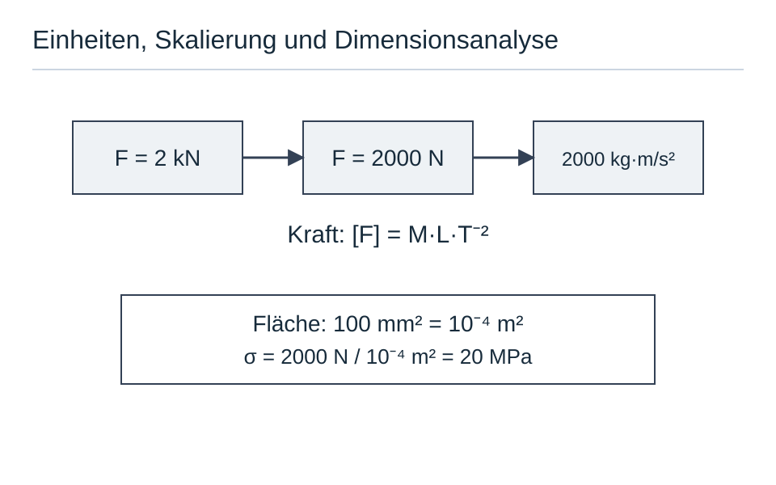

# M1-L1 – Einheiten, Skalierung und Dimensionsanalyse {#L1}

**Kursbereich:** M1 – Ingenieurmathematik und Modellierung

**Niveau:** Bachelor

**Vorwissen:** Grundrechenarten und Schulalgebra.

**Lernziel:** Einheiten fehlerfrei umrechnen und Gleichungen auf Dimensionshomogenität prüfen.

## Einstieg {#S1}

Ein Konstrukteur erhält eine Last in Kilonewton, eine CAD-Fläche in Quadratmillimetern und einen Werkstoffkennwert in Megapascal. Werden die Zahlen ohne Einheiten eingesetzt, entstehen leicht Fehler um mehrere Zehnerpotenzen. Eine Dimensionsprüfung ist daher Bestandteil der Rechnung, nicht nachträgliche Kosmetik.

## Grundlagen, Begriffe und Modell {#S2}

Eine physikalische Größe besteht aus Zahlenwert und Einheit. Dimensionen beschreiben dagegen die Art einer Größe, unabhängig von der Einheit. Für mechanische Probleme genügen häufig Masse $M$, Länge $L$ und Zeit $T$. Aus $F=ma$ folgt $[F]=MLT^{-2}$; daher ist $1\,\mathrm{N}=1\,\mathrm{kg\,m/s^2}$. Aus $\sigma=F/A$ ergibt sich $[\sigma]=ML^{-1}T^{-2}$ und $1\,\mathrm{Pa}=1\,\mathrm{N/m^2}$.

Bei Potenzen gilt der Umrechnungsfaktor für die gesamte Einheit: $1\,\mathrm{mm^2}=10^{-6}\,\mathrm{m^2}$, nicht $10^{-3}\,\mathrm{m^2}$. In einer Summe müssen sämtliche Terme dieselbe Dimension haben. Das Argument einer Exponential- oder trigonometrischen Funktion ist dimensionslos; ein Winkel in Radiant ist ein Verhältnis zweier Längen. Prüfe außerdem die Größenordnung. Wird ein geometrisch ähnlicher Körper mit Faktor $\lambda$ skaliert, wachsen Flächen mit $\lambda^2$ und Volumina mit $\lambda^3$. Bei konstanter Dichte wächst das Gewicht daher schneller als die tragende Querschnittsfläche.

*Umrechnung von Kraft und Fläche mit resultierender Normalspannung.*

## Durchgerechnetes Beispiel {#S3}

Eine idealisierte Zugprobe wird mit $2\,\mathrm{kN}$ belastet. Die Querschnittsfläche beträgt $100\,\mathrm{mm^2}$. Umrechnung: $F=2000\,\mathrm{N}$ und $A=100\cdot10^{-6}\,\mathrm{m^2}=10^{-4}\,\mathrm{m^2}$. Damit

$$
\sigma=\frac{2000}{10^{-4}}\,\mathrm{Pa}=20\,\mathrm{MPa}.
$$

Kontrollrechnung im N-mm-System: $2000/100=20\,\mathrm{N/mm^2}=20\,\mathrm{MPa}$. Beide Wege stimmen überein.

## Selbstkontrolle {#S4}

### Aufgaben

1. Wandle 250 mm³ in m³ um.
2. Ein geometrisch ähnlicher Körper wird in jeder Richtung doppelt so groß. Wie verändern sich Masse und Fläche?

::: {.lc-solutions data-lc-section="S4"}
### Lösungen

1. $250\cdot10^{-9}=2.5\cdot10^{-7}\,\mathrm{m^3}$.
2. Bei unveränderter Dichte achtfache Masse, vierfache Fläche.
:::

## Annahmen und Grenzen {#S5}

Dimensionshomogenität ist notwendig, aber kein Beweis für eine richtige Gleichung. Drehmoment und Energie haben beispielsweise dieselbe Dimension, jedoch unterschiedliche physikalische Bedeutung. Die Skalierung setzt geometrische Ähnlichkeit und gleichbleibende Dichte voraus.

## Zusammenfassung und Übergang {#S6}

Einheiten konsequent mitführen und Potenzen korrekt umrechnen; anschließend Richtungen und Kraftkomponenten berücksichtigen.

**Weiterlesen:** [M1-L2 – Vektoren und Kräfte](M1-L2.md)

## Quellen {#S7}

- [OpenStax – University Physics Volume 1, 1.4 Dimensional Analysis](https://openstax.org/books/university-physics-volume-1/pages/1-4-dimensional-analysis) · §1.4: dimensional consistency · Zuletzt abgerufen: 2026-11-25

