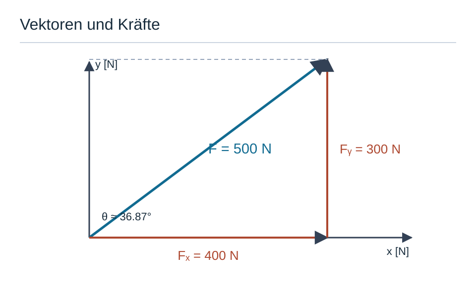

# M1-L2 – Vektoren und Kräfte {#L2}

**Kursbereich:** M1 – Ingenieurmathematik und Modellierung

**Niveau:** Bachelor

**Vorwissen:** [M1-L1 – Einheiten, Skalierung und Dimensionsanalyse](M1-L1.md)

**Lernziel:** Kräfte in Komponenten zerlegen, Resultierende bestimmen und Skalar- sowie Kreuzprodukt anwenden.

## Einstieg {#S1}

Ein Seil zieht an einer Maschinenhalterung. Für die Auslegung des Halters sind horizontale und vertikale Belastung oft wichtiger als der Betrag der Seilkraft allein.

## Grundlagen, Begriffe und Modell {#S2}

Ein kartesischer Vektor besitzt Komponenten bezüglich orthogonaler Einheitsvektoren: $\mathbf F=F_x\mathbf e_x+F_y\mathbf e_y+F_z\mathbf e_z$. In der Ebene, für einen von der positiven x-Achse gemessenen Winkel $\theta$, gilt $F_x=F\cos\theta$, $F_y=F\sin\theta$. In dieser Ebene ist der Betrag $F=\sqrt{F_x^2+F_y^2}$; Komponenten werden vorzeichenrichtig addiert. Eine Resultierende beschreibt die gemeinsame translatorische Kraftwirkung; bei unterschiedlichen Angriffspunkten müssen zusätzlich Momente bilanziert werden.

Das Skalarprodukt $\mathbf F\cdot\mathbf s=F_xs_x+F_ys_y+F_zs_z$ liefert bei konstanter Kraft die Arbeit entlang der Verschiebung. Senkrechte Vektoren haben ein Skalarprodukt von null. Das Kreuzprodukt $\mathbf M=\mathbf r\times\mathbf F$ beschreibt das Moment um einen Bezugspunkt; seine Richtung folgt der Rechtsschraubenregel. In der xy-Ebene gilt $M_z=r_xF_y-r_yF_x$.

*Zerlegung einer Kraft von 500 N in orthogonale Komponenten von 400 N und 300 N.*

## Durchgerechnetes Beispiel {#S3}

Eine Seilkraft besitzt $F_x=400\,\mathrm N$, $F_y=300\,\mathrm N$. Der Betrag ist $\sqrt{400^2+300^2}=500\,\mathrm N$ und der Winkel $\arctan(300/400)\approx36.87^\circ$. Bei $\mathbf r=(0.2,0.1)\,\mathrm m$ ergibt sich $M_z=0.2\cdot300-0.1\cdot400=20\,\mathrm{N\,m}$ (gegen den Uhrzeigersinn). Verschiebt sich der Angriffspunkt dagegen um $\mathbf s=(0.05,0)\,\mathrm m$, leistet die Kraft bei gleichbleibender Richtung und Größe $W=400\cdot0.05=20\,\mathrm J$. Die identischen Zahlenwerte sind Zufall; Moment und Arbeit sind nicht austauschbar.

## Selbstkontrolle {#S4}

### Aufgaben

1. Addiere die Kräfte (100, −20) N und (−30, 80) N.
2. Welche Arbeit leistet eine Kraft, die stets senkrecht zur momentanen Bewegungsrichtung steht?

::: {.lc-solutions data-lc-section="S4"}
### Lösungen

1. $(70,60)\,\mathrm N$; Betrag $\sqrt{8500}\,\mathrm N\approx92.2\,\mathrm N$.
2. Null, da das lokale Skalarprodukt mit der Verschiebung null ist.
:::

## Annahmen und Grenzen {#S5}

Die Arkustangensfunktion allein unterscheidet nicht alle Quadranten. Für allgemeine Komponenten ist eine zweistellige Winkelfunktion sinnvoll. Bei räumlich verteilten Kräften genügt die Resultierende allein nicht zur Beschreibung der Drehwirkung.

## Zusammenfassung und Übergang {#S6}

Vektorkomponenten und Momente liefern Gleichungen, deren unbekannte Größen in linearen Systemen bestimmt werden können.

**Weiterlesen:** [M1-L3 – Lineare Gleichungssysteme und Matrizen](M1-L3.md)

## Quellen {#S7}

- [OpenStax – University Physics Volume 1, 2.4 Products of Vectors](https://openstax.org/books/university-physics-volume-1/pages/2-4-products-of-vectors) · §2.4: components, dot and cross products · Zuletzt abgerufen: 2026-11-25

