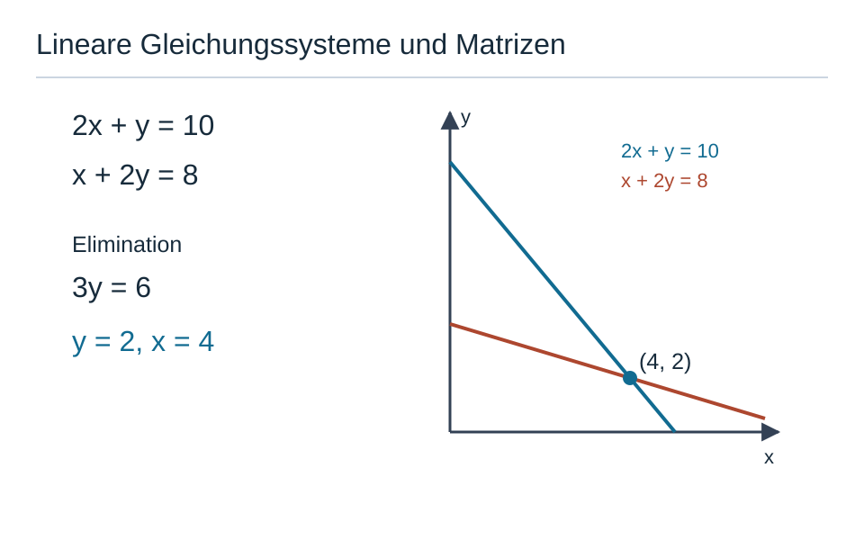

# M1-L3 – Lineare Gleichungssysteme und Matrizen {#L3}

**Kursbereich:** M1 – Ingenieurmathematik und Modellierung

**Niveau:** Bachelor

**Vorwissen:** [M1-L2 – Vektoren und Kräfte](M1-L2.md)

**Lernziel:** Ein lineares Gleichungssystem aus einem Modell lösen und das Residuum kontrollieren.

## Einstieg {#S1}

Bei mehreren unbekannten Lagerkräften oder Verschiebungen müssen Gleichungen gleichzeitig erfüllt sein. Ein einzelner Messwert oder eine einzelne Bilanz reicht oft nicht aus.

## Grundlagen, Begriffe und Modell {#S2}

Ein lineares System $A\mathbf x=\mathbf b$ fasst Koeffizienten in einer Matrix, Unbekannte in einem Vektor und bekannte rechte Seiten in einem zweiten Vektor zusammen. Die Zeilen entsprechen Gleichungen. Gauß-Elimination kombiniert Gleichungen so, dass schrittweise Unbekannte verschwinden. Zulässige Operationen sind Zeilentausch, Multiplikation einer Zeile mit einem von null verschiedenen Faktor und Addition eines Vielfachen einer anderen Zeile.

Für eine quadratische Matrix mit vollem Rang ist die Lösung eindeutig. Bei Rangmangel können widersprüchliche Randbedingungen oder unendlich viele Lösungen vorliegen. Eine kleine Determinante allein ist ohne Skalierungsbezug kein zuverlässiger Konditionsindikator. In numerischen Rechnungen werden deshalb Pivotisierung und geeignete Skalierung verwendet. Das Residuum $\mathbf r=\mathbf b-A\hat{\mathbf x}$ kontrolliert die Erfüllung der Gleichungen; bei schlecht konditionierter Matrix kann es trotzdem einen großen Lösungsfehler geben.

In der linearen Strukturmechanik wird die gleiche Form als $K\mathbf u=\mathbf f$ verwendet. Die Steifigkeitsmatrix $K$ verknüpft Verschiebungen mit Kräften; fehlende Lagerung kann Starrkörpermoden und eine singuläre Matrix erzeugen.

*Zwei lineare Gleichungen und ihr gemeinsamer Schnittpunkt.*

## Durchgerechnetes Beispiel {#S3}

Für zwei normierte unbekannte Größen $x,y$ gelten $2x+y=10$ und $x+2y=8$. Multipliziere die zweite Gleichung mit zwei und subtrahiere die erste: $3y=6$. Somit $y=2$, und aus der ersten Gleichung $x=(10-2)/2=4$. Prüfung: $2\cdot4+2=10$ und $4+2\cdot2=8$. Das Residuum ist $(0,0)$. Geometrisch schneiden sich zwei Geraden genau in $(4,2)$.

## Selbstkontrolle {#S4}

### Aufgaben

1. Löse x+y=7 und x−y=1.
2. Warum besitzt x+y=3 und 2x+2y=8 keine Lösung?

::: {.lc-solutions data-lc-section="S4"}
### Lösungen

1. Addition ergibt 2x=8, also x=4 und y=3.
2. Die erste Gleichung fordert 2x+2y=6, im Widerspruch zur zweiten.
:::

## Annahmen und Grenzen {#S5}

Lineare Systeme gelten nur für lineare oder entsprechend linearisierte Modelle. Reibkontakt, große Deformation und plastisches Materialverhalten können nicht ohne Weiteres durch eine konstante Matrix beschrieben werden.

## Zusammenfassung und Übergang {#S6}

Elimination und Residuum sind Grundlagen für numerische Mechanik; zeitabhängige Modelle erfordern außerdem Ableitungen und Integrale.

**Weiterlesen:** [M1-L4 – Differential- und Integralrechnung](M1-L4.md)

## Quellen {#S7}

- [MIT OCW – Linear Algebra, Elimination with Matrices](https://ocw.mit.edu/courses/18-06sc-linear-algebra-fall-2011/pages/ax-b-and-the-four-subspaces/elimination-with-matrices/) · Session Overview: elimination method; individual examples are original · Zuletzt abgerufen: 2026-11-25

