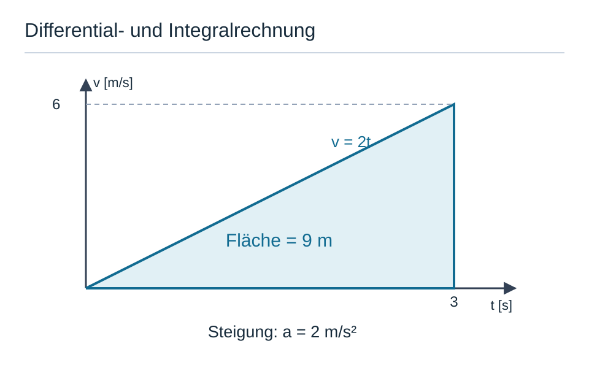

# M1-L4 – Differential- und Integralrechnung {#L4}

**Kursbereich:** M1 – Ingenieurmathematik und Modellierung

**Niveau:** Bachelor

**Vorwissen:** [M1-L3 – Lineare Gleichungssysteme und Matrizen](M1-L3.md)

**Lernziel:** Ableitungen als Änderungsraten und Integrale als akkumulierte Größen interpretieren.

## Einstieg {#S1}

Eine Vorschubachse beschleunigt beim Anfahren. Der Endwert ihrer Geschwindigkeit beschreibt nicht den bis dahin zurückgelegten Weg.

## Grundlagen, Begriffe und Modell {#S2}

Die Ableitung $f'(t)=\lim_{h\to0}[f(t+h)-f(t)]/h$ beschreibt eine lokale Änderungsrate. Für einen Ort $x(t)$ sind $v=\mathrm dx/\mathrm dt$ und $a=\mathrm dv/\mathrm dt$. Die SI-Einheiten sind m/s und m/s². Eine stationäre Stelle erfüllt $f'=0$; ob dort ein lokales Extremum vorliegt, kann beispielsweise durch einen Vorzeichenwechsel der Ableitung oder ein geeignetes Kriterium höherer Ableitungen geprüft werden. Auch Randpunkte und nicht differenzierbare Stellen können Extremstellen sein.

Das bestimmte Integral $\int_a^b f(t)\,\mathrm dt$ summiert Beiträge über ein Intervall. Der Hauptsatz verbindet es mit einer Stammfunktion $F$: $\int_a^b f(t)\,\mathrm dt=F(b)-F(a)$, wenn die Voraussetzungen erfüllt sind. Für die Mechanik folgt $x(t)-x(0)=\int_0^t v(\tau)\,\mathrm d\tau$. Bei Richtungswechseln ist diese Verschiebung nicht die Weglänge, die durch das Integral von $|v|$ entsteht. Für eine ortsabhängige Kraft liefert $W=\int F_x\,\mathrm dx$ die Arbeit entlang der x-Richtung.

*Geschwindigkeits-Zeit-Diagramm mit linearer Geschwindigkeit und dreieckiger Wegfläche.*

## Durchgerechnetes Beispiel {#S3}

Eine hypothetische Achse fährt während $0\le t\le3\,\mathrm s$ mit $v(t)=at$, wobei $a=2\,\mathrm{m/s^2}$. Die Geschwindigkeit nach 3 s ist 6 m/s. Die Beschleunigung ist konstant. Der zurückgelegte Weg ergibt sich aus

$$
\Delta x=\int_0^{3\,\mathrm s}at\,\mathrm dt=\frac{a(3\,\mathrm s)^2}{2}=9\,\mathrm m.
$$

Die geometrische Kontrolle über die Dreiecksfläche $3\,\mathrm s\cdot6\,\mathrm{m/s}/2$ ergibt ebenfalls 9 m.

## Selbstkontrolle {#S4}

### Aufgaben

1. Eine konstante Kraft von 80 N wirkt parallel zu einer Verschiebung von 0,25 m. Bestimme die Arbeit.
2. Ein Körper bewegt sich eine Sekunde mit +2 m/s und eine Sekunde mit −2 m/s. Bestimme Verschiebung und Weglänge.

::: {.lc-solutions data-lc-section="S4"}
### Lösungen

1. W = 80 N · 0,25 m = 20 J.
2. Verschiebung 0 m, Weglänge 4 m.
:::

## Annahmen und Grenzen {#S5}

Die Rechnung mit einer stückweise konstanten Geschwindigkeit idealisiert abrupte Übergänge; reale Maschinen haben begrenzte Beschleunigung und begrenzten Ruck. Numerische Ableitungen aus verrauschten Messdaten können stark schwanken.

## Zusammenfassung und Übergang {#S6}

Ableitungen und Integrale verknüpfen Zustandsgrößen; Bewegungsgesetze führen daraus zu Differentialgleichungen.

**Weiterlesen:** [M1-L5 – Differentialgleichungen und numerische Fehler](M1-L5.md)

## Quellen {#S7}

- [OpenStax – Calculus Volume 1, 3.1 Defining the Derivative](https://openstax.org/books/calculus-volume-1/pages/3-1-defining-the-derivative) · §3.1: derivative as limit · Zuletzt abgerufen: 2026-11-25
- [OpenStax – Calculus Volume 1, 5.3 The Fundamental Theorem of Calculus](https://openstax.org/books/calculus-volume-1/pages/5-3-the-fundamental-theorem-of-calculus) · §5.3: derivative and definite integral · Zuletzt abgerufen: 2026-11-25

