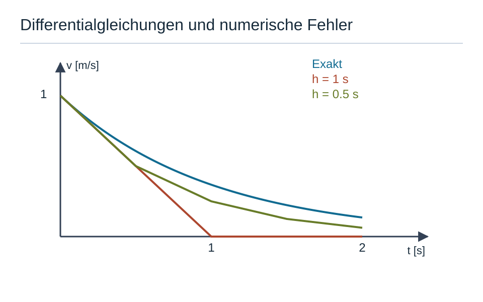

# M1-L5 – Differentialgleichungen und numerische Fehler {#L5}

**Kursbereich:** M1 – Ingenieurmathematik und Modellierung

**Niveau:** Bachelor

**Vorwissen:** [M1-L4 – Differential- und Integralrechnung](M1-L4.md)

**Lernziel:** Eine einfache Anfangswertaufgabe diskretisieren und die Abhängigkeit des Fehlers von der Schrittweite beurteilen.

## Einstieg {#S1}

Ein vereinfachtes Modell einer viskos gebremsten Masse sagt voraus, wie ihre Geschwindigkeit abnimmt. Die numerische Simulation ersetzt eine kontinuierliche Zeitfunktion durch diskrete Zeitpunkte.

## Grundlagen, Begriffe und Modell {#S2}

Die Bewegungsgleichung einer frei gleitenden Masse mit linearer Widerstandskraft lautet $m\dot v=-cv$, wobei $c$ die Einheit kg/s hat. Mit $k=c/m>0$ erhält man $\dot v=-kv$. Separation der Variablen und Anfangsbedingung $v(0)=v_0$ liefern $v(t)=v_0\exp(-kt)$.

Bei einer allgemeinen Gleichung $\dot y=f(t,y)$ kann das explizite Euler-Verfahren verwendet werden. Aus der lokalen Tangentenapproximation folgt

$$
y_{n+1}=y_n+h f(t_n,y_n),\quad t_{n+1}=t_n+h.
$$

Für die gebremste Masse wird daraus $v_{n+1}=(1-kh)v_n$. Unter üblichen Glattheitsannahmen ist der lokale Einschrittfehler (ausgehend vom exakten Wert am Schrittanfang) von Ordnung $h^2$, der globale Fehler über ein festes endliches Zeitintervall unter den üblichen Stabilitäts- und Lipschitz-Bedingungen von Ordnung $h$. Für die lineare Testgleichung mit $k>0$ klingt der numerische Wert ab, wenn $|1-kh|<1$. Für $1<kh<2$ entsteht zwar betragsmäßig Abklingen, aber ein hier unphysikalischer Vorzeichenwechsel.

*Exakte exponentielle Abnahme und explizite Euler-Näherungen für zwei Zeitschritte.*

## Durchgerechnetes Beispiel {#S3}

Setze $k=1\,\mathrm{s^{-1}}$ und $v_0=1\,\mathrm{m/s}$. Bei $h=1\,\mathrm s$ liefert Euler bereits nach einem Schritt null. Bei $h=0.5\,\mathrm s$ erhält man nacheinander 0.5, 0.25, 0.125 und 0.0625 m/s. Nach 2 s beträgt der exakte Wert $\exp(-2)\,\mathrm{m/s}\approx0.13534\,\mathrm{m/s}$. Der absolute Fehler der feineren Rechnung beträgt rund 0.07284 m/s. Eine stabile Rechnung kann also noch eine unzureichende Genauigkeit besitzen.

## Selbstkontrolle {#S4}

### Aufgaben

1. Bestimme für k=1 s⁻¹ und h=0,25 s den ersten Euler-Schritt ab 1 m/s.
2. Was geschieht bei k=1 s⁻¹ und h=3 s?

::: {.lc-solutions data-lc-section="S4"}
### Lösungen

1. v₁=(1−0,25)·1=0,75 m/s.
2. Der Verstärkungsfaktor ist −2; die Folge wechselt das Vorzeichen und wächst betragsmäßig.
:::

## Annahmen und Grenzen {#S5}

Der Stabilitätsbereich wurde für genau diese lineare Testgleichung hergeleitet. Nichtlineare oder steife Systeme benötigen geeignete Integratoren und eine gesonderte Konvergenzprüfung. Die TUM- und KIT-Quellen belegen den curricularen Methodenbereich. Der fachliche Beleg zur Stabilität des expliziten Euler-Verfahrens findet sich in Abschnitt 2.15.1 der verlinkten NTNU-Lehrunterlagen.

## Zusammenfassung und Übergang {#S6}

Diskretisierung und Modellfehler unterscheiden; auch bei realen Messdaten ist Unsicherheit gesondert zu quantifizieren.

**Weiterlesen:** [M1-L6 – Wahrscheinlichkeit und Statistik](M1-L6.md)

## Quellen {#S7}

- [TUM – Maschinenwesen B.Sc.](https://www.ed.tum.de/ed/studium/studienangebot/maschinenwesen-b-sc/) · Studieninhalte und Studienstruktur; Grundlagen 1–4, Wahlbereich 5–6; Mechanik, IT, Werkstoffe, CAD, Thermofluide, Regelung · Zuletzt abgerufen: 2026-11-25
- [KIT – Maschinenbau M.Sc.](https://www.sle.kit.edu/vorstudium/master-maschinenbau.php) · Studienaufbau; mathematische Methoden, Daten, Simulation, Auslegung, zwei Schwerpunkte, Labor, Arbeit; SPO 2025 verlinkt · Zuletzt abgerufen: 2026-11-25
- [NTNU – Numerical Methods for Engineers, 2.15 Absolute stability of numerical methods for ODE IVPs](https://leifh.folk.ntnu.no/teaching/tkt4140/._main025.html) · §2.15.1, Gl. (2.132)–(2.148): Euler-Rekursion, Stabilität und Oszillation · Zuletzt abgerufen: 2026-11-25 · Inhaltlich geprüft: 2026-11-25
