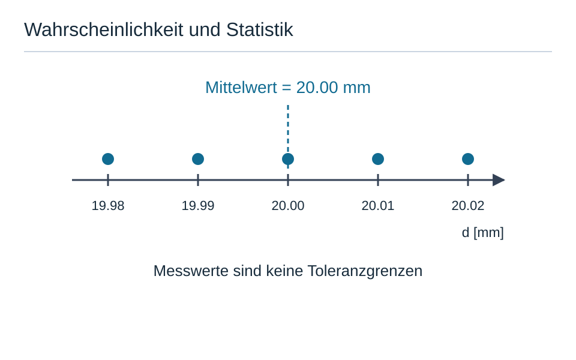

# M1-L6 – Wahrscheinlichkeit und Statistik {#L6}

**Kursbereich:** M1 – Ingenieurmathematik und Modellierung

**Niveau:** Bachelor

**Vorwissen:** [M1-L5 – Differentialgleichungen und numerische Fehler](M1-L5.md)

**Lernziel:** Mittelwert, Stichprobenstandardabweichung und Grenzen statistischer Aussagen über Fertigungsdaten erläutern.

## Einstieg {#S1}

Fünf gefertigte Wellen haben geringfügig unterschiedliche Durchmesser. Ein Mittelwert nahe dem Sollwert sagt noch nicht, wie stark einzelne Teile abweichen.

## Grundlagen, Begriffe und Modell {#S2}

Eine Stichprobe besteht aus beobachteten Werten $x_1,\ldots,x_n$. Der arithmetische Mittelwert lautet $\bar x=\sum_i x_i/n$. Als Maß der Streuung dient die Stichprobenvarianz $s^2=\sum_i(x_i-\bar x)^2/(n-1)$ für $n>1$. Ihre Wurzel $s$ hat dieselbe Einheit wie die Messwerte. Bei unabhängigen, identisch verteilten Beobachtungen mit endlicher Varianz ist $s^2$ ein erwartungstreuer Schätzer der Populationsvarianz; die Standardabweichung selbst ist nicht generell erwartungstreu.

Die Wahrscheinlichkeit eines Ereignisses liegt zwischen null und eins. Für unabhängige Ereignisse gilt $P(A\cap B)=P(A)P(B)$. Unabhängigkeit darf bei aufeinanderfolgenden Fertigungsteilen nicht ohne Prüfung angenommen werden: Werkzeugverschleiß kann einen zeitlichen Trend erzeugen. Die empirische Häufigkeit ist ein Schätzwert, keine garantierte zukünftige Ausschussquote. Unter unabhängiger Stichprobenziehung kann die Standardunsicherheit des Mittelwerts aus der Streuung als $s/\sqrt n$ geschätzt werden; systematische Kalibrierfehler sind darin nicht enthalten.

*Fünf hypothetische Durchmessermesswerte um den Mittelwert von 20 mm.*

## Durchgerechnetes Beispiel {#S3}

Fünf hypothetische Durchmesser sind 19.98, 19.99, 20.00, 20.01 und 20.02 mm. Der Mittelwert ist exakt 20.00 mm. Die Summe der quadrierten Abweichungen ist $(0.0004+0.0001+0+0.0001+0.0004)\,\mathrm{mm^2}=0.001\,\mathrm{mm^2}$. Damit

$$
s=\sqrt{0.001/4}\,\mathrm{mm}\approx0.01581\,\mathrm{mm}.
$$

Die geschätzte Standardunsicherheit des Mittelwerts aus der Streuung beträgt bei unabhängigen Beobachtungen $0.01581/\sqrt5\approx0.00707\,\mathrm{mm}$. Ohne festgelegte Spezifikationsgrenzen lässt sich daraus keine Konformitätsentscheidung ableiten.

## Selbstkontrolle {#S4}

### Aufgaben

1. Drei Messwerte sind 9, 10 und 11 mm. Berechne Mittelwert und Stichprobenstandardabweichung.
2. Zwei voneinander unabhängige Teile haben jeweils eine hypothetische Fehlerwahrscheinlichkeit von 0,02. Wie groß ist die Wahrscheinlichkeit, dass beide fehlerhaft sind?

::: {.lc-solutions data-lc-section="S4"}
### Lösungen

1. 10 mm; s=√((1+0+1)/2) mm=1 mm.
2. 0,02·0,02=0,0004=0,04 %.
:::

## Annahmen und Grenzen {#S5}

Eine kleine Stichprobe belegt weder Normalverteilung noch Prozessstabilität. Messunsicherheit, Serienkorrelation und tatsächliche Spezifikationen sind getrennt zu prüfen.

## Zusammenfassung und Übergang {#S6}

Statistische Aussagen ergänzen mechanische Modelle. Im nächsten Modul werden Kräfte und Momente an freigeschnittenen Körpern bilanziert.

**Weiterlesen:** [M2-L1 – Freikörperbilder und Gleichgewicht](M2-L1.md)

## Quellen {#S7}

- [OpenStax – Introductory Statistics 2e, 2.5 Measures of the Center of the Data](https://openstax.org/books/introductory-statistics-2e/pages/2-5-measures-of-the-center-of-the-data) · §2.5: sample mean and median · Zuletzt abgerufen: 2026-11-25
- [OpenStax – Introductory Statistics 2e, 2.7 Measures of the Spread of the Data](https://openstax.org/books/introductory-statistics-2e/pages/2-7-measures-of-the-spread-of-the-data) · §2.7: standard deviation · Zuletzt abgerufen: 2026-11-25

