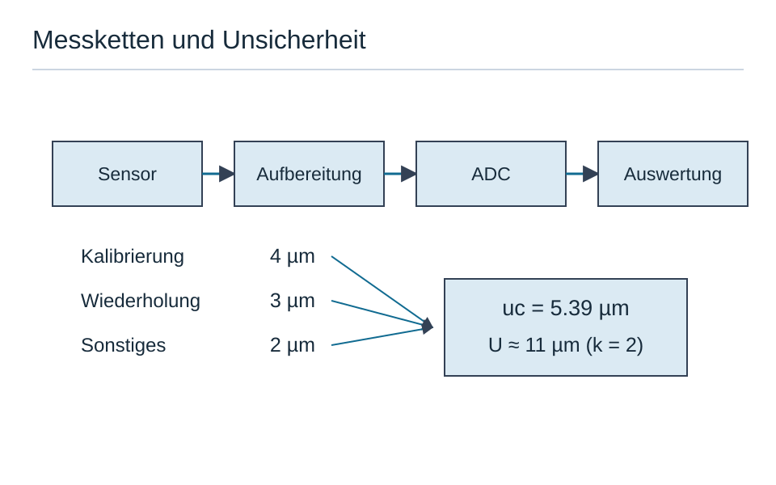

# M10-L1 – Messketten und Unsicherheit {#L1}

**Kursbereich:** M10 – Messtechnik und Mechatronik

**Niveau:** Bachelor

**Vorwissen:** [M1-L1 – Einheiten, Skalierung und Dimensionsanalyse](M1-L1.md)

**Lernziel:** Messgrößen definieren und unabhängige Standardunsicherheiten kombinieren.

## Einstieg {#S1}

Eine Messzahl ohne Einheit, Messverfahren und Unsicherheit erlaubt keine belastbare Aussage über eine Bauteilanforderung.

## Grundlagen, Begriffe und Modell {#S2}

Die Messkette beginnt mit der Definition der Messgröße, etwa dem Durchmesser an einer festgelegten Stelle und Temperatur. Ein Sensor übersetzt eine physikalische Größe in ein Signal. Verstärkung, Filterung, Analog-Digital-Wandlung und Auswertung können eigene Abweichungen einbringen. Kalibrierung bestimmt die Beziehung zwischen Anzeige und Referenz unter festgelegten Bedingungen. Auflösung ist nicht gleich Genauigkeit; auch wiederholbare Ergebnisse können systematisch abweichen.

Typ-A-Auswertungen beruhen auf statistischen Beobachtungen, Typ-B-Auswertungen auf anderen Informationen, beispielsweise Kalibrierscheinen. Für ein Messmodell $y=f(x_1,\ldots,x_n)$ und unkorrelierte Eingänge ergibt die lineare Unsicherheitsfortpflanzung $u_c^2=\sum_i(c_i u_i)^2$ mit $c_i=\partial f/\partial x_i$. Bei Korrelationen sind Kovarianzterme erforderlich. Die erweiterte Unsicherheit $U=k u_c$ benötigt einen begründeten Erweiterungsfaktor. Ein Ergebnis nahe der Spezifikationsgrenze erfordert eine vereinbarte Entscheidungsregel.

*Messkette mit Sensor, Signalaufbereitung und digitaler Auswertung sowie Unsicherheitsbudget.*

## Durchgerechnetes Beispiel {#S3}

Ein korrigierter Durchmesser beträgt 20,012 mm. Drei unkorrelierte Standardunsicherheiten mit Sensitivitätskoeffizient 1 betragen 0,004, 0,003 und 0,002 mm. u_c = √(0,004² + 0,003² + 0,002²) = 0,00539 mm. Mit beispielhaft k = 2 folgt U = 0,01077 mm, gerundet 0,011 mm. Ergebnis: (20,012 ± 0,011) mm, k = 2. Bei einer Obergrenze von 20,020 mm überlappt das Intervall die Grenze.

## Selbstkontrolle {#S4}

### Aufgaben

1. Was ergibt die Kombination von 3 und 4 µm unabhängigen Standardunsicherheiten?
2. Ist k = 2 immer exakt 95 % Überdeckungswahrscheinlichkeit?

::: {.lc-solutions data-lc-section="S4"}
### Lösungen

1. 5 µm.
2. Nein; Verteilung, effektive Freiheitsgrade und Auswertungsmethode bestimmen die Überdeckung.
:::

## Annahmen und Grenzen {#S5}

Linearisierung und unkorrelierte Eingänge vorausgesetzt. Das Beispiel definiert keine Annahme- oder Rückweisungsregel für reale Bauteile.

## Zusammenfassung und Übergang {#S6}

Messunsicherheit beschreibt begrenztes Wissen über die Messgröße; eine Messentscheidung benötigt zusätzlich eine Regel.

**Weiterlesen:** [M10-L2 – Sensoren und Aktoren](M10-L2.md)

## Quellen {#S7}

- [NIST/SEMATECH e-Handbook – Approach to uncertainty](https://www.itl.nist.gov/div898/handbook/mpc/section5/mpc52.htm) · §2.5.2: type A and B, quadrature, expanded uncertainty · Zuletzt abgerufen: 2026-11-25

