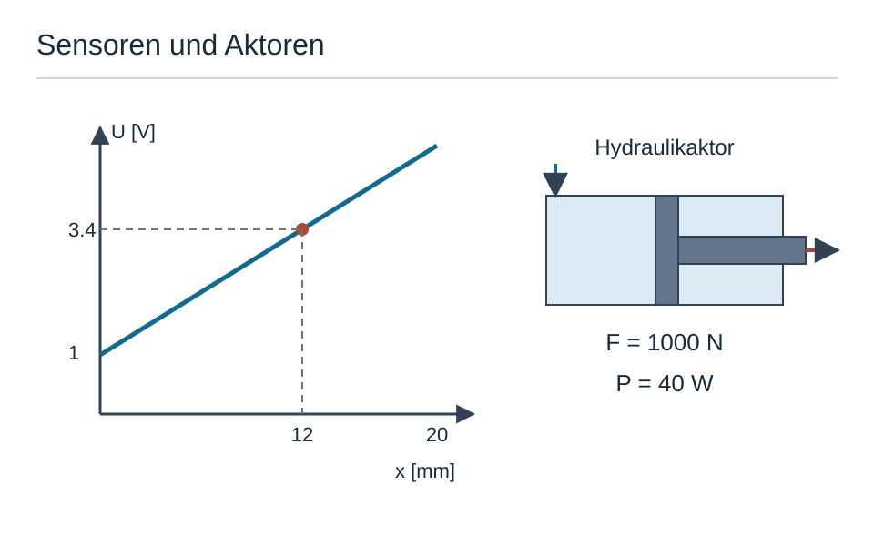

# M10-L2 – Sensoren und Aktoren {#L2}

**Kursbereich:** M10 – Messtechnik und Mechatronik

**Niveau:** Bachelor

**Vorwissen:** [M10-L1 – Messketten und Unsicherheit](M10-L1.md)

**Lernziel:** Sensorprinzipien vergleichen, Kennlinien auswerten und Aktorgrößen abschätzen.

## Einstieg {#S1}

Mechatronik koppelt mechanische Komponenten, elektrische Signale und Informationsverarbeitung. Sensoren erfassen Zustände, Aktoren verändern sie.

## Grundlagen, Begriffe und Modell {#S2}

Ein Dehnungsmessstreifen ändert seinen elektrischen Widerstand mit der Dehnung. Induktive Sensoren können berührungslos metallische Ziele erfassen; optische Encoder liefern Positionsinformationen. Für eine lineare Sensorkennlinie gilt $y=Sx+b$, wobei S die Empfindlichkeit und b den Offset beschreibt. Hysterese, Nichtlinearität, Temperaturdrift, Messbereich und dynamische Bandbreite begrenzen das Modell. Die Wahl hängt unter anderem von Störumgebung, benötigter Auflösung und Ansprechzeit ab.

Aktoren setzen zugeführte Energie in Bewegung oder Kraft um. Ein Hydraulikzylinder nutzt Druckdifferenzen; für einen idealen Zylinder mit gleichen wirksamen Flächen A auf beiden Seiten (oder einer Gegenseite mit null Relativdruck) gilt $F=\Delta p A$, bei vernachlässigter Leckage und Kompressibilität ist $Q=Av$. Elektrische Motoren, Pneumatik und piezoelektrische Antriebe haben unterschiedliche Kraft-, Weg- und Geschwindigkeitsprofile. Die Leistung ergibt sich aus gekoppelten Energiegrößen, etwa $P=Fv=\Delta p Q$ im verlustfreien hydraulischen Modell.

*Lineare Sensorkennlinie und Aktor als Energieumwandler in einer mechatronischen Kette.*

## Durchgerechnetes Beispiel {#S3}

Ein hypothetischer Wegsensor liefert bei 0 mm 1 V und bei 20 mm 5 V. S = 4/20 = 0,2 V/mm, b = 1 V; bei 3,4 V folgt x = 12 mm. Ein idealer Modellaktor hat A = 5 cm² = 0,0005 m², Δp = 2 MPa und v = 0,04 m/s. F = 1000 N, Q = 0,00002 m³/s = 1,2 l/min und P = 40 W.

## Selbstkontrolle {#S4}

### Aufgaben

1. Welche Weganzeige entspricht 2 V?
2. Wie ändert sich bei gleicher Druckdifferenz die ideale Kraft bei doppelter Fläche?

::: {.lc-solutions data-lc-section="S4"}
### Lösungen

1. 5 mm.
2. Sie verdoppelt sich.
:::

## Annahmen und Grenzen {#S5}

Lineare Kalibrierung im Messbereich; Aktormodell ohne Reibung, Leckage, Trägheit oder Druckstöße. Keine realen Betriebsparameter.

## Zusammenfassung und Übergang {#S6}

Sensoren liefern Information; Aktoren übertragen Energie. Beide benötigen ein Modell ihrer statischen und dynamischen Eigenschaften.

**Weiterlesen:** [M10-L3 – Elektrische Antriebe](M10-L3.md)

## Quellen {#S7}

- [MIT OCW – Design and Manufacturing I: Lecture Notes](https://ocw.mit.edu/courses/2-007-design-and-manufacturing-i-spring-2009/pages/lecture-notes/) · Lecture index 3, 14, 16: actuators, microcontrollers, sensors; individual PDFs not reviewed · Zuletzt abgerufen: 2026-11-25

