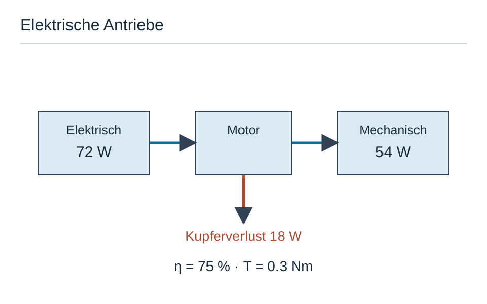

# M10-L3 – Elektrische Antriebe {#L3}

**Kursbereich:** M10 – Messtechnik und Mechatronik

**Niveau:** Bachelor

**Vorwissen:** [M10-L2 – Sensoren und Aktoren](M10-L2.md)

**Lernziel:** Drehmoment, Gegen-EMK, Drehzahl und Verluste eines einfachen Motormodells berechnen.

## Einstieg {#S1}

Die Auswahl eines elektrischen Antriebs verbindet mechanisches Lastprofil, Stromversorgung, Wärmeabfuhr und Regelung.

## Grundlagen, Begriffe und Modell {#S2}

Im vereinfachten permanentmagneterregten Gleichstrommotor gilt $V=Ri+L\,di/dt+k_e\omega$ und $T_e=k_t i$. Der Term $k_e\omega$ ist die Gegen-EMK, die mit der Drehzahl steigt. Die mechanische Bewegung folgt $J\dot\omega=T_e-T_L-b\omega$. In kohärenten SI-Einheiten stimmen k_t und k_e beim idealen elektromechanischen Wandler numerisch überein. Bei stationärem Strom gilt im idealisierten elektrischen Modell $Vi=Ri^2+T_e\omega$. Der zweite Term ist die elektromagnetisch umgewandelte Leistung; erst nach Abzug mechanischer Verluste ergibt sich im mechanisch stationären Betrieb die Wellenleistung. Reale Motoren besitzen zusätzliche Verluste, Temperaturgrenzen und begrenzte Drehmoment-Drehzahl-Bereiche.

Wechselstromantriebe können beispielsweise als Asynchronmaschinen oder permanenterregte Synchronmaschinen ausgeführt werden. Ein Umrichter beeinflusst Spannungen, Ströme und Frequenzen; die Regelung muss das Lastprofil und die Grenzen des Antriebssystems berücksichtigen. Ein Getriebe kann Drehzahl und Drehmoment anpassen, aber Verluste und Spiel hinzufügen. Die Nennleistung allein beschreibt weder Anfahrmoment noch zulässige kurzzeitige Belastung.

*Gleichstrommotormodell mit elektrischer und mechanischer Leistungsbilanz.*

## Durchgerechnetes Beispiel {#S3}

Ein stationärer Modellmotor hat V = 24 V, R = 2 Ω, k_e = 0,1 V·s/rad, k_t = 0,1 Nm/A und i = 3 A. Gegen-EMK = 24 − 6 = 18 V, ω = 180 rad/s ≈ 1719 min⁻¹, T = 0,3 Nm. Eingangsleistung 72 W, Kupferverlust 18 W, mechanische Leistung 54 W. Modellwirkungsgrad 75 %.

## Selbstkontrolle {#S4}

### Aufgaben

1. Was passiert mit dem Drehmoment bei halbem Strom im linearen Modell?
2. Wie groß ist die modellierte Kupferverlustleistung bei 2 A?

::: {.lc-solutions data-lc-section="S4"}
### Lösungen

1. Es halbiert sich.
2. 8 W.
:::

## Annahmen und Grenzen {#S5}

Keine magnetische Sättigung, keine mechanischen oder Eisenverluste, konstante Wicklungstemperatur im Beispiel. Reale elektrische Anlagen erfordern geeignete Schutzkonzepte.

## Zusammenfassung und Übergang {#S6}

Gegen-EMK und Drehmomentkonstante koppeln Stromkreis und mechanische Bewegung.

**Weiterlesen:** [M10-L4 – Dynamische Systeme und Regelkreise](M10-L4.md)

## Quellen {#S7}

- [MIT OCW – Design and Manufacturing I: Lecture Notes](https://ocw.mit.edu/courses/2-007-design-and-manufacturing-i-spring-2009/pages/lecture-notes/) · Lecture index 3, 14, 16: actuators, microcontrollers, sensors; individual PDFs not reviewed · Zuletzt abgerufen: 2026-11-25
- [MIT OCW – Systems, Modeling, and Control II, Lecture 05](https://ocw.mit.edu/courses/2-004-systems-modeling-and-control-ii-fall-2007/92b7076d416d5ae7f9a26c100b52b724_lecture05.pdf) · Folien 6–10: Drehmoment, Gegen-EMK und gekoppelte Motorgleichungen; Hintergrund zum Antriebsmodell · Zuletzt abgerufen: 2026-11-25 · Inhaltlich geprüft: 2026-11-25
- [OpenStax – University Physics 1: Work and Power for Rotational Motion](https://openstax.org/books/university-physics-volume-1/pages/10-8-work-and-power-for-rotational-motion) · §10.8 torque, work and power · Zuletzt abgerufen: 2026-11-25

