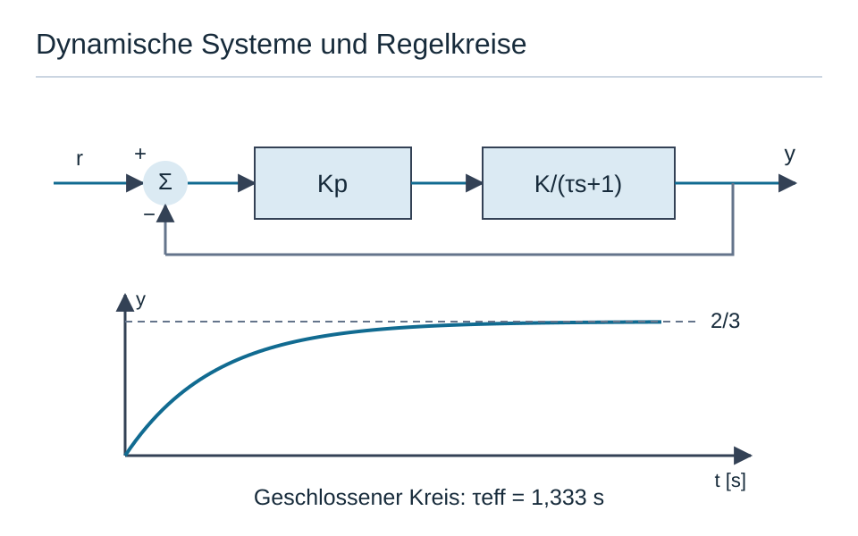

# M10-L4 – Dynamische Systeme und Regelkreise {#L4}

**Kursbereich:** M10 – Messtechnik und Mechatronik

**Niveau:** Bachelor

**Vorwissen:** [M10-L3 – Elektrische Antriebe](M10-L3.md)

**Lernziel:** Offene Steuerung und Rückkopplung unterscheiden und ein einfaches dynamisches Modell analysieren.

## Einstieg {#S1}

Ein Antrieb soll eine Sollgröße erreichen, obwohl Last und Umgebung variieren. Dazu wird häufig die Ausgangsgröße gemessen und zurückgeführt.

## Grundlagen, Begriffe und Modell {#S2}

Eine Steuerung wirkt ohne Rückführung der betrachteten Ausgangsgröße; eine Regelung bildet die Abweichung $e=r-y$ zwischen Sollwert r und gemessenem Istwert y. Ein Regler erzeugt daraus die Stellgröße u. Ein Modell erster Ordnung $\tau\dot y+y=Ku$ mit positiver Zeitkonstante τ und Verstärkung K beschreibt beispielsweise angenäherte thermische oder mechanische Vorgänge. Bei einer Sprungstellgröße u₀ und y(0)=0 ist $y(t)=Ku_0(1-e^{-t/\tau})$.

Mit proportionaler Rückführung $u=K_p(r-y)$ ergibt sich $\tau\dot y+(1+KK_p)y=KK_pr$. Für $1+KK_p>0$ ist dieses ideale Modell stabil, die effektive Zeitkonstante ist $\tau/(1+KK_p)$ und die stationäre Verstärkung $KK_p/(1+KK_p)$. Ein PI-Regler ergänzt das Integral der Abweichung; dies kann bei stabiler Regelung, erreichbarem konstantem Sollwert, wirksamer Integralverstärkung und ohne dauerhafte Stellgrößenbegrenzung die stationäre Abweichung beseitigen. Begrenzungen, Totzeiten, Messrauschen und zusätzliche Dynamik können jedoch zu Überschwingen oder Instabilität führen.

*Geschlossener Regelkreis und Sprungantwort eines Systems erster Ordnung.*

## Durchgerechnetes Beispiel {#S3}

Ein normiertes System hat K = 2 und τ = 4 s. Bei einem offenen Einheitssprung ist y(4 s) = 2·(1−e⁻¹) ≈ 1,264. Mit K_p = 1, negativer Einheitsrückführung und r = 1 gilt τ_eff = 4/3 ≈ 1,333 s und y∞ = 2/3. Die stationäre Regelabweichung beträgt 1/3.

## Selbstkontrolle {#S4}

### Aufgaben

1. Welchen Anteil seines Endwerts erreicht ein System erster Ordnung nach einer Zeitkonstante?
2. Garantiert ein größerer Proportionalfaktor immer Stabilität?

::: {.lc-solutions data-lc-section="S4"}
### Lösungen

1. Etwa 63,2 %.
2. Nein, reale zusätzliche Pole, Totzeiten und Nichtlinearitäten können die Stabilität begrenzen.
:::

## Annahmen und Grenzen {#S5}

Nur das angegebene lineare Einpolmodell, ideale Rückführung und unbeschränkte Stellgröße. Keine Reglerauslegung für reale Maschinen ohne Modell- und Sicherheitsprüfung.

## Zusammenfassung und Übergang {#S6}

Rückkopplung verändert Dynamik und stationäres Verhalten. Stabilität ist eine Eigenschaft des gesamten Regelkreises.

**Weiterlesen:** [M10-L5 – Digitale Steuerungen und Zustandsüberwachung](M10-L5.md)

## Quellen {#S7}

- [MIT OCW – Design and Manufacturing I: Lecture Notes](https://ocw.mit.edu/courses/2-007-design-and-manufacturing-i-spring-2009/pages/lecture-notes/) · Lecture index 3, 14, 16: actuators, microcontrollers, sensors; individual PDFs not reviewed · Zuletzt abgerufen: 2026-11-25
- [MIT OCW – Systems, Modeling, and Control II, Lecture 05](https://ocw.mit.edu/courses/2-004-systems-modeling-and-control-ii-fall-2007/92b7076d416d5ae7f9a26c100b52b724_lecture05.pdf) · Folien 6–10: Drehmoment, Gegen-EMK und gekoppelte Motorgleichungen; Hintergrund zum Antriebsmodell · Zuletzt abgerufen: 2026-11-25 · Inhaltlich geprüft: 2026-11-25

