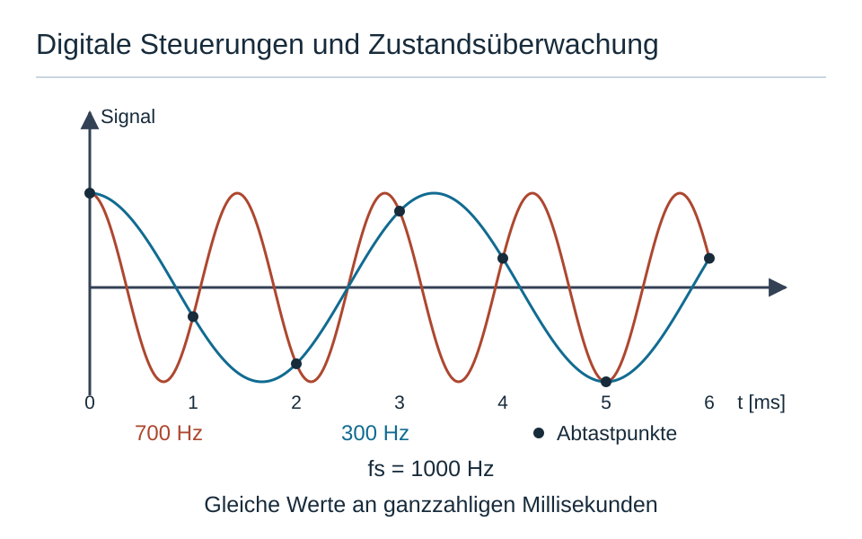

# M10-L5 – Digitale Steuerungen und Zustandsüberwachung {#L5}

**Kursbereich:** M10 – Messtechnik und Mechatronik

**Niveau:** Bachelor

**Vorwissen:** [M10-L4 – Dynamische Systeme und Regelkreise](M10-L4.md)

**Lernziel:** Abtastung, Ablaufsteuerung und Zustandsüberwachung unterscheiden sowie Aliasfrequenzen bestimmen.

## Einstieg {#S1}

Digitale Steuerungen führen logische und zeitdiskrete Aufgaben aus. Zustandsüberwachung gewinnt zusätzliche Informationen aus Betriebsdaten, ersetzt aber keine sicherheitsgerichtete Schutzfunktion.

## Grundlagen, Begriffe und Modell {#S2}

Eine speicherprogrammierbare Steuerung (SPS) verarbeitet Eingangssignale, führt Logik aus und aktualisiert Ausgänge. Ein Zustandsautomat beschreibt zulässige Übergänge zwischen definierten Betriebszuständen mit Ereignissen und Bedingungen. Zykluszeit, Kommunikation und Aktorverzögerung beeinflussen die Reaktionszeit. Sicherheitsfunktionen benötigen eine getrennt nachgewiesene Architektur; normale Betriebslogik ist kein Nachweis ihrer Wirksamkeit.

Ein zeitdiskretes Messsignal hat Abtastzeit T_s und Frequenz $f_s=1/T_s$. Für bandbegrenzte Signale muss $f_s>2f_{max}$ gelten, um ideal rekonstruieren zu können. Ein analoges Anti-Aliasing-Filter vor der Digitalisierung unterdrückt höhere Frequenzanteile. Bei Zustandsüberwachung können Effektivwert $x_{RMS}=\sqrt{\sum_{i=1}^N x_i^2/N}$, Spektren oder Temperaturtrends als Merkmale dienen. Belastung, Drehzahl, Sensormontage und Alterung beeinflussen die Signale. Veränderungen sind Hinweise, keine eindeutigen Fehlerdiagnosen.

*Zeitdiskrete Abtastung eines Signals und identische Abtastpunkte zweier Frequenzen durch Aliasing.*

## Durchgerechnetes Beispiel {#S3}

Bei f_s = 1000 Hz ergeben Kosinussignale mit 700 Hz und 300 Hz (1000−700) bei gleicher Amplitude, Anfangsphase null und gemeinsamen Abtastzeitpunkten dieselben Abtastwerte. Ein Filter vor der Abtastung muss unerwünschte Frequenzen ausreichend dämpfen. Für vier Beschleunigungsmesswerte 2, −2, 4, −4 m/s² ergibt sich RMS = √(40/4) = 3,162 m/s². Aus vier Werten allein kann keine belastbare Maschinendiagnose abgeleitet werden.

## Selbstkontrolle {#S4}

### Aufgaben

1. Welche Abtastperiode gehört zu 2 kHz?
2. Warum genügt eine höhere Abtastrate ohne Filter nicht immer?

::: {.lc-solutions data-lc-section="S4"}
### Lösungen

1. 0,5 ms.
2. Auch dann können höhere Signal- oder Rauschanteile in den Nutzbereich zurückgefaltet werden.
:::

## Annahmen und Grenzen {#S5}

Ideales gleichmäßiges Abtasten und hypothetische Signalwerte. Diagnose erfordert validierte Referenzdaten, Betriebszustände und fachliche Prüfung.

## Zusammenfassung und Übergang {#S6}

Digitale Steuerung verarbeitet Zustände und Signale; Messqualität und Kontext bestimmen die Aussagekraft der Überwachung.

**Weiterlesen:** [M11-L1 – Numerische Modellbildung und Verifikation](M11-L1.md)

## Quellen {#S7}

- [MIT OCW – Design and Manufacturing I: Lecture Notes](https://ocw.mit.edu/courses/2-007-design-and-manufacturing-i-spring-2009/pages/lecture-notes/) · Lecture index 3, 14, 16: actuators, microcontrollers, sensors; individual PDFs not reviewed · Zuletzt abgerufen: 2026-11-25
- [MIT OCW – Signals and Systems, Lecture 16: Sampling](https://ocw.mit.edu/courses/res-6-007-signals-and-systems-spring-2011/8708ec068ebdea2c4ee2f38fad39fb83_MITRES_6_007S11_lec16.pdf) · S. 16-1 bis 16-2: Abtasttheorem und Aliasing · Zuletzt abgerufen: 2026-11-25 · Inhaltlich geprüft: 2026-11-25
- [NIST – Handbook of Frequency Stability Analysis: Section Ten](https://tf.nist.gov/phase/Properties/ten.htm) · Section 10.3: aliasing and anti-aliasing filters · Zuletzt abgerufen: 2026-11-25
- [NIST – A Generalized Method for Featurization of Manufacturing Signals, with Application to Tool Condition Monitoring](https://www.nist.gov/publications/generalized-method-featurization-manufacturing-signals-application-tool-condition) · 2017 publication abstract: signal acquisition and tool condition prediction · Zuletzt abgerufen: 2026-11-25

