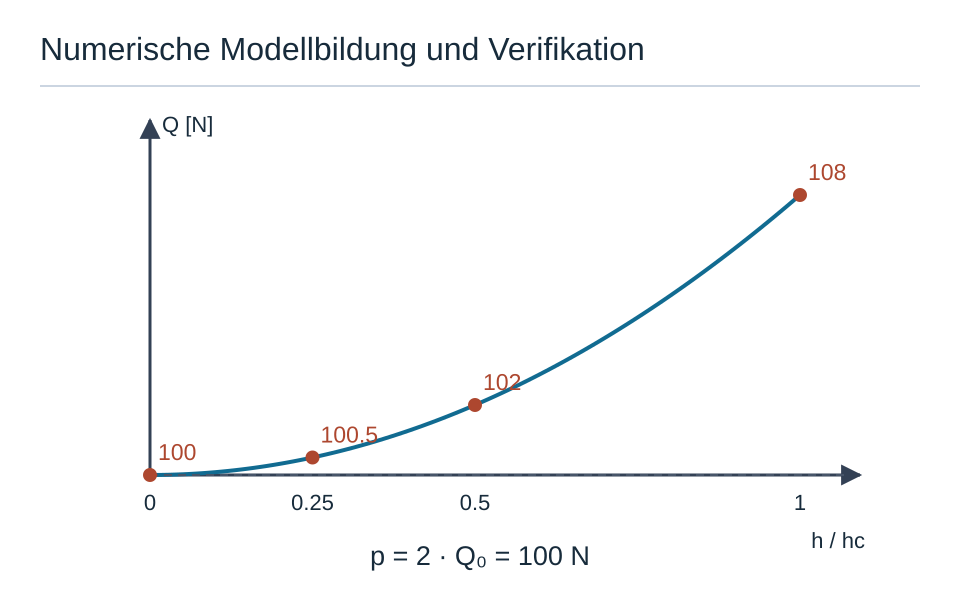

# M11-L1 – Numerische Modellbildung und Verifikation {#L1}

**Kursbereich:** M11 – Simulation und numerische Methoden

**Niveau:** Master

**Vorwissen:** [M2-L4 – Spannung, Dehnung und Zug](M2-L4.md), [M5-L2 – Erster Hauptsatz und Energiebilanzen](M5-L2.md)

**Lernziel:** Diskretisierungsfehler abschätzen und Verifikation von Validierung unterscheiden.

## Einstieg {#S1}

Ein numerisch berechneter Wert ist zunächst eine Aussage über ein Modell, nicht über das reale Bauteil.

## Grundlagen, Begriffe und Modell {#S2}

Verifikation fragt, ob die Modellgleichungen korrekt gelöst werden; Validierung fragt, ob diese Gleichungen die beobachtete Wirklichkeit für den Einsatzzweck hinreichend beschreiben. Codeverifikation nutzt analytische Lösungen oder hergestellte Lösungen; Lösungsverifikation untersucht beispielsweise Netz- und Zeitschrittfehler. Modellparameter, Randbedingungen, Rundung und iterativer Abbruch sind getrennte Fehlerquellen. Ein kleines Residuum allein beweist keine räumliche Konvergenz.

Sei $Q(h)=Q_0+Ch^p$ eine asymptotische Fehlerentwicklung für eine skalare Zielgröße. Bei drei gleichmäßig verfeinerten Netzen $h,h/r,h/r^2$ mit $r>1$ und von null verschiedenen, gleichgerichteten und bei Verfeinerung abnehmenden Differenzen ergibt sich $p=\ln[(Q_c-Q_m)/(Q_m-Q_f)]/\ln r$. Richardson-Extrapolation liefert $Q_0\approx Q_f+(Q_f-Q_m)/(r^p-1)$. Bei nicht monotonen Daten, wechselnder Netzqualität oder mehreren dominanten Fehlertermen ist diese Schätzung nicht ohne Weiteres gültig.

*Netzverfeinerung mit drei Ergebnissen und extrapoliertem Grenzwert.*

## Durchgerechnetes Beispiel {#S3}

Bei r = 2 ergeben sich Qc = 108 N, Qm = 102 N und Qf = 100,5 N. p = ln(6/1,5)/ln(2) = 2. Q₀ ≈ 100,5 − 1,5/3 = 100 N. Der geschätzte relative Feinnetzfehler bezogen auf Q₀ ist 0,5 %.

## Selbstkontrolle {#S4}

### Aufgaben

1. Wie groß ist der führende Fehler bei Halbierung von h und p = 2?
2. Beweist Netzkonvergenz die Gültigkeit eines Turbulenzmodells?

::: {.lc-solutions data-lc-section="S4"}
### Lösungen

1. Ein Viertel des bisherigen Fehlers.
2. Nein, dafür ist Validierung anhand geeigneter Referenzdaten nötig.
:::

## Annahmen und Grenzen {#S5}

Nur ein führender Fehlerterm im asymptotischen Bereich; keine normgerechte Unsicherheitsbescheinigung.

## Zusammenfassung und Übergang {#S6}

Numerische Genauigkeit und physikalische Modellgüte getrennt dokumentieren.

**Weiterlesen:** [M11-L2 – Finite-Elemente-Methode](M11-L2.md)

## Quellen {#S7}

- [NASA Glenn / NPARC – Conducting and Reporting a CFD Analysis](https://www.grc.nasa.gov/www/wind/TFAWS2007/Conducting-Reporting.pdf) · Folien Verification Assessment, Grid Convergence Study und Order of Convergence (20–24): Verifikation, Konvergenzordnung und Richardson-Extrapolation · Zuletzt abgerufen: 2026-11-25 · Inhaltlich geprüft: 2026-11-25

