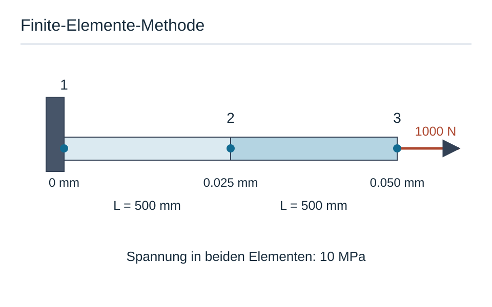

# M11-L2 – Finite-Elemente-Methode {#L2}

**Kursbereich:** M11 – Simulation und numerische Methoden

**Niveau:** Master

**Vorwissen:** [M11-L1 – Numerische Modellbildung und Verifikation](M11-L1.md)

**Lernziel:** Eine globale Steifigkeitsmatrix aus zwei Elementen aufbauen und Randbedingungen anwenden.

## Einstieg {#S1}

FEM ersetzt ein kontinuierliches Verschiebungsfeld durch endlich viele Freiheitsgrade.

## Grundlagen, Begriffe und Modell {#S2}

Im verschiebungsbasierten Ansatz wird innerhalb eines Elements $u(x)=N_1u_1+N_2u_2$ interpoliert. Für den linearen Stab gilt $N_1=1-x/L$, $N_2=x/L$, $\epsilon=du/dx$ und $\sigma=E\epsilon$. Aus innerer virtueller Arbeit folgt die Elementmatrix $K_e=\int_0^L B^TEAB\,dx$ mit $B=[-1/L,1/L]$. Für konstante Querschnittsfläche A und Elastizitätsmodul E ist $K_e=(EA/L)\begin{bmatrix}1&-1\\-1&1\end{bmatrix}$.

Die Montage addiert Elementbeiträge an gemeinsamen globalen Freiheitsgraden. Vorgegebene Verschiebungen sind wesentliche Randbedingungen; Kräfte treten auf der rechten Seite auf. Nach ihrer Berücksichtigung kann $Ku=f$ gelöst werden. Reaktionskräfte folgen aus dem ursprünglichen Gleichungssystem, Spannungen aus den Elementverschiebungen. Ein freier Starrkörpermodus macht die statische Matrix singulär.

*Zwei axiale Stabelemente mit drei Knoten, festem Lager und Endkraft.*

## Durchgerechnetes Beispiel {#S3}

Zwei gleich lange Elemente L = 500 mm, E = 200 000 N/mm², A = 100 mm² ergeben je k = 40 000 N/mm. Die globale Matrix ist $k\begin{bmatrix}1&-1&0\\-1&2&-1\\0&-1&1\end{bmatrix}$. Bei u₁ = 0 und F₃ = 1000 N gilt 2u₂ − u₃ = 0 und −u₂ + u₃ = 0,025 mm. Damit u₂ = 0,025 mm und u₃ = 0,050 mm. Beide Spannungen betragen 10 MPa; die Lagerreaktion ist −1000 N.

## Selbstkontrolle {#S4}

### Aufgaben

1. Wie groß wird u₃ bei verdoppelter Fläche beider Stäbe?
2. Warum reicht eine feinere Vernetzung bei falschen Randbedingungen nicht aus?

::: {.lc-solutions data-lc-section="S4"}
### Lösungen

1. 0,025 mm.
2. Sie nähert die Lösung des falschen Problems an.
:::

## Annahmen und Grenzen {#S5}

Kleine Verformung, eindimensionale lineare Elastizität, konstante Querschnitte, keine Stabilitäts- oder Kontaktprobleme.

## Zusammenfassung und Übergang {#S6}

FEM verbindet lokale Elementmatrizen mit globalem Gleichgewicht und prüfbaren Randbedingungen.

**Weiterlesen:** [M11-L3 – Computational Fluid Dynamics](M11-L3.md)

## Quellen {#S7}

- [MIT OCW – Mechanical Behavior of Plastics: finite element analysis](https://ocw.mit.edu/courses/3-91-mechanical-behavior-of-plastics-spring-2007/resources/18_fea/) · Resource description: element matrices and assembly; PDF not inspected · Zuletzt abgerufen: 2026-11-25

