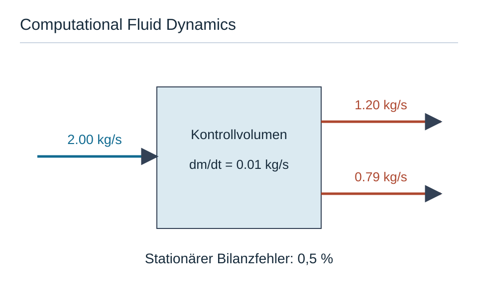

# M11-L3 – Computational Fluid Dynamics {#L3}

**Kursbereich:** M11 – Simulation und numerische Methoden

**Niveau:** Master

**Vorwissen:** [M11-L2 – Finite-Elemente-Methode](M11-L2.md)

**Lernziel:** Eine diskrete Massenbilanz auswerten und CFD-Fehlerquellen einordnen.

## Einstieg {#S1}

Strömungssimulation liefert räumliche Felder, aus denen Druckverluste, Kräfte oder Wärmeübergänge berechnet werden.

## Grundlagen, Begriffe und Modell {#S2}

Bei der Finite-Volumen-Methode wird eine Erhaltungsgleichung über jede Zelle integriert. Für Masse gilt $d(\rho V)/dt+\sum_f \rho_f(\mathbf v_f\cdot\mathbf n_f)A_f=0$ bei ruhendem Netz. Gemeinsame Flüsse benachbarter Zellen müssen sich mit entgegengesetztem Vorzeichen aufheben. Impuls- und Energiebilanz benötigen zusätzlich Druck-, Spannungs- und Wärmeflüsse. Konvektionsdiskretisierung kann numerische Diffusion erzeugen; kleine Zellen erhöhen oft den Rechenaufwand.

Am Einlass werden beispielsweise Geschwindigkeit und Temperatur, am Auslass ein Druck vorgegeben; die Wahl muss zum Gleichungssystem passen. An festen undurchlässigen Wänden gilt kein Normalfluss, bei viskoser Haftbedingung zusätzlich die Wandgeschwindigkeit. Turbulenzmodelle schließen die gemittelten Gleichungen mit modellierten Zusatztermen. Prüfe Residuen, globale Erhaltung, Zielgrößen und Netz- beziehungsweise Zeitschrittunabhängigkeit getrennt.

*Kontrollvolumen mit Massenströmen am Ein- und Austritt.*

## Durchgerechnetes Beispiel {#S3}

Ein stationärer Kontrollraum hat 2,00 kg/s Zulauf, 1,20 kg/s und 0,79 kg/s Abflüsse. Die Netto-Ausströmung ist −0,01 kg/s; der Betrag des Bilanzfehlers bezogen auf den Zulauf beträgt 0,5 %. Bei exakt stationärer Bilanz müsste der zweite Abfluss 0,80 kg/s sein.

## Selbstkontrolle {#S4}

### Aufgaben

1. Welche Massenänderung folgt bei unveränderten Flüssen im instationären Fall?
2. Ist eine perfekte Massenbilanz ein Nachweis korrekter Wandreibung?

::: {.lc-solutions data-lc-section="S4"}
### Lösungen

1. Die Masse steigt mit 0,01 kg/s.
2. Nein, Impulsbilanz, Wandmodell und Validierung sind gesondert zu prüfen.
:::

## Annahmen und Grenzen {#S5}

Feste Kontrollvolumina und keine Massenquellen; numerisches Lehrbeispiel, keine allgemeine Akzeptanzgrenze.

## Zusammenfassung und Übergang {#S6}

Erhaltung und Modellprüfung sind wichtiger als eine optisch überzeugende Strömungsdarstellung.

**Weiterlesen:** [M11-L4 – Mehrkörpersimulation](M11-L4.md)

## Quellen {#S7}

- [NASA Glenn / NPARC – Conducting and Reporting a CFD Analysis](https://www.grc.nasa.gov/www/wind/TFAWS2007/Conducting-Reporting.pdf) · Folien Verification Assessment, Grid Convergence Study und Order of Convergence (20–24): Verifikation, Konvergenzordnung und Richardson-Extrapolation · Zuletzt abgerufen: 2026-11-25 · Inhaltlich geprüft: 2026-11-25

