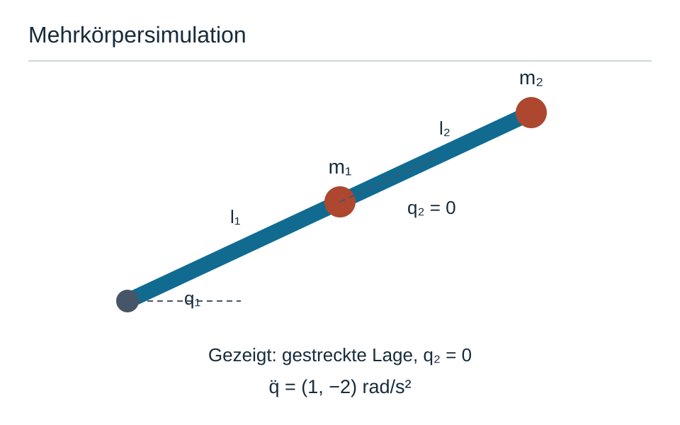

# M11-L4 – Mehrkörpersimulation {#L4}

**Kursbereich:** M11 – Simulation und numerische Methoden

**Niveau:** Master

**Vorwissen:** [M11-L3 – Computational Fluid Dynamics](M11-L3.md)

**Lernziel:** Generalisierte Koordinaten und gekoppelte Trägheitskräfte anhand eines Mechanismus erklären.

## Einstieg {#S1}

Bei einem Gelenksystem beeinflusst die Bewegung eines Glieds die Kräfte in anderen Gliedern.

## Grundlagen, Begriffe und Modell {#S2}

Für unabhängige generalisierte Koordinaten $q$ lässt sich die kinetische Energie als $T=\frac12\dot q^TM(q)\dot q$ schreiben. Für die kinetische und konservative potenzielle Energie ist $L=T-V$ die Lagrange-Funktion. Die Euler-Lagrange-Gleichung $d(\partial L/\partial\dot q_i)/dt-\partial L/\partial q_i=Q_i$ mit Q_i als generalisierten Kräften, die nicht bereits in V enthalten sind, führt auf $M(q)\ddot q+C(q,\dot q)\dot q+g(q)=\tau$ für ein offenes Gelenksystem. Nichtdiagonale Terme in M beschreiben dynamische Kopplung. Für geschlossene Schleifen können zusätzliche Zwangsbedingungen $\Phi(q)=0$ und Multiplikatoren erforderlich sein.

Bei einem ebenen Zweigelenkarm mit masselosen Stäben und Punktmassen m₁ am ersten sowie m₂ am zweiten Ende gilt bei relativem zweiten Winkel $M_{11}=(m_1+m_2)l_1^2+m_2l_2^2+2m_2l_1l_2\cos q_2$, $M_{12}=M_{21}=m_2l_2^2+m_2l_1l_2\cos q_2$ und $M_{22}=m_2l_2^2$. Numerische Integration benötigt konsistente Anfangswerte; Kontakt und Reibung erfordern zusätzliche Modelle.

*Zweigliedriger ebener Mechanismus mit Gelenkwinkeln q1 und q2.*

## Durchgerechnetes Beispiel {#S3}

m₁ = m₂ = 1 kg, l₁ = l₂ = 1 m, q₂ = 0. Im horizontalen Bewegungsraum bei Stillstand ist $M=\begin{bmatrix}5&2\\2&1\end{bmatrix}$ kg m². Für τ = (1, 0) Nm ergibt $M\ddot q=\tau$ die Beschleunigungen (1, −2) rad/s². Trotz momentfreiem zweitem Gelenk entsteht dort eine relative Beschleunigung.

## Selbstkontrolle {#S4}

### Aufgaben

1. Wie groß ist M₁₂ bei q₂ = 90° und sonst gleichen Werten?
2. Warum müssen bei einer geschlossenen Schleife Anfangslage und Anfangsgeschwindigkeit zusammenpassen?

::: {.lc-solutions data-lc-section="S4"}
### Lösungen

1. 1 kg m².
2. Sie müssen die Lage- und Geschwindigkeitszwänge erfüllen.
:::

## Annahmen und Grenzen {#S5}

Starre masselose Stäbe, ideale Gelenke, Punktmassen; Beispiel ohne Schwerkraftmoment und ohne Geschwindigkeitsterme.

## Zusammenfassung und Übergang {#S6}

Mehrkörpersimulation muss Trägheitskopplung und Zwangsbedingungen berücksichtigen.

**Weiterlesen:** [M11-L5 – Optimierung und Unsicherheitsquantifizierung](M11-L5.md)

## Quellen {#S7}

- [MIT Underactuated Robotics – Multi-Body Dynamics](https://underactuated.mit.edu/multibody.html) · Chapter 23: inertia matrix, equations of motion and constraints · Zuletzt abgerufen: 2026-11-25

