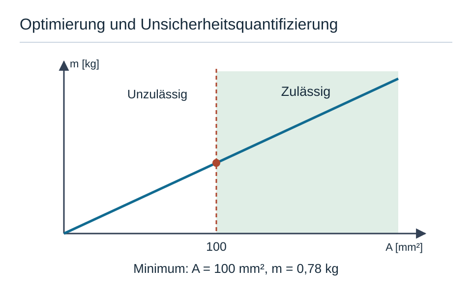

# M11-L5 – Optimierung und Unsicherheitsquantifizierung {#L5}

**Kursbereich:** M11 – Simulation und numerische Methoden

**Niveau:** Master

**Vorwissen:** [M11-L4 – Mehrkörpersimulation](M11-L4.md)

**Lernziel:** Ein beschränktes Entwurfsproblem lösen und die Unsicherheit einer abgeleiteten Größe berechnen.

## Einstieg {#S1}

Der leichteste Entwurf ist nicht automatisch der beste; Anforderungen begrenzen die zulässigen Lösungen.

## Grundlagen, Begriffe und Modell {#S2}

Ein Optimierungsproblem besteht aus Entwurfsvariablen x, Zielfunktion $f(x)$ und Nebenbedingungen $g_i(x)\le0$, gegebenenfalls Gleichungen $h_j(x)=0$. Bei einem differenzierbaren inneren Optimum ohne bindende Gleichungs- oder Ungleichungsbedingungen gilt $\nabla f=0$; an einer aktiven Grenze kann die Steigung ungleich null sein. Bei geeigneten Regularitätsbedingungen geben KKT-Bedingungen mit nichtnegativen Ungleichungsmultiplikatoren notwendige lokale Optimalitätsbedingungen. Nichtkonvexe Probleme können mehrere lokale Optima besitzen.

Unsicherheit entsteht durch Lasten, Werkstoffe, Fertigung und Messung. Für $y=f(x)$ ergibt lineare Fehlerfortpflanzung $u_y^2\approx J\Sigma J^T$, wobei J der Gradient als Zeilenvektor und $\Sigma$ die Kovarianzmatrix ist. Bei unabhängigen Eingängen entfallen Kreuzterme. Monte-Carlo-Verfahren können Nichtlinearität und Verteilungen abbilden, benötigen aber begründete Eingangsdaten und Konvergenzkontrolle. Robuste Entwürfe berücksichtigen Schwankungen statt nur Nominalwerte zu optimieren.

*Zielfunktion mit zulässigem Bereich und aktiver Nebenbedingung.*

## Durchgerechnetes Beispiel {#S3}

Ein vereinfachter Zugstab soll bei L = 1 m und ρ = 7800 kg/m³ minimale Masse haben. Bei F = 10 kN und hypothetischer Spannungsgrenze 100 MPa gilt A ≥ F/σmax = 100 mm². Da m = ρLA monoton steigt, beträgt die optimale Masse 0,78 kg. Für die Spannung σ = F/A bei unabhängigen relativen Standardunsicherheiten uF/F = 2 % und uA/A = 1 % ergibt sich uσ/σ ≈ √(0,02² + 0,01²) = 2,24 %.

## Selbstkontrolle {#S4}

### Aufgaben

1. Wie groß ist die Mindestfläche bei verdoppelter Kraft?
2. Ist der nominale Entwurf an der Spannungsgrenze bereits robust?

::: {.lc-solutions data-lc-section="S4"}
### Lösungen

1. 200 mm².
2. Nein, Schwankungen und weitere Versagensarten sind nicht abgesichert.
:::

## Annahmen und Grenzen {#S5}

Nur Zugspannung und kleine unabhängige Eingangsschwankungen; keine reale Bemessung, kein Zuverlässigkeitsnachweis.

## Zusammenfassung und Übergang {#S6}

Optimierung braucht Nebenbedingungen, Unsicherheiten und eine Prüfung der Modellannahmen.

**Weiterlesen:** [M12-L1 – Bruchmechanik und Lebensdauermodelle](M12-L1.md)

## Quellen {#S7}

- [MIT OCW – Nonlinear Programming](https://ocw.mit.edu/courses/6-252j-nonlinear-programming-spring-2003/pages/lecture-notes/) · Lecture index 2–6, 11–13: optimality and constraints; individual PDFs pending · Zuletzt abgerufen: 2026-11-25
- [NIST TN 1297 – Appendix A: Law of Propagation of Uncertainty](https://www.nist.gov/pml/nist-technical-note-1297/nist-tn-1297-appendix-law-propagation-uncertainty) · A.3: first-order Taylor approximation, sensitivities and covariance · Zuletzt abgerufen: 2026-11-25

