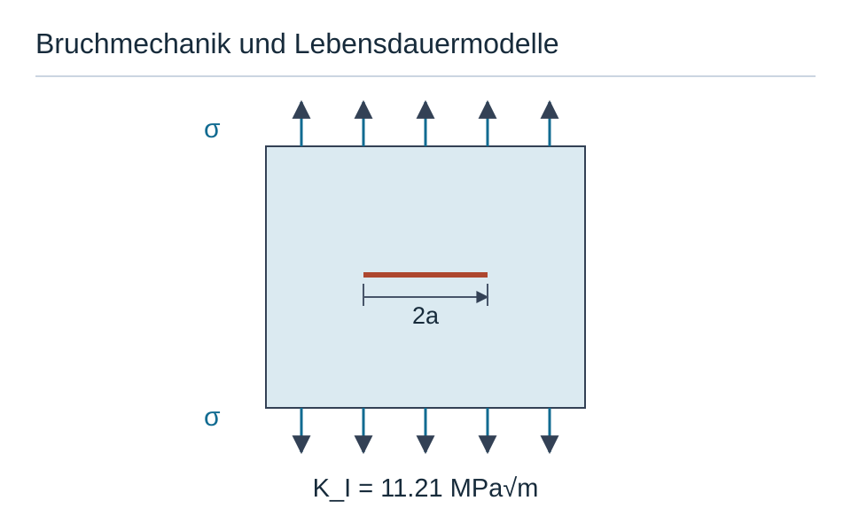

# M12-L1 – Bruchmechanik und Lebensdauermodelle {#L1}

**Kursbereich:** M12 – Vertiefung Konstruktion und Material

**Niveau:** Master

**Vorwissen:** [M2-L4 – Spannung, Dehnung und Zug](M2-L4.md), [M5-L2 – Erster Hauptsatz und Energiebilanzen](M5-L2.md)

**Lernziel:** Spannungsintensität und vereinfachtes Ermüdungsrisswachstum berechnen.

## Einstieg {#S1}

Ein Bauteil kann trotz moderater Nennspannung an einem vorhandenen Riss versagen.

## Grundlagen, Begriffe und Modell {#S2}

Die linear-elastische Bruchmechanik beschreibt das singuläre Spannungsfeld an der Rissspitze durch Spannungsintensitätsfaktoren. Mode I bezeichnet öffnende, Mode II in der Rissebene scherende und Mode III aus der Rissebene scherende Belastung. Für Mode I gilt $K_I=Y\sigma\sqrt{\pi a}$ mit Geometriefaktor Y und einer geometriespezifisch definierten Rissgröße a. Bei hinreichend kleiner plastischer Zone und gültigen Ebenen-Dehnungs-Bedingungen kann $K_{IC}$ als Bruchzähigkeit dienen. Ein Vergleich mit K_IC ist kein vollständiger Bauteilnachweis.

Im mittleren Bereich stabilen Ermüdungsrisswachstums beschreibt das Paris-Modell $da/dN=C(\Delta K)^m$. C und m sind experimentell bestimmt und einheitenabhängig. Lastverhältnis, Schwellenwert, Rissschließen, Umwelt und schnelles Wachstum nahe dem Bruch verändern das Verhalten. Eine Lebensdauerabschätzung integriert $dN=da/[C(\Delta K(a))^m]$ zwischen begründeten Rissgrößen. Konstantes ΔK ist nur eine lokale Näherung oder ein kontrollierter Sonderfall.

*Platte mit zentralem Riss der Länge 2a unter Zugspannung.*

## Durchgerechnetes Beispiel {#S3}

Für einen zentralen Riss in einer ideal unendlich breiten Platte gilt Y = 1. Mit a = 4 mm (halbe Risslänge), σ = 100 MPa folgt K_I = 11,21 MPa√m. Hypothetisch sei C = 10⁻¹² m/Zyklus/(MPa√m)³, m = 3, konstantes ΔK = 10 MPa√m. Dann da/dN = 10⁻⁹ m/Zyklus; 0,1 mm Zuwachs entspräche 100 000 Zyklen unter genau dieser Annahme.

## Selbstkontrolle {#S4}

### Aufgaben

1. Wie verändert sich K_I bei vierfacher Rissgröße und gleichem Y?
2. Warum ist konstantes ΔK bei konstanter Zugspannungsamplitude meist falsch?

::: {.lc-solutions data-lc-section="S4"}
### Lösungen

1. Er verdoppelt sich.
2. Weil ΔK mit der Wurzel der Rissgröße steigt, sofern Y konstant ist.
:::

## Annahmen und Grenzen {#S5}

Idealgeometrie, linear-elastischer Bereich, hypothetische Materialparameter; keine Inspektionsfrist oder Freigabe ableitbar.

## Zusammenfassung und Übergang {#S6}

Rissgröße, Beanspruchung und Materialzähigkeit bestimmen gemeinsam die Bruchgefahr.

**Weiterlesen:** [M12-L2 – Nichtlineare Materialmodelle](M12-L2.md)

## Quellen {#S7}

- [MIT OCW – Techniques for Structural Analysis and Design](https://ocw.mit.edu/courses/16-21-techniques-for-structural-analysis-and-design-spring-2005/pages/lecture-notes/) · Lecture index 34–42: fracture and fatigue; detailed lecture materials pending · Zuletzt abgerufen: 2026-11-25

