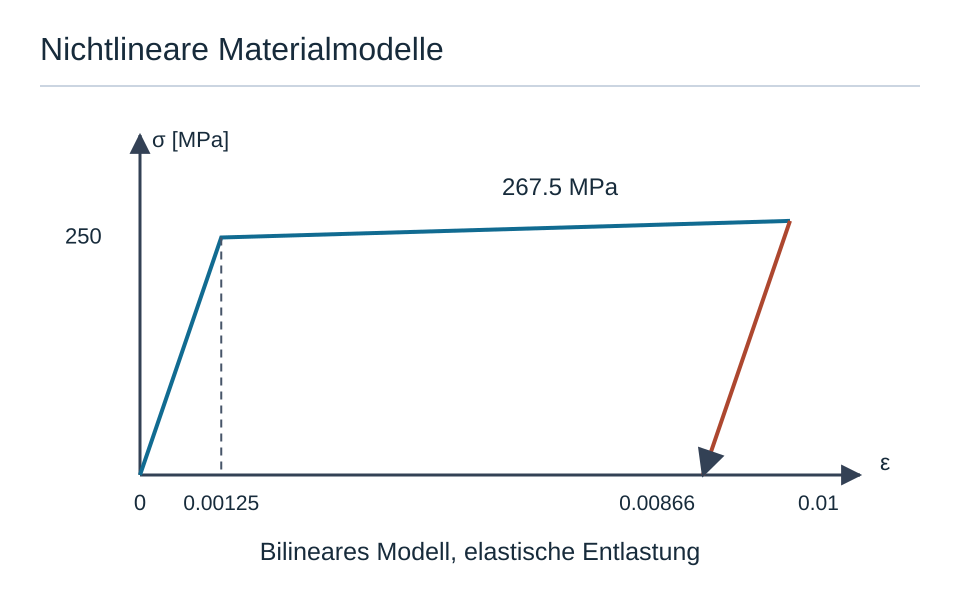

# M12-L2 – Nichtlineare Materialmodelle {#L2}

**Kursbereich:** M12 – Vertiefung Konstruktion und Material

**Niveau:** Master

**Vorwissen:** [M12-L1 – Bruchmechanik und Lebensdauermodelle](M12-L1.md)

**Lernziel:** Elastische, plastische und zeitabhängige Materialanteile unterscheiden.

## Einstieg {#S1}

Eine rein lineare Steifigkeit beschreibt weder bleibende Verformung noch Kriechen.

## Grundlagen, Begriffe und Modell {#S2}

Ein Materialmodell verknüpft Spannung und Dehnung mit Zustandsgrößen und gegebenenfalls der Belastungsgeschichte. Im kleinen einachsigen Verzerrungsbereich gilt $\epsilon=\epsilon_e+\epsilon_p$, $\sigma=E\epsilon_e$. Ein bilineares monotones Modell hat bis $\epsilon_y=\sigma_y/E$ die Steigung E und danach den Tangentenmodul $E_t$: $\sigma=\sigma_y+E_t(\epsilon-\epsilon_y)$. Der Tangentenmodul der Gesamtdehnung ist nicht gleich dem plastischen Verfestigungsmodul; bei linearer isotroper Verfestigung gilt $E_t=EH/(E+H)$. Entlastung ohne weiteres Fließen erfolgt mit elastischer Steigung E.

Mehrachsige Plastizität benötigt Fließfläche, Fließregel und Verfestigungsgesetz. Viskoelastische Modelle verbinden elastische und viskose Anteile; ein Maxwell-Element aus Feder E und Dämpfer η in Reihe zeigt bei festgehaltener Dehnung $\sigma(t)=\sigma_0e^{-tE/\eta}$. Viskoplastizität kann zusätzlich irreversible zeitabhängige Verformungen beschreiben. Parameter sind aus passenden Versuchen und Temperaturbereichen zu identifizieren.

*Bilineares Spannungs-Dehnungs-Diagramm mit elastischer Entlastung.*

## Durchgerechnetes Beispiel {#S3}

E = 200 GPa, σy = 250 MPa, Et = 2 GPa, ε = 0,010. εy = 0,00125. σ = 250 + 2000·(0,010 − 0,00125) = 267,5 MPa. Bei elastischer Entlastung bis σ = 0 verbleibt εp = 0,010 − 267,5/200 000 = 0,0086625.

## Selbstkontrolle {#S4}

### Aufgaben

1. Welche Spannung folgt bei idealer Plastizität (Et = 0) und gleicher Enddehnung?
2. Auf welchen Anteil fällt die Maxwell-Spannung nach einer Relaxationszeit η/E?

::: {.lc-solutions data-lc-section="S4"}
### Lösungen

1. 250 MPa.
2. 1/e ≈ 36,8 %.
:::

## Annahmen und Grenzen {#S5}

Einachsige Kleinverzerrung; keine Schädigung, Raten- oder Temperatureffekte im bilinearen Beispiel.

## Zusammenfassung und Übergang {#S6}

Materialmodelle benötigen gültige Parameter und eine zur Lastgeschichte passende Beschreibung.

**Weiterlesen:** [M12-L3 – Leichtbau und Verbundstrukturen](M12-L3.md)

## Quellen {#S7}

- [MIT OCW – Mechanics and Materials II: Lecture Notes](https://ocw.mit.edu/courses/2-002-mechanics-and-materials-ii-spring-2004/pages/lecture-notes/) · Vorlesung 11, Themenübersicht zum elastisch-plastischen Verhalten; einzelne Formeln nicht belegt · Zuletzt abgerufen: 2026-11-25
- [MIT OCW – Mechanical Behavior of Plastics](https://ocw.mit.edu/courses/3-91-mechanical-behavior-of-plastics-spring-2007/) · Course description: viscoelasticity, composites and laminates, yield and fracture · Zuletzt abgerufen: 2026-11-25

