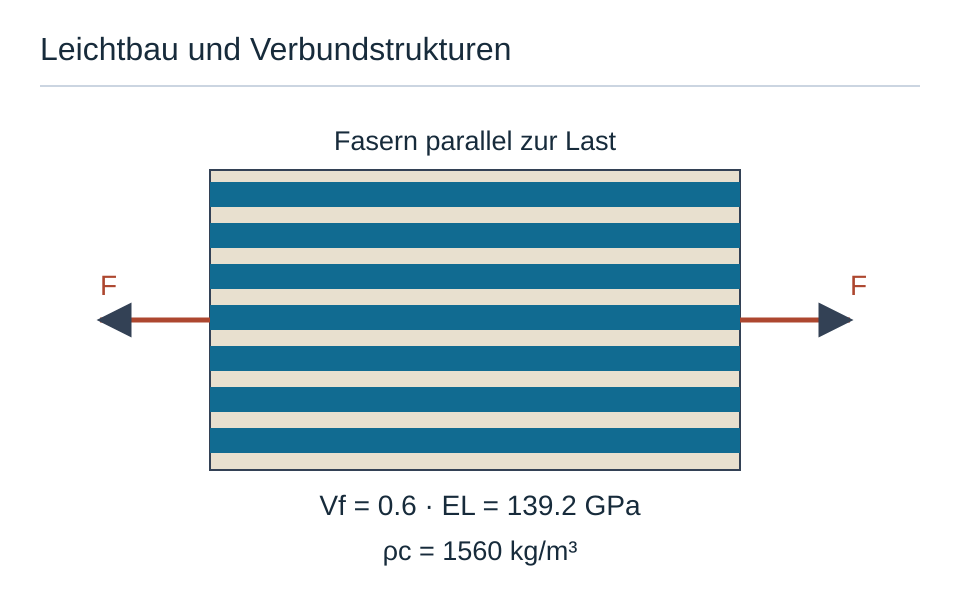

# M12-L3 – Leichtbau und Verbundstrukturen {#L3}

**Kursbereich:** M12 – Vertiefung Konstruktion und Material

**Niveau:** Master

**Vorwissen:** [M12-L2 – Nichtlineare Materialmodelle](M12-L2.md)

**Lernziel:** Längssteifigkeit und Dichte eines idealen Verbunds abschätzen und anisotropes Verhalten einordnen.

## Einstieg {#S1}

Leichtbau erreicht geringe Masse nicht nur durch Materialwahl, sondern auch durch Lastpfade und Querschnittsgestaltung.

## Grundlagen, Begriffe und Modell {#S2}

Die spezifische Steifigkeit E/ρ ist ein möglicher Vergleichsparameter bei axialer Belastung; für Biegung oder Knicken ändern sich geeignete Leistungsindizes mit der Geometrie und den Nebenbedingungen. Bei einem idealen kontinuierlichen Faserverbund parallel zur Faser und gleicher Dehnung beider Phasen gilt aus Kräfteaddition $E_L=V_fE_f+(1-V_f)E_m$. Ohne Poren ergibt sich die Dichte $\rho_c=V_f\rho_f+(1-V_f)\rho_m$. Die Faser-Matrix-Grenzfläche überträgt Lasten; Faserorientierung, Welligkeit und Poren beeinflussen die Eigenschaften.

Ein Laminat besteht aus Schichten unterschiedlicher Orientierung. Die klassische Laminattheorie verknüpft Membrankräfte und Momente mit Mittelflächendehnungen und Krümmungen über A-, B- und D-Matrizen. Symmetrischer Aufbau eliminiert die idealisierte Membran-Biege-Kopplung B. Querdruck, Schub, Delamination, Kerben und Stoßlasten erfordern eigenständige Nachweise; ein hoher Längsmodul beweist keine hohe Querfestigkeit.

*Unidirektionaler Faserverbund mit paralleler Zugbelastung und Volumenanteilen.*

## Durchgerechnetes Beispiel {#S3}

Vf = 0,6, Ef = 230 GPa, Em = 3 GPa, ρf = 1800 kg/m³, ρm = 1200 kg/m³. EL = 0,6·230 + 0,4·3 = 139,2 GPa; ρc = 1560 kg/m³. EL/ρc ≈ 89,2·10⁶ m²/s². Für hypothetischen Stahl mit 210 GPa und 7800 kg/m³ sind es 26,9·10⁶ m²/s². Das Verhältnis von etwa 3,31 gilt nur für diesen axialen Vergleich.

## Selbstkontrolle {#S4}

### Aufgaben

1. Wie groß ist EL bei Vf = 0,5?
2. Kann die Längsmischungsregel direkt quer zur Faser angewendet werden?

::: {.lc-solutions data-lc-section="S4"}
### Lösungen

1. 116,5 GPa.
2. Nein, andere Spannungs- und Dehnungsverteilungen benötigen andere Modelle.
:::

## Annahmen und Grenzen {#S5}

Ideal ausgerichtete kontinuierliche Fasern, perfekter Verbund, linear-elastisch, porenfrei; keine Festigkeitsfreigabe.

## Zusammenfassung und Übergang {#S6}

Leichtbau ist eine lastfallbezogene Systemaufgabe, keine Rangliste der Werkstoffe.

**Weiterlesen:** [M12-L4 – Methodische Produktentwicklung und Zuverlässigkeit](M12-L4.md)

## Quellen {#S7}

- [MIT OCW – Mechanical Behavior of Plastics](https://ocw.mit.edu/courses/3-91-mechanical-behavior-of-plastics-spring-2007/) · Course description: viscoelasticity, composites and laminates, yield and fracture · Zuletzt abgerufen: 2026-11-25

