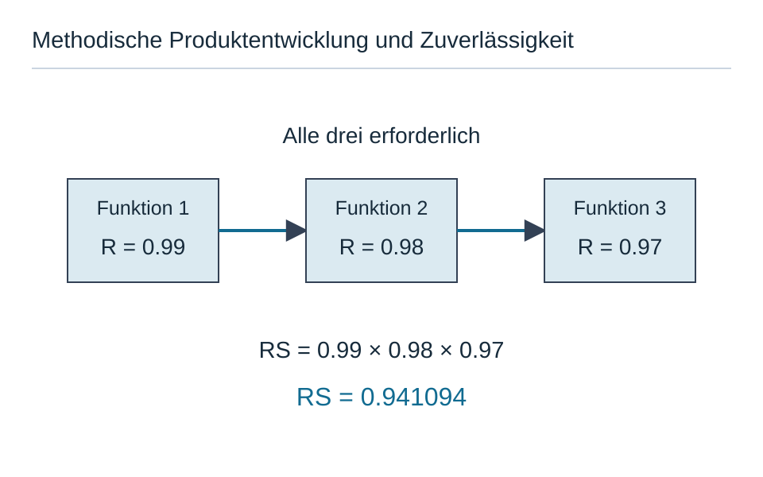

# M12-L4 – Methodische Produktentwicklung und Zuverlässigkeit {#L4}

**Kursbereich:** M12 – Vertiefung Konstruktion und Material

**Niveau:** Master

**Vorwissen:** [M12-L3 – Leichtbau und Verbundstrukturen](M12-L3.md)

**Lernziel:** Anforderungen in prüfbare Funktionen übersetzen und Systemzuverlässigkeit abschätzen.

## Einstieg {#S1}

Ein Produkt ist erst dann nachvollziehbar entwickelt, wenn seine Anforderungen, Entwurfsentscheidungen und Prüfnachweise zusammenpassen.

## Grundlagen, Begriffe und Modell {#S2}

Methodisches Entwickeln beginnt mit einer Anforderungsliste, die Muss-Kriterien von bewertbaren Zielen trennt. Die Funktionsstruktur beschreibt Eingänge, Ausgänge und Teilfunktionen unabhängig von konkreten Bauteilen. Alternative Wirkprinzipien werden kombiniert, bewertet und auf Verträglichkeit geprüft. Bewertungsmatrizen machen Gewichtungen transparent, ersetzen aber keine Mindestanforderungen. Verifikation ordnet jeder Anforderung einen Nachweis zu; Validierung prüft, ob das Produkt seinen beabsichtigten Nutzen erfüllt.

Zuverlässigkeit $R(t)=P(T>t)$ beschreibt die Wahrscheinlichkeit, eine definierte Zeit ohne spezifiziertes Versagen zu überstehen. Wenn jedes Teilsystem für die Funktion erforderlich ist und seine Ausfälle bis zum ersten Versagen unabhängig sind, ist $R_S(t)=\prod_i R_i(t)$. Redundanz kann andere logische Strukturen erzeugen; gemeinsame Ursachen wie Stromausfall, Überhitzung oder fehlerhafte Software verletzen häufig die Unabhängigkeit. Eine FMEA untersucht Fehlermöglichkeiten und ihre Auswirkungen, eine Fehlerbaumanalyse verknüpft Ereignisse logisch. Sicherheitsrelevante Entscheidungen benötigen zusätzliche Nachweise.

*Drei unabhängige Funktionen in logischer Reihenschaltung.*

## Durchgerechnetes Beispiel {#S3}

Für eine hypothetische Mission von 100 h haben drei notwendige unabhängige Baugruppen R₁ = 0,99, R₂ = 0,98, R₃ = 0,97. RS = 0,99·0,98·0,97 = 0,941094, entsprechend etwa 94,11 %. Die Ausfallwahrscheinlichkeit beträgt 5,89 %. Wird allein R₃ auf 0,99 verbessert, ergibt sich RS = 0,960498.

## Selbstkontrolle {#S4}

### Aufgaben

1. Welche Zuverlässigkeit besitzen zwei unabhängige notwendige Komponenten mit je R = 0,99?
2. Warum ist ein gemeinsamer Netzanschluss eine mögliche Schwachstelle redundanter Baugruppen?

::: {.lc-solutions data-lc-section="S4"}
### Lösungen

1. 0,9801.
2. Sein Ausfall kann beide gleichzeitig außer Funktion setzen.
:::

## Annahmen und Grenzen {#S5}

Fiktive Wahrscheinlichkeiten, gleiche Missionsdauer, unabhängige Erstversagen, keine Reparatur; keine sicherheitstechnische Freigabe.

## Zusammenfassung und Übergang {#S6}

Anforderungen, Entwurfsentscheidungen und Zuverlässigkeitsmodelle müssen durch nachvollziehbare Nachweise verbunden werden.

**Weiterlesen:** [M13-L1 – Turbomaschinen](M13-L1.md)

## Quellen {#S7}

- [MIT OCW – Introduction to Civil Engineering Design: Design Process](https://ocw.mit.edu/courses/1-012-introduction-to-civil-engineering-design-spring-2002/pages/projects/design_process/) · Design alternatives, decisions, outcomes and probabilistic sensitivity · Zuletzt abgerufen: 2026-11-25
- [NIST/SEMATECH e-Handbook – Series model](https://www.itl.nist.gov/div898/handbook/apr/section1/apr182.htm) · 8.1.8.2: independent components, first failure and product of survival probabilities · Zuletzt abgerufen: 2026-11-25

