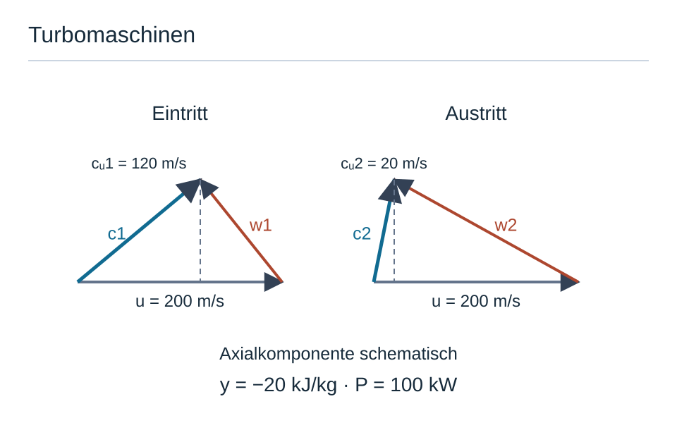

# M13-L1 – Turbomaschinen {#L1}

**Kursbereich:** M13 – Vertiefung Energie und Verfahren

**Niveau:** Master

**Vorwissen:** [M2-L4 – Spannung, Dehnung und Zug](M2-L4.md), [M5-L2 – Erster Hauptsatz und Energiebilanzen](M5-L2.md)

**Lernziel:** Die Euler-Gleichung aus dem Drallsatz anwenden und Rotorarbeit von Statorwirkung unterscheiden.

## Einstieg {#S1}

Turbomaschinen übertragen Energie über kontinuierlich durchströmte Schaufelreihen.

## Grundlagen, Begriffe und Modell {#S2}

Mit positiver Umfangsrichtung in Drehrichtung sei $c_u$ die tangentiale Komponente der Absolutgeschwindigkeit, $u=\omega r$ die Umfangsgeschwindigkeit und $w=c-u$ die relative Geschwindigkeit (vektoriell). Der stationäre Drallsatz ergibt das Drehmoment auf das Fluid $M=\dot m(r_2c_{u2}-r_1c_{u1})$. Multiplikation mit der Winkelgeschwindigkeit ergibt die spezifische Rotorarbeit am Fluid $y=u_2c_{u2}-u_1c_{u1}$. Für einen adiabaten Rotor entspricht sie der Änderung der Totalenthalpie. Bei einer Turbine ist y negativ; die abgegebene Leistung ist $-\dot m y$.

Bei einem Stator ist u = 0. Er kann den Drall und statischen Druck ändern, führt jedoch keine Wellenarbeit zu. Ein Wirkungsgrad muss anhand eines klar definierten idealen Vergleichsprozesses bestimmt werden; Euler-Arbeit allein gibt keine Aussage über Druckverluste. Geschwindigkeitsdreiecke verbinden die axialen und tangentialen Komponenten und zeigen den Unterschied zwischen absolutem und rotierendem Bezugssystem.

*Zwei Geschwindigkeitsdreiecke einer axialen Turbinenstufe mit abnehmender Drallkomponente.*

## Durchgerechnetes Beispiel {#S3}

Eine axiale Stufe hat u = 200 m/s, c_u1 = 120 m/s, c_u2 = 20 m/s und einen Massenstrom von 5 kg/s. y = 200·(20 − 120) = −20 kJ/kg. Die Rotorleistung beträgt 100 kW. Bei 100 rad/s ergibt sich ein abgegebenes Drehmoment von 1000 Nm.

## Selbstkontrolle {#S4}

### Aufgaben

1. Wie groß ist die Leistung bei 3 kg/s und gleichen Geschwindigkeiten?
2. Was folgt bei gleichem u und identischem Drall am Ein- und Austritt?

::: {.lc-solutions data-lc-section="S4"}
### Lösungen

1. 60 kW.
2. Die Euler-Arbeit ist null; das schließt Verluste nicht aus.
:::

## Annahmen und Grenzen {#S5}

Stationäre, gemittelte Strömung ohne zusätzliche Drehmomente; keine Auslegung von Schaufeln oder Festigkeitsnachweis.

## Zusammenfassung und Übergang {#S6}

Das Produkt aus Umfangsgeschwindigkeit und Dralländerung bestimmt die ideale Energiebilanz des Rotors.

**Weiterlesen:** [M13-L2 – Verbrennung und emissionsarme Systeme](M13-L2.md)

## Quellen {#S7}

- [MIT Unified Engineering – The Euler Turbine Equation](https://ocw.mit.edu/ans7870/16/16.unified/propulsionS04/UnifiedPropulsion9/UnifiedPropulsion9.htm) · Section B: angular momentum, power and absolute velocities · Zuletzt abgerufen: 2026-11-25

