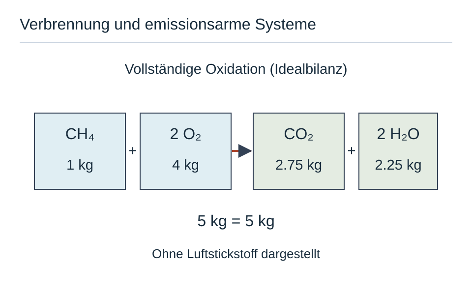

# M13-L2 – Verbrennung und emissionsarme Systeme {#L2}

**Kursbereich:** M13 – Vertiefung Energie und Verfahren

**Niveau:** Master

**Vorwissen:** [M13-L1 – Turbomaschinen](M13-L1.md)

**Lernziel:** Stöchiometrische Stoffmengen, Luftbedarf und Emissionsgrenzen des Idealmodells berechnen.

## Einstieg {#S1}

Verbrennung koppelt chemische Reaktionen mit Wärmeübertragung, Strömung und Schadstoffbildung.

## Grundlagen, Begriffe und Modell {#S2}

Eine vollständige Methanoxidation folgt $\mathrm{CH_4+2O_2\to CO_2+2H_2O}$. Die Koeffizienten sind Stoffmengenverhältnisse. Mit den gerundeten molaren Massen 16, 32, 44 und 18 g/mol ergeben sich je Kilogramm Methan 4 kg Sauerstoff, 2,75 kg Kohlendioxid und 2,25 kg Wasser. Bei einem Sauerstoffmassenanteil trockener Luft von 0,232 ist der stöchiometrische Luftbedarf $L_{st}=4/0.232$. Die Luftzahl $\lambda=L/L_{st}$ beschreibt das Verhältnis des tatsächlichen zum stöchiometrischen Luftbedarf.

Die Elementbilanz beschreibt keine Reaktionsgeschwindigkeit. Reale Systeme erzeugen unter anderem CO bei unvollständiger Oxidation und Stickoxide, deren Bildung unter anderem von Temperatur und Verweilzeit abhängt. Abgasnachbehandlung, Wärmerückgewinnung und geänderte Energieträger sind getrennte Systemoptionen. Klimawirkung erfordert zusätzlich die vorgelagerten Emissionen und die tatsächlich bereitgestellte Nutzenergie. Ein bilanziertes CO₂ ist keine vollständige Emissionsmessung.

*Stöchiometrische Methanbilanz mit Massen von Edukten und Produkten; keine Brennerkonstruktion.*

## Durchgerechnetes Beispiel {#S3}

Für 1 kg Methan ergibt sich L_st ≈ 17,24 kg trockene Luft. Bei einer rein bilanziellen Luftzahl 1,2 beträgt die Luftmasse 20,69 kg. Bei vollständiger Oxidation bleiben 0,8 kg O₂ übrig; die CO₂-Masse bleibt 2,75 kg.

## Selbstkontrolle {#S4}

### Aufgaben

1. Wie viel CO₂ entsteht aus 2 kg reinem Methan bei vollständiger Oxidation?
2. Kann man aus der Luftzahl allein den NOx-Ausstoß bestimmen?

::: {.lc-solutions data-lc-section="S4"}
### Lösungen

1. 5,5 kg.
2. Nein, unter anderem fehlen Temperaturverlauf, Kinetik, Geometrie und Verweilzeit.
:::

## Annahmen und Grenzen {#S5}

Reine Stoffbilanz mit gerundeten Molmassen; keine Betriebsparameterempfehlung, keine Zünd- oder Versuchsprozedur und kein Grenzwertnachweis.

## Zusammenfassung und Übergang {#S6}

Stoffbilanzen und reale Emissionsmodelle haben unterschiedliche Aufgaben.

**Weiterlesen:** [M13-L3 – Verfahrenstechnik und Stofftransport](M13-L3.md)

## Quellen {#S7}

- [OpenStax Chemistry 2e – Writing and Balancing Chemical Equations](https://openstax.org/books/chemistry-2e/pages/4-1-writing-and-balancing-chemical-equations) · Section 4.1: methane combustion stoichiometry · Zuletzt abgerufen: 2026-11-25
- [EPA – Report on Revisions to AP-42 Section 3.3](https://nepis.epa.gov/Exe/ZyPURL.cgi?Dockey=P100RH0G.TXT) · Sections 2.3 and 2.3.3: combustion emissions and CO formation; historical technical reference, not current limits · Zuletzt abgerufen: 2026-11-25

