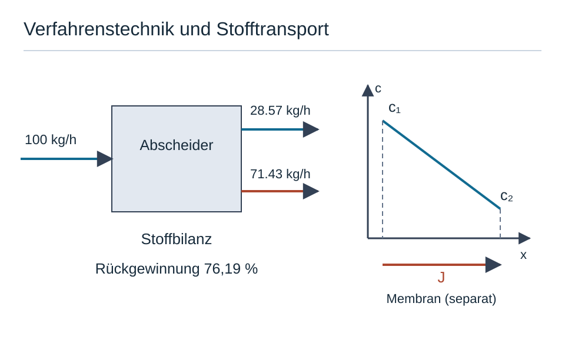

# M13-L3 – Verfahrenstechnik und Stofftransport {#L3}

**Kursbereich:** M13 – Vertiefung Energie und Verfahren

**Niveau:** Master

**Vorwissen:** [M13-L2 – Verbrennung und emissionsarme Systeme](M13-L2.md)

**Lernziel:** Gesamt- und Komponentenbilanzen formulieren und einen diffusionsbegrenzten Stoffstrom abschätzen.

## Einstieg {#S1}

Verfahrenstechnik gestaltet Stoffumwandlung und Trennung auf Basis erhaltener Größen und Transportgesetze.

## Grundlagen, Begriffe und Modell {#S2}

Für einen stationären Abscheider ohne Reaktion gilt $F=P+R$ und für einen Stoff A $Fx_F=Px_P+Rx_R$. F, P und R bezeichnen Massenströme von Zulauf, Produkt und Reststrom, x den jeweiligen Massenanteil. Sind Zusammensetzungen gegeben, folgt $P=F(x_F-x_R)/(x_P-x_R)$. Die Rückgewinnung von A ist $Px_P/(Fx_F)$. Die Bilanz allein erklärt nicht, wie schnell die Trennung erreicht wird oder welche Energie sie benötigt.

Für eindimensionale Diffusion ohne Konvektion lautet das erste Fick’sche Gesetz $J=-D\,dc/dx$, hier mit Massenkonzentration c in kg/m³ und Diffusionskoeffizient D in m²/s. Bei konstanter D, homogener ebener Schicht der Dicke L und stationärem linearem Profil ist $J=D(c_1-c_2)/L$. Der Stoffstrom ist JA mit Fläche A. Bei Mehrphasenprozessen können Grenzflächenwiderstände, Phasengleichgewicht und Konvektion den Transport begrenzen.

*Stoffbilanz eines Abscheiders und lineares Konzentrationsprofil einer Membran.*

## Durchgerechnetes Beispiel {#S3}

F = 100 kg/h, x_F = 0,30, x_P = 0,80 und x_R = 0,10. P = 100·0,20/0,70 = 28,57 kg/h, R = 71,43 kg/h; Rückgewinnung ≈ 76,19 %. Separates Membranmodell: D = 2·10⁻¹⁰ m²/s, L = 0,001 m, Δc = 5 kg/m³, A = 0,2 m². J = 10⁻⁶ kg/(m² s), JA = 2·10⁻⁷ kg/s.

## Selbstkontrolle {#S4}

### Aufgaben

1. Wie viel A verbleibt im Reststrom?
2. Wie ändert sich der Membranfluss bei doppelter Dicke und konstanten übrigen Größen?

::: {.lc-solutions data-lc-section="S4"}
### Lösungen

1. 7,14 kg/h.
2. Er halbiert sich.
:::

## Annahmen und Grenzen {#S5}

Zusammensetzungen sind vorgegeben; keine Vorhersage von Phasengleichgewicht, Anlagenkapazität oder Sicherheit. Membranmodell und Abscheiderbeispiel sind unabhängig.

## Zusammenfassung und Übergang {#S6}

Bilanzgleichungen legen Mengen fest; Transportgesetze ergänzen die zeitliche bzw. räumliche Übertragung.

**Weiterlesen:** [M13-L4 – Nachhaltige Energiewandlung und Systemintegration](M13-L4.md)

## Quellen {#S7}

- [LearnChemE / University of Colorado Boulder – Material Balances: Summary](https://learncheme.com/quiz-yourself/interactive-self-study-modules/material-balances/material-balances-summary/) · Key points: stationäre Komponenten- und Gesamtbilanzen; unabhängige Gleichungen · Zuletzt abgerufen: 2026-11-25 · Inhaltlich geprüft: 2026-11-25
- [LearnChemE – Mass/Energy Balances](https://learncheme.com/screencasts/mass-energy-balances/) · Single and multiple unit balances; resource index only, videos not inspected · Zuletzt abgerufen: 2026-11-25
- [MIT OCW – STEM Concept Videos: Gradient](https://ocw.mit.edu/courses/res-tll-004-stem-concept-videos-fall-2013/resources/gradient/) · Zusammenfassung und Lernziele: Ficks erstes Gesetz und Konzentrationsgradient; Video nicht angesehen · Zuletzt abgerufen: 2026-11-25

