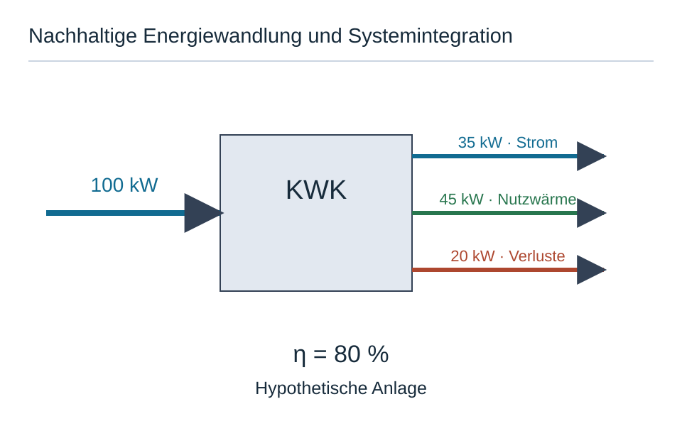

# M13-L4 – Nachhaltige Energiewandlung und Systemintegration {#L4}

**Kursbereich:** M13 – Vertiefung Energie und Verfahren

**Niveau:** Master

**Vorwissen:** [M13-L3 – Verfahrenstechnik und Stofftransport](M13-L3.md)

**Lernziel:** Energieeffizienz integrierter Systeme und die Bedeutung der tatsächlichen Wärmenutzung bewerten.

## Einstieg {#S1}

Ein hoher Anlagenwirkungsgrad ist nur dann sinnvoll, wenn die bereitgestellte Energie genutzt werden kann.

## Grundlagen, Begriffe und Modell {#S2}

Eine Kraft-Wärme-Kopplung (KWK) liefert aus einem Brennstoffstrom elektrische Energie und nutzbare Wärme. Auf konsistenter Heizwertbasis lautet der Nutzungsgrad $\eta=(P_{el}+\dot Q_{use})/\dot E_{fuel}$. Elektrischer Wirkungsgrad und Wärmeanteil lassen sich getrennt ausweisen. Wärme, die nicht zur Nachfrage, zum Temperaturniveau oder zum Zeitpunkt passt, ist nicht als Nutzwärme anzurechnen.

Zum Vergleich mit getrennter Erzeugung dient $\dot E_{sep}=P_{el}/\eta_{el,ref}+\dot Q_{use}/\eta_{heat,ref}$. Diese Referenz hängt vom Stromsystem und der Wärmequelle ab. Strom aus erneuerbaren Quellen und Wärmepumpen sind weitere Systemalternativen. Für eine Wärmepumpe ist $COP=\dot Q_{heat}/P_{el}$; ein COP über eins verletzt die Energiebilanz nicht, weil Umgebungswärme aufgenommen wird. Für Jahresbilanzen müssen zeitlich variierende Last, Teillast, Speicherverluste, Netzbezug und Emissionsfaktoren berücksichtigt werden.

*Energiebilanz einer Kraft-Wärme-Kopplung mit Nutzwärme, Strom und Verlusten.*

## Durchgerechnetes Beispiel {#S3}

Eine Modell-KWK benötigt 100 kW Brennstoffleistung und liefert 35 kW Strom sowie 45 kW genutzte Wärme. 20 kW verlassen die Systemgrenze ungenutzt. η = 80 %. Bei Referenzwirkungsgraden 0,40 und 0,90 erfordert getrennte Erzeugung 35/0,40 + 45/0,90 = 137,5 kW. Die modellierte Brennstoffeinsparung beträgt 27,27 %.

## Selbstkontrolle {#S4}

### Aufgaben

1. Wie hoch ist der Nutzungsgrad, wenn nur 20 kW Wärme verwendet werden?
2. Wie viel Strom braucht eine Wärmepumpe mit COP 3 für 45 kW Wärme?

::: {.lc-solutions data-lc-section="S4"}
### Lösungen

1. 55 %.
2. 15 kW; 30 kW werden der Wärmequelle entzogen.
:::

## Annahmen und Grenzen {#S5}

Hypothetische Referenzwirkungsgrade, stationäre Last, keine Aussage zur realen Klimabilanz oder Wirtschaftlichkeit.

## Zusammenfassung und Übergang {#S6}

Vergleichbare Systemgrenzen und zeitlich passende Nutzenergie sind Voraussetzung einer aussagekräftigen Bewertung.

**Weiterlesen:** [M14-L1 – Automatisierte Produktion und Roboterschnittstellen](M14-L1.md)

## Quellen {#S7}

- [US Department of Energy – Combined Heat and Power Basics](https://www.energy.gov/cmei/ito/combined-heat-and-power-basics) · Definition and useful thermal output of CHP · Zuletzt abgerufen: 2026-11-25

