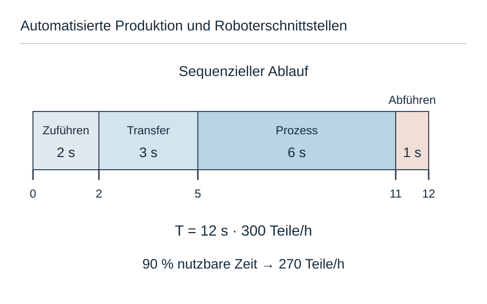

# M14-L1 – Automatisierte Produktion und Roboterschnittstellen {#L1}

**Kursbereich:** M14 – Vertiefung Produktion und Digitalisierung

**Niveau:** Master

**Vorwissen:** [M2-L4 – Spannung, Dehnung und Zug](M2-L4.md), [M5-L2 – Erster Hauptsatz und Energiebilanzen](M5-L2.md)

**Lernziel:** Eine Roboterzelle als gekoppeltes System aus Mechanik, Ablaufsteuerung und Sicherheit analysieren.

## Einstieg {#S1}

Die Produktivität einer automatisierten Zelle hängt nicht allein von der Geschwindigkeit des Roboters ab.

## Grundlagen, Begriffe und Modell {#S2}

Ein geometrischer Pfad $q(s)$ beschreibt Gelenkstellungen entlang eines normierten Parameters s; die Zeitfunktion $s(t)$ legt die Trajektorie $q(s(t))$ fest. Aus der Kettenregel ergeben sich $\dot q=q_s\dot s$ und $\ddot q=q_{ss}\dot s^2+q_s\ddot s$. Geschwindigkeit, Beschleunigung, Drehmoment, Reichweite und Kollisionen begrenzen die realisierbare Bewegung. Das Greifsystem, Werkstückzuführung, Sensoren und Steuerungen benötigen abgestimmte Zustände und eindeutige Rückmeldungen.

Ein Ablaufmodell unterscheidet beispielsweise bereit, in Bearbeitung, fertig und Störung. Bei einer rein sequenziellen Folge ist die Zykluszeit $T_c=\sum_i t_i$; der theoretische Durchsatz bei einem Teil pro Zyklus lautet $3600/T_c$ in Teilen pro Stunde, falls T_c in Sekunden angegeben wird. Überlappte Schritte erfordern eine Zeitplanung mit Abhängigkeiten statt bloßer Addition. Sicherheitsfunktionen sind vom Produktionshandshake zu unterscheiden und auf Grundlage einer Risikobeurteilung zu validieren. Ein Standard-Steuersignal allein weist keine Sicherheit nach.

*Zeitdiagramm eines modellierten Roboterzyklus mit sequenziellen Prozessphasen.*

## Durchgerechnetes Beispiel {#S3}

Ein hypothetischer Zyklus besteht aus Zuführen 2 s, Transfer 3 s, Prozess 6 s und Abführen 1 s. T_c = 12 s, theoretisch 300 Teile/h. Ein nutzbarer Zeitanteil von 90 % ohne weitere Verluste ergibt 270 Teile/h im Langzeitmittel.

## Selbstkontrolle {#S4}

### Aufgaben

1. Wie hoch ist der theoretische Durchsatz, wenn der Prozess rechnerisch 5 s dauert?
2. Darf die rechnerisch schnellere Variante ohne erneute Risikobeurteilung umgesetzt werden?

::: {.lc-solutions data-lc-section="S4"}
### Lösungen

1. 3600/11 ≈ 327,27 Teile/h.
2. Nein, das Modell weist weder sichere Bewegung noch sichere Integration nach.
:::

## Annahmen und Grenzen {#S5}

Reines Zeitmodell ohne reale Roboterparameter, keine Anleitung zur Inbetriebnahme, keine Norm- oder Konformitätsprüfung.

## Zusammenfassung und Übergang {#S6}

Zyklusoptimierung und sicherheitsbezogene Freigabe sind getrennte Aufgaben.

**Weiterlesen:** [M14-L2 – Digitale Zwillinge und industrielle Daten](M14-L2.md)

## Quellen {#S7}

- [Northwestern – Modern Robotics: Point-to-Point Trajectories](https://modernrobotics.northwestern.edu/nu-gm-book-resource/9-1-and-9-2-point-to-point-trajectories-part-1-of-2/) · Transcript: path, time scaling, velocity and acceleration · Zuletzt abgerufen: 2026-11-25
- [OSHA Technical Manual – Industrial Robot Systems and Industrial Robot System Safety](https://www.osha.gov/otm/section-4-safety-hazards/chapter-4) · Risk assessment and safeguarding; not a current EU conformity assessment · Zuletzt abgerufen: 2026-11-25

