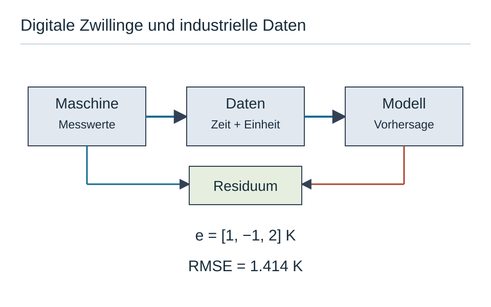

# M14-L2 – Digitale Zwillinge und industrielle Daten {#L2}

**Kursbereich:** M14 – Vertiefung Produktion und Digitalisierung

**Niveau:** Master

**Vorwissen:** [M14-L1 – Automatisierte Produktion und Roboterschnittstellen](M14-L1.md)

**Lernziel:** Digitale Zwillinge von statischen Modellen unterscheiden und Datenqualität quantitativ beurteilen.

## Einstieg {#S1}

Ein digitaler Zwilling verknüpft einen realen Gegenstand oder Prozess mit einem synchronisierten digitalen Modell für definierte Zwecke.

## Grundlagen, Begriffe und Modell {#S2}

Ein digitaler Zwilling benötigt eine identifizierbare Anlage, definierte Zustandsgrößen, Datenverbindungen, ein Modell und eine Anwendung. Messwerte sollten Einheit, Zeitstempel, Qualitätskennzeichen und Anlagenbezug enthalten. Eine statische CAD-Datei ohne Datenbezug ist allein noch kein synchronisierter Zwilling. Je nach Zweck können Zustandsdiagnose, Prognose oder virtuelle Inbetriebnahme unterschiedliche Modellauflösungen benötigen.

Für N zeitlich zugeordnete Referenzmessungen $y_i$ und Modellwerte $\hat y_i$ ist das Residuum $e_i=y_i-\hat y_i$. Der mittlere Fehler ist $\bar e=\sum e_i/N$, die quadratische Fehlerkennzahl $RMSE=\sqrt{\sum e_i^2/N}$. Ein kleiner RMSE garantiert keine Eignung außerhalb der Testdaten. Bei einer Abtastrate f in Hz und Datenalter Δt muss die Anwendung prüfen, ob Synchronisation und Latenz zur Prozessdynamik passen. Versionierung von Modell, Kalibrierung und Datenverarbeitung sowie Zugriffsschutz und Ausfallverhalten sind Teil der Systemarchitektur.

*Datenfluss von Maschine über Zeitstempel und Modell zum überwachten Residuum.*

## Durchgerechnetes Beispiel {#S3}

Temperaturmessungen [50, 52, 54] °C, Modell [49, 53, 52] °C. Residuen [1, −1, 2] K, Mittelwert 0,667 K, RMSE = √(6/3) ≈ 1,414 K. Bei 10 Hz und 0,5 s Datenalter entspricht das Alter fünf Abtastintervallen.

## Selbstkontrolle {#S4}

### Aufgaben

1. Was ergibt sich als RMSE für drei gleiche Residuen von −2 K?
2. Warum sollte bei einer Prozessänderung erneut validiert werden?

::: {.lc-solutions data-lc-section="S4"}
### Lösungen

1. 2 K; der mittlere Fehler beträgt −2 K.
2. Das bisher geprüfte Modell könnte seine Gültigkeitsgrenzen überschreiten.
:::

## Annahmen und Grenzen {#S5}

Synthetische Daten; drei Messpunkte belegen keine statistische Modellgüte. Keine automatisierte sicherheitskritische Regelung.

## Zusammenfassung und Übergang {#S6}

Synchronisation, Datenherkunft und anwendungsbezogene Validierung sind ebenso wichtig wie Modellgenauigkeit.

**Weiterlesen:** [M14-L3 – Produktionslogistik und Optimierung](M14-L3.md)

## Quellen {#S7}

- [NIST – Digital Twins for Advanced Manufacturing](https://www.nist.gov/programs-projects/digital-twins-advanced-manufacturing) · Synchronized models, interoperability, validation and uncertainty · Zuletzt abgerufen: 2026-11-25

