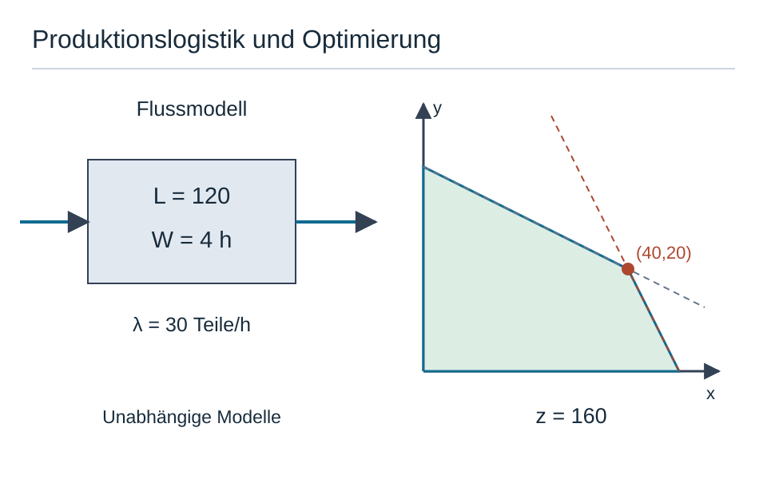

# M14-L3 – Produktionslogistik und Optimierung {#L3}

**Kursbereich:** M14 – Vertiefung Produktion und Digitalisierung

**Niveau:** Master

**Vorwissen:** [M14-L2 – Digitale Zwillinge und industrielle Daten](M14-L2.md)

**Lernziel:** Little’s Law anwenden und Kapazitätsoptimierung mit realisierbaren Nebenbedingungen formulieren.

## Einstieg {#S1}

Produktionslogistik verknüpft Materialfluss, Auslastung, Bestand und Lieferfähigkeit.

## Grundlagen, Begriffe und Modell {#S2}

Für einen konsistent abgegrenzten stabilen Prozess gilt im Langzeitmittel $L=\lambda W$, wobei L die mittlere Anzahl von Aufträgen oder Teilen im System, λ der Durchsatz und W die mittlere Verweilzeit ist. Einheiten und Population müssen zusammenpassen. Diese Bilanzbeziehung setzt keine bestimmte Verteilung der Prozesszeit voraus. Sie sagt jedoch allein nicht vorher, wie Durchsatz oder Wartezeit auf eine veränderte Bestandsregel reagieren.

Für eine Kapazitätsplanung mit zwei Produkten x und y kann ein lineares Modell den Deckungsbeitrag $z=c_xx+c_yy$ maximieren. Ressourcenrestriktionen haben die Form $a_{jx}x+a_{jy}y\le b_j$. Dazu kommen Nichtnegativität, Nachfragegrenzen und gegebenenfalls Ganzzahligkeit. Bei einem zweidimensionalen kontinuierlichen linearen Programm mit beschränkter zulässiger Menge genügt es, die Eckpunkte zu vergleichen, sofern eine Lösung existiert. Rüstzeiten und stochastische Nachfrage können ein anderes Modell verlangen.

*Produktionsfluss mit Bestand, Durchsatz und mittlerer Durchlaufzeit sowie zwei Kapazitätsgrenzen.*

## Durchgerechnetes Beispiel {#S3}

Bei 120 Teilen mittlerem Bestand und 30 Teilen/h Durchsatz beträgt W = 4 h. Separates Planungsmodell: maximiere 3x + 2y bei 2x + y ≤ 100 und x + 2y ≤ 80, x,y ≥ 0. Eckpunkte (0; 0), (50; 0), (40; 20), (0; 40) ergeben z = 0; 150; 160; 80. Optimale Lösung (40; 20), z = 160 Geldeinheiten.

## Selbstkontrolle {#S4}

### Aufgaben

1. Welcher mittlere Bestand entspricht 30 Teilen/h und 3 h Durchlaufzeit?
2. Welche Ressourcen sind im optimalen Plan vollständig belegt?

::: {.lc-solutions data-lc-section="S4"}
### Lösungen

1. 90 Teile, falls die Mittelwerte zum gleichen stabilen Prozess gehören.
2. Beide: 2·40+20 = 100 und 40+2·20 = 80.
:::

## Annahmen und Grenzen {#S5}

Stabile Langzeitmittel; kontinuierliches, deterministisches Planungsmodell mit hypothetischen Daten. Keine Garantie, dass eine Bestandsänderung den Durchsatz konstant hält.

## Zusammenfassung und Übergang {#S6}

Flusskennzahlen beschreiben den Betrieb, Optimierungsmodelle unterstützen Entscheidungen unter expliziten Annahmen.

**Weiterlesen:** [M14-L4 – Instandhaltung und Zuverlässigkeit](M14-L4.md)

## Quellen {#S7}

- [University of Texas at Austin – Operations Management: Inventory](https://utw11041.utweb.utexas.edu/ORMM/omie/operation/unit/inventory/general.html) · Flow, inventory and time; Little’s law · Zuletzt abgerufen: 2026-11-25

