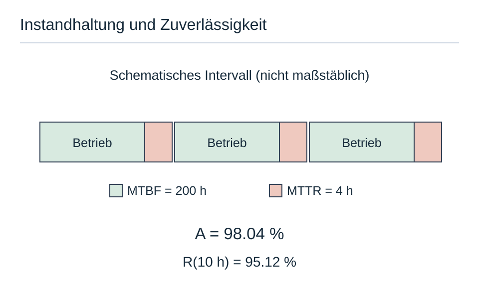

# M14-L4 – Instandhaltung und Zuverlässigkeit {#L4}

**Kursbereich:** M14 – Vertiefung Produktion und Digitalisierung

**Niveau:** Master

**Vorwissen:** [M14-L3 – Produktionslogistik und Optimierung](M14-L3.md)

**Lernziel:** Ausfallrate, mittlere Betriebsdauer und stationäre Verfügbarkeit auseinanderhalten.

## Einstieg {#S1}

Instandhaltung soll Risiken und Stillstandsfolgen beherrschbar machen; bloße Laufzeitmaximierung reicht nicht.

## Grundlagen, Begriffe und Modell {#S2}

Für eine reparierbare Anlage mit n beobachteten Ausfällen in einer Gesamtbetriebszeit T_up lässt sich bei konstanter Ausfallintensität $\hat\lambda=n/T_{up}$ schätzen. $MTBF=T_{up}/n$ bezeichnet hier ausdrücklich die mittlere Betriebszeit zwischen Ausfällen, ohne Reparaturdauer. MTTR ist die mittlere Wiederherstellungsdauer. Bei einem alternierenden Erneuerungsmodell mit endlichen Mittelwerten und ohne zusätzliche Stillstandsarten gilt langfristig $A=MTBF/(MTBF+MTTR)$. Diese Zeitverfügbarkeit unterscheidet sich von der Wahrscheinlichkeit, innerhalb eines Auftrags keinen Ausfall zu erleben.

Bei einer konstanten bedingten Ausfallrate während des Betriebs (exponentiell verteilte Betriebsintervalle) ist die Wahrscheinlichkeit eines ausfallfreien Zeitintervalls t, aus einem betriebsbereiten Zustand, $R(t)=e^{-\lambda t}$. Verschleiß und Alterung können eine zeitabhängige Rate erfordern. Zustandsorientierte Instandhaltung nutzt beobachtbare Merkmale, etwa Trends in Temperatur oder Schwingung; die Aussagekraft hängt von Messqualität, Fehlermodus und Prognosehorizont ab. Eine Instandhaltungsstrategie benötigt eine Risikobewertung, nicht nur Mittelwerte.

*Zeitachse von Betriebs- und Reparaturintervallen mit berechneter Verfügbarkeit.*

## Durchgerechnetes Beispiel {#S3}

In 1000 Betriebsstunden werden 5 Ausfälle und insgesamt 20 h Wiederherstellung beobachtet. MTBF = 200 h, MTTR = 4 h, λ = 0,005 h⁻¹. Modellverfügbarkeit A = 200/204 ≈ 98,04 %. Bei konstantem λ ist R(10 h) = exp(−0,05) ≈ 95,12 %.

## Selbstkontrolle {#S4}

### Aufgaben

1. Wie hoch ist A bei MTTR = 2 h und gleichem MTBF?
2. Ist die Schätzung mit fünf Ausfällen ein sicherer Nachweis einer Zielverfügbarkeit?

::: {.lc-solutions data-lc-section="S4"}
### Lösungen

1. 200/202 ≈ 99,01 %.
2. Nein, Stichprobenunsicherheit, Modellannahmen und weitere Stillstandsarten sind zu berücksichtigen.
:::

## Annahmen und Grenzen {#S5}

Konstante Ausfallintensität, alternierende Betriebs- und Reparaturintervalle, keine präventiven oder logistischen Stillstandszeiten. Keine reale Wartungsanweisung.

## Zusammenfassung und Übergang {#S6}

Verfügbarkeit berücksichtigt Wiederherstellung; Zuverlässigkeit betrachtet ausfallfreien Betrieb.

**Weiterlesen:** [M15-L1 – Fahrzeug- und Mobilitätssysteme](M15-L1.md)

## Quellen {#S7}

- [NIST/SEMATECH – Homogeneous Poisson Process](https://www.itl.nist.gov/div898/handbook/apr/section1/apr171.htm) · 8.1.7.1: constant event rate, MTBF, Poisson model · Zuletzt abgerufen: 2026-11-25
- [NIST/SEMATECH – Constant repair rate model](https://www.itl.nist.gov/div898/handbook/apr/section4/apr451.htm) · 8.4.5.1: operating time divided by observed failures · Zuletzt abgerufen: 2026-11-25

