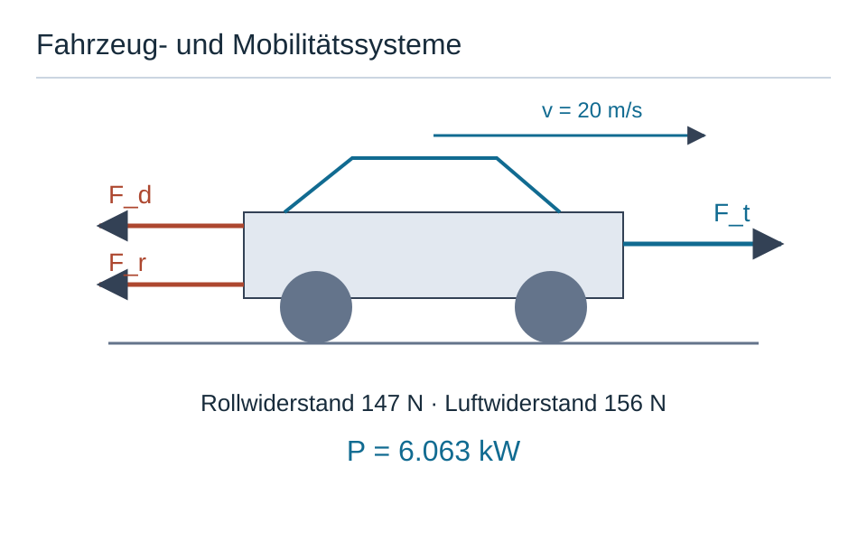

# M15-L1 – Fahrzeug- und Mobilitätssysteme {#L1}

**Kursbereich:** M15 – Vertiefung Anwendungsfelder

**Niveau:** Master

**Vorwissen:** [M2-L4 – Spannung, Dehnung und Zug](M2-L4.md), [M5-L2 – Erster Hauptsatz und Energiebilanzen](M5-L2.md)

**Lernziel:** Fahrwiderstände bilanzieren und den Einfluss der Geschwindigkeit auf die Antriebsleistung quantifizieren.

## Einstieg {#S1}

Ein Fahrzeug muss nicht nur beschleunigen, sondern auch bei konstanter Geschwindigkeit Energie gegen Fahrwiderstände aufwenden. Die Wahl des Antriebs allein bestimmt deshalb nicht den Verbrauch.

## Grundlagen, Begriffe und Modell {#S2}

Auf ebener Straße ohne Wind kann der Rollwiderstand näherungsweise als $F_r=c_rmg$ und der Luftwiderstand als $F_d=\rho C_d A v^2/2$ beschrieben werden. Hier sind $c_r$ der Rollwiderstandsbeiwert, $C_d$ der Luftwiderstandsbeiwert bezogen auf die Stirnfläche A, und v die Geschwindigkeit. In einem Längsmodell gilt $F_t-F_r-F_d=ma$. Bei Steigung mit Winkel $\theta$ kommen $mg\sin\theta$ und der Faktor $\cos\theta$ im Rollwiderstand hinzu. Die Radleistung ist $P=F_tv$. Bei stationärer Fahrt wächst der aerodynamische Leistungsanteil mit der dritten Potenz der Geschwindigkeit. Für eine idealisierte Antriebseffizienz $\eta$ ist die Eingangsleistung $P/\eta$; Rekuperation benötigt eine gesonderte Bilanz. Fahrzyklen erfordern die zeitliche Integration der Leistung und eine Berücksichtigung von Nebenverbrauchern.

*Kraftbilanz eines Fahrzeugs auf ebener Straße und erforderliche Radleistung.*

## Durchgerechnetes Beispiel {#S3}

m = 1500 kg, g = 9,81 m/s², c_r = 0,01, ρ = 1,2 kg/m³, C_d A = 0,65 m², v = 20 m/s. F_r = 147,15 N, F_d = 156 N; Radleistung = 6063 W. Bei η = 0,9 beträgt die Eingangsleistung 6,74 kW.

## Selbstkontrolle {#S4}

### Aufgaben

1. Wie groß ist die Radleistung bei 30 m/s?
2. Wie viel Radenergie benötigt das Modell bei 20 m/s für 10 km?

::: {.lc-solutions data-lc-section="S4"}
### Lösungen

1. (147,15 + 351)·30 = 14,94 kW.
2. 303,15 N · 10 000 m = 3,0315 MJ ≈ 0,842 kWh.
:::

## Annahmen und Grenzen {#S5}

Konstante Beiwerte, keine Windböen, keine Steigung, keine rotierenden Trägheiten oder Nebenverbraucher; kein realer Verbrauchsnachweis.

## Zusammenfassung und Übergang {#S6}

Widerstandskräfte und Geschwindigkeit bestimmen die mechanische Energie- und Leistungsbilanz.

**Weiterlesen:** [M15-L2 – Luft- und Raumfahrtgrundlagen](M15-L2.md)

## Quellen {#S7}

- [NASA Glenn – Drag Equation](https://www1.grc.nasa.gov/beginners-guide-to-aeronautics/drag-equation/) · Drag coefficient and reference area · Zuletzt abgerufen: 2026-11-25
- [OpenStax – Work-Energy Theorem](https://openstax.org/books/university-physics-volume-1/pages/7-3-work-energy-theorem) · §7.3 work and kinetic energy · Zuletzt abgerufen: 2026-11-25
- [OpenStax – Newton’s Second Law](https://openstax.org/books/university-physics-volume-1/pages/5-3-newtons-second-law) · §5.3 net force and acceleration · Zuletzt abgerufen: 2026-11-25

