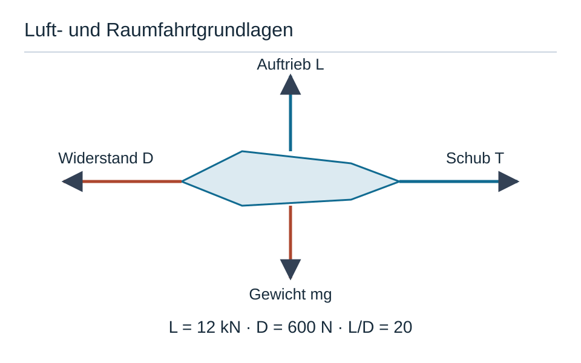

# M15-L2 – Luft- und Raumfahrtgrundlagen {#L2}

**Kursbereich:** M15 – Vertiefung Anwendungsfelder

**Niveau:** Master

**Vorwissen:** [M15-L1 – Fahrzeug- und Mobilitätssysteme](M15-L1.md)

**Lernziel:** Aerodynamische Beiwerte, Kräfte und Orbitalgeschwindigkeit in getrennten Modellen erklären.

## Einstieg {#S1}

Luftfahrt und Raumfahrt beruhen auf unterschiedlichen Betriebsbedingungen: In der Atmosphäre prägt Strömung die Lasten, im idealisierten Orbit die Gravitation.

## Grundlagen, Begriffe und Modell {#S2}

Mit dynamischem Druck $q=\rho v^2/2$ ergeben sich Auftrieb $L=qSC_L$ und Widerstand $D=qSC_D$ bezogen auf dieselbe Referenzfläche S. Die dimensionslosen Beiwerte hängen unter anderem von Geometrie, Anstellwinkel, Reynolds- und Machzahl ab. Im stationären Horizontalflug mit horizontalem Schub gilt $L=mg$ und $T=D$; für gleiche Referenzfläche ist $L/D=C_L/C_D$. Ein hoher Quotient ist allein kein vollständiges Leistungs- oder Stabilitätskriterium.

Im idealisierten kreisförmigen Orbit eines kleinen Körpers um einen kugelsymmetrischen Zentralkörper wird $v^2/r=\mu/r^2$ gesetzt, mit Gravitationsparameter $\mu=GM$. Daher $v=\sqrt{\mu/r}$ und $T_o=2\pi r/v$. Der Radius wird vom Zentrum aus gemessen, nicht von der Oberfläche. Diese Modellgleichungen beschreiben keinen realen Start- oder Missionsablauf.

*Kräfte im stationären Horizontalflug und Vergleich von Auftrieb und Widerstand.*

## Durchgerechnetes Beispiel {#S3}

ρ = 1,2 kg/m³, v = 50 m/s, S = 10 m², C_L = 0,8, C_D = 0,04. q = 1500 Pa, L = 12 kN, D = 600 N, L/D = 20. Unabhängiges Modell: μ = 3,986·10¹⁴ m³/s², r = 7·10⁶ m; Kreisbahngeschwindigkeit ≈ 7,55 km/s, Umlaufdauer ≈ 97,1 min.

## Selbstkontrolle {#S4}

### Aufgaben

1. Welche Masse würde der Auftrieb im stationären Horizontalflug bei g = 9,81 m/s² tragen?
2. Wie ändert sich die Kreisbahngeschwindigkeit bei Verdopplung von r?

::: {.lc-solutions data-lc-section="S4"}
### Lösungen

1. 12000/9,81 ≈ 1223 kg.
2. Sie sinkt auf 1/√2 des ursprünglichen Werts.
:::

## Annahmen und Grenzen {#S5}

Konstante Beiwerte und stationärer Flug; idealisiertes Zweikörperproblem ohne Störungen. Keine Flug- oder Missionsfreigabe.

## Zusammenfassung und Übergang {#S6}

Flugkräfte und Orbitalmechanik benötigen unterschiedliche Modelle und Bezugsgrößen.

**Weiterlesen:** [M15-L3 – Kunststoff- und Textiltechnik](M15-L3.md)

## Quellen {#S7}

- [MIT OCW – Aerodynamics, Lecture 8: Equations of Aircraft Motion](https://ocw.mit.edu/courses/16-100-aerodynamics-fall-2005/678fcdd7f52560f148826442b6885f3e_16100lecture8_cg.pdf) · S. 3: Staudruck, Bezugsfläche, Auftriebs- und Widerstandsbeiwert · Zuletzt abgerufen: 2026-11-25 · Inhaltlich geprüft: 2026-11-25
- [NASA Glenn – Drag Equation](https://www1.grc.nasa.gov/beginners-guide-to-aeronautics/drag-equation/) · Drag coefficient and reference area · Zuletzt abgerufen: 2026-11-25
- [OpenStax – Newton’s Second Law](https://openstax.org/books/university-physics-volume-1/pages/5-3-newtons-second-law) · §5.3 net force and acceleration · Zuletzt abgerufen: 2026-11-25
- [OpenStax – Satellite Orbits and Energy](https://openstax.org/books/university-physics-volume-1/pages/13-4-satellite-orbits-and-energy) · 13.4: circular orbit equations 13.7 and 13.8 · Zuletzt abgerufen: 2026-11-25

