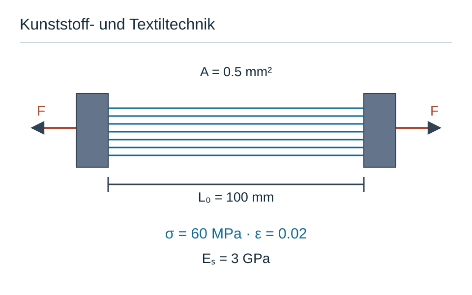

# M15-L3 – Kunststoff- und Textiltechnik {#L3}

**Kursbereich:** M15 – Vertiefung Anwendungsfelder

**Niveau:** Master

**Vorwissen:** [M15-L2 – Luft- und Raumfahrtgrundlagen](M15-L2.md)

**Lernziel:** Polymerverarbeitung mit Orientierung, Zeitabhängigkeit und Faserkennwerten verbinden.

## Einstieg {#S1}

Kunststoffprodukte und Textilien entstehen aus einer Prozesskette, die ihre spätere Struktur und Gebrauchseigenschaften prägt.

## Grundlagen, Begriffe und Modell {#S2}

Thermoplaste lassen sich durch Erwärmen erweichen und beispielsweise extrudieren; vernetzte Duroplaste können nicht auf dieselbe Weise wieder aufgeschmolzen werden. Bei der Faserherstellung beeinflussen Abkühlung und Verstreckung die molekulare Orientierung. Fasern werden zu Garnen und flächigen Strukturen verarbeitet, deren Eigenschaften nicht allein aus dem Polymerkennwert folgen. Temperatur, Feuchte, Dehnrate und Belastungsdauer sind in der Prüfung zu dokumentieren. Für einen homogenen Faserquerschnitt A ist die nominale Zugspannung $\sigma=F/A$ und die technische Dehnung $\varepsilon=\Delta L/L_0$. Die Sekantensteifigkeit $E_s=\sigma/\varepsilon$ ist nicht notwendig der Tangentenmodul. Bei viskoelastischem Material können Kriechen unter konstanter Spannung und Spannungsrelaxation unter konstanter Dehnung auftreten. Für ein Gewebe muss zwischen Faserfläche, nomineller Probenfläche und richtungsabhängiger Struktur unterschieden werden.

*Faserzugversuch und nominale Spannung aus der tragenden Querschnittsfläche.*

## Durchgerechnetes Beispiel {#S3}

Idealisiertes Faserbündel: A = 0,5 mm², F = 30 N, L₀ = 100 mm, ΔL = 2 mm. σ = 60 MPa, ε = 0,02, E_s = 3 GPa.

## Selbstkontrolle {#S4}

### Aufgaben

1. Wie groß ist σ bei 45 N und gleicher Fläche?
2. Warum kann der Modul aus dem Bündel nicht ohne Weiteres auf ein Gewebe übertragen werden?

::: {.lc-solutions data-lc-section="S4"}
### Lösungen

1. 90 MPa.
2. Faserorientierung, Garngeometrie, Porosität, Kontakt und zeitabhängige Verformung verändern das Verhalten.
:::

## Annahmen und Grenzen {#S5}

Fiktive Messwerte und nominale Fläche; kein Werkstoffdatenblatt. Detaillierte Prozessfenster und textile Prüfstandards sind Vertiefungsthemen.

## Zusammenfassung und Übergang {#S6}

Prozess, Struktur, Eigenschaften und Prüfung bilden eine zusammenhängende Kette.

**Weiterlesen:** [M15-L4 – Medizintechnik und Mikrosysteme](M15-L4.md)

## Quellen {#S7}

- [MIT OCW – Polymer Engineering](https://ocw.mit.edu/courses/3-064-polymer-engineering-fall-2003/) · Course description: selection, mechanical characterisation, processing · Zuletzt abgerufen: 2026-11-25
- [MIT Mechanical Engineering – Fiber and Textile Engineering](https://meche.mit.edu/featured-classes/fiber-and-textile-engineering) · Course scope: polymer science and fibrous media; not detailed constitutive equations · Zuletzt abgerufen: 2026-11-25
- [OpenStax – University Physics Volume 1, 12.3 Stress, Strain, and Elastic Modulus](https://openstax.org/books/university-physics-volume-1/pages/12-3-stress-strain-and-elastic-modulus) · §12.3: stress, strain, elastic modulus · Zuletzt abgerufen: 2026-11-25

