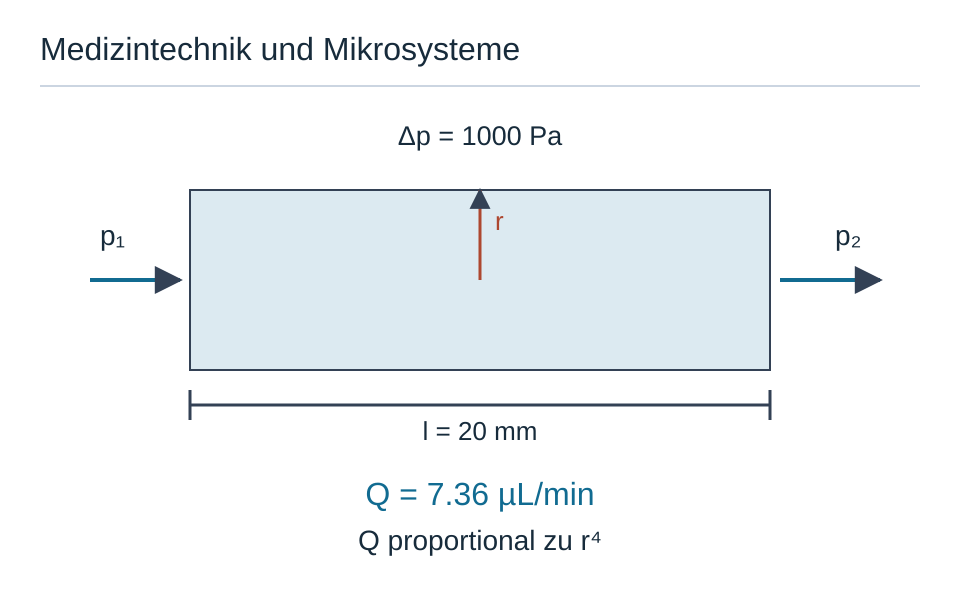

# M15-L4 – Medizintechnik und Mikrosysteme {#L4}

**Kursbereich:** M15 – Vertiefung Anwendungsfelder

**Niveau:** Master

**Vorwissen:** [M15-L3 – Kunststoff- und Textiltechnik](M15-L3.md)

**Lernziel:** Skaleneffekte in Mikrosystemen berechnen und technische von klinischer Validierung unterscheiden.

## Einstieg {#S1}

Medizintechnik verbindet Mechanik und Werkstoffe mit biologischen Randbedingungen; Mikrosysteme stellen zusätzliche Anforderungen an Fertigung und Messung.

## Grundlagen, Begriffe und Modell {#S2}

Ein Modell für voll entwickelte laminare Strömung einer inkompressiblen Newtonschen Flüssigkeit durch einen starren kreisförmigen Kanal ist $Q=\pi r^4\Delta p/(8\eta l)$. Der Strömungswiderstand $R_h=\Delta p/Q$ hängt besonders stark vom Radius ab. Die Reynolds-Zahl $Re=\rho \bar v(2r)/\eta$ mit $\bar v=Q/(\pi r^2)$ unterstützt die Plausibilitätsprüfung. Bei kleinen Kanälen können Toleranzen, Oberflächenkräfte, Benetzung und Verstopfung entscheidend sein. Das Modell gilt nicht automatisch für Blut oder lebendes Gewebe.

Ein technischer Nachweis prüft spezifizierte Messgrößen, etwa Durchfluss und Dichtheit. Ob ein Medizinprodukt seinen klinischen Zweck sicher erfüllt, erfordert darüber hinaus geeignete biologische, klinische und regulatorische Evidenz; diese ist nicht durch eine Strömungsrechnung ersetzt. In der Konzeptphase werden Anforderungen, Risiken, Prüfverfahren und Akzeptanzgrenzen getrennt dokumentiert.

*Idealisierter Mikrokanal mit Druckdifferenz, Radius und Volumenstrom.*

## Durchgerechnetes Beispiel {#S3}

Wasserähnliche Testflüssigkeit: η = 0,001 Pa·s, ρ = 1000 kg/m³, r = 50 µm, l = 0,02 m, Δp = 1000 Pa. Q ≈ 1,227·10⁻¹⁰ m³/s = 7,36 µL/min. Mittlere Geschwindigkeit ≈ 0,0156 m/s; Re ≈ 1,56.

## Selbstkontrolle {#S4}

### Aufgaben

1. Wie ändert sich Q bei einer Radiusverringerung um 10 %?
2. Reicht der Durchflussnachweis als Nachweis klinischer Wirksamkeit?

::: {.lc-solutions data-lc-section="S4"}
### Lösungen

1. Auf 0,9⁴ = 65,61 % des Ausgangswerts.
2. Nein. Er prüft nur eine technische Anforderung im festgelegten Modell bzw. Versuch.
:::

## Annahmen und Grenzen {#S5}

Keine medizinische Anwendung, Dosierung oder Zulassungsanleitung; idealisierte Flüssigkeit und Kanalgeometrie.

## Zusammenfassung und Übergang {#S6}

Skalierung und messbare Anforderungen sind notwendig, aber kein Ersatz für die Validierung des Einsatzzwecks.

**Weiterlesen:** [M16-L1 – Sicherheit, Verantwortung und Nachhaltigkeit](M16-L1.md)

## Quellen {#S7}

- [OpenStax – Viscosity and Turbulence](https://openstax.org/books/university-physics-volume-1/pages/14-7-viscosity-and-turbulence) · §14.7: laminar flow and Poiseuille law · Zuletzt abgerufen: 2026-11-25
- [NIST/SEMATECH e-Handbook – Approach to uncertainty](https://www.itl.nist.gov/div898/handbook/mpc/section5/mpc52.htm) · §2.5.2: type A and B, quadrature, expanded uncertainty · Zuletzt abgerufen: 2026-11-25
- [NASA Systems Engineering Handbook – Product Realization](https://www.nasa.gov/reference/5-0-product-realization/) · Sections 5.3–5.4: verification and validation · Zuletzt abgerufen: 2026-11-25

