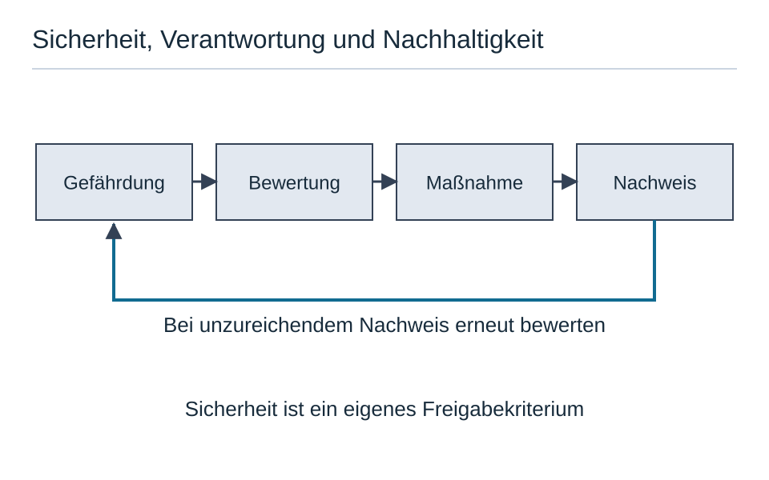

# M16-L1 – Sicherheit, Verantwortung und Nachhaltigkeit {#L1}

**Kursbereich:** M16 – Ingenieurpraxis und Forschungsprojekt

**Niveau:** Bachelor / Master

**Vorwissen:** [M2-L4 – Spannung, Dehnung und Zug](M2-L4.md), [M5-L2 – Erster Hauptsatz und Energiebilanzen](M5-L2.md)

**Lernziel:** Sicherheits-, Umwelt- und Verantwortungsfragen systematisch in technische Entscheidungen integrieren.

## Einstieg {#S1}

Ein günstiger und leistungsfähiger Entwurf ist unzureichend, wenn seine Risiken nicht beherrscht werden.

## Grundlagen, Begriffe und Modell {#S2}

Eine Gefährdung ist eine mögliche Schadensquelle; Risiko berücksichtigt Wahrscheinlichkeit und Ausmaß eines möglichen Schadens. Dokumentiere Betriebszustände, Betroffene, Fehlermöglichkeiten und Unsicherheiten. Vorrang haben konstruktive Risikominderung und technische Schutzmaßnahmen; organisatorische Maßnahmen und Information ergänzen sie. Verbleibende Risiken und erforderliche Nachweise sind festzuhalten. Bei fehlendem Nachweis wird eine Freigabe nicht durch Termin- oder Kostendruck gerechtfertigt.

Nachhaltigkeitsvergleiche benötigen eine gemeinsame funktionale Einheit, Systemgrenzen und einen Zeithorizont. Für zwei Varianten mit Herstellungsaufwand H und konstantem jährlichem Betriebsaufwand B ergibt sich im vereinfachten Modell $E(t)=H+Bt$. Der Schnittpunkt liegt bei $t=(H_2-H_1)/(B_1-B_2)$, wenn der Nenner nicht null ist. Energiebedarf ist nicht dasselbe wie Treibhausgasbilanz, Ressourcenbedarf oder gesellschaftliche Auswirkung.

*Entscheidungsfolge von Gefährdungsermittlung über Maßnahmen bis zum erneuten Nachweis.*

## Durchgerechnetes Beispiel {#S3}

Variante A benötigt zur Herstellung 1000 kWh und im Betrieb 500 kWh/Jahr; B benötigt 1600 kWh und 300 kWh/Jahr. Schnittpunkt nach 3 Jahren, beide 2500 kWh. Nach 5 Jahren: A 3500 kWh, B 3100 kWh. Ein ungeklärtes Sicherheitsrisiko muss unabhängig von dieser Bilanz behoben werden.

## Selbstkontrolle {#S4}

### Aufgaben

1. Wie groß ist die Differenz nach 2 Jahren?
2. Darf ein nicht bestandener Schutznachweis mit einem Umweltvorteil aufgerechnet werden?

::: {.lc-solutions data-lc-section="S4"}
### Lösungen

1. A: 2000 kWh, B: 2200 kWh; A ist um 200 kWh geringer.
2. Nein. Sicherheitsanforderungen bleiben eigenständige Freigabekriterien.
:::

## Annahmen und Grenzen {#S5}

Keine normgerechte Risikobeurteilung oder vollständige Ökobilanz. Die NSPE-Quelle ist berufsethische Orientierung, kein deutsches Recht.

## Zusammenfassung und Übergang {#S6}

Verantwortung erfordert nachvollziehbare Anforderungen, Nachweise und transparente Grenzen.

**Weiterlesen:** [M16-L2 – Wirtschaftlichkeit und Projektmanagement](M16-L2.md)

## Quellen {#S7}

- [NSPE – Code of Ethics for Engineers](https://www.nspe.org/career-growth/nspe-code-ethics-engineers) · Professional ethics; US professional guidance, not German law · Zuletzt abgerufen: 2026-11-25
- [NASA Systems Engineering Handbook – Product Realization](https://www.nasa.gov/reference/5-0-product-realization/) · Sections 5.3–5.4: verification and validation · Zuletzt abgerufen: 2026-11-25

