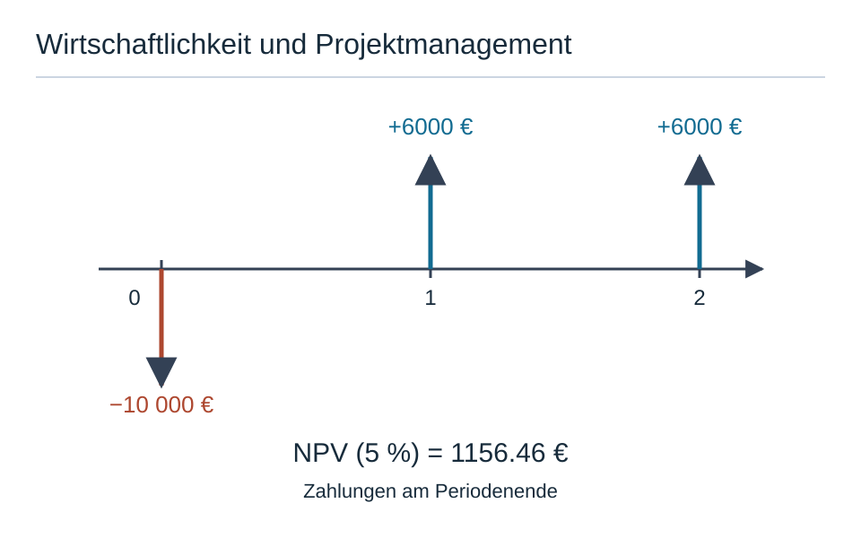

# M16-L2 – Wirtschaftlichkeit und Projektmanagement {#L2}

**Kursbereich:** M16 – Ingenieurpraxis und Forschungsprojekt

**Niveau:** Bachelor / Master

**Vorwissen:** [M16-L1 – Sicherheit, Verantwortung und Nachhaltigkeit](M16-L1.md)

**Lernziel:** Kapitalwert und einfache Terminabhängigkeiten zur Bewertung technischer Projekte nutzen.

## Einstieg {#S1}

Eine technische Variante muss nicht nur funktionieren, sondern auch unter nachvollziehbaren wirtschaftlichen und organisatorischen Annahmen umsetzbar sein.

## Grundlagen, Begriffe und Modell {#S2}

Der Kapitalwert einer Investition ist $NPV=-I_0+\sum_{t=1}^n C_t/(1+i)^t$, wobei $I_0$ die Anfangsauszahlung, $C_t$ die Nettozahlung am Periodenende und i der Kalkulationszins pro Periode ist. Positive Werte sprechen im Modell für eine Verzinsung oberhalb des Kalkulationszinses. Alternativen sind auf vergleichbare Nutzungsdauer, Restwerte und Risiken zu beziehen. Eine Sensitivitätsanalyse variiert unsichere Eingaben.

Ein Projektstrukturplan zerlegt die Arbeit in prüfbare Ergebnisse. Ein Netzplan bildet Abhängigkeiten ab: Bei parallelen Zweigen entscheidet zunächst der längste abhängige Pfad über die früheste Fertigstellung. Ressourcenbeschränkungen können das Ergebnis verändern. Meilensteine haben messbare Abnahmekriterien. Risiken erhalten Zuständigkeiten und Reaktionsmaßnahmen; Änderungen werden mit Auswirkungen auf Kosten, Termine und Anforderungen protokolliert.

*Zahlungszeitachse mit Investition, abgezinsten Rückflüssen und berechnetem Kapitalwert.*

## Durchgerechnetes Beispiel {#S3}

I₀ = 10 000 €, C₁ = C₂ = 6000 €, i = 5 %. NPV = −10000 + 6000/1,05 + 6000/1,05² ≈ 1156,46 €. Separater Netzplan: Entwurf 3 Tage, danach parallel Prüfung 4 und Beschaffung 6 Tage, anschließend Integration 2 Tage; frühestens 11 Tage.

## Selbstkontrolle {#S4}

### Aufgaben

1. Wie groß ist der Kapitalwert bei 10 %?
2. Was geschieht bei einer Verlängerung der Prüfung auf 7 Tage?

::: {.lc-solutions data-lc-section="S4"}
### Lösungen

1. −10000 + 6000/1,1 + 6000/1,1² ≈ 413,22 €.
2. Die Prüfung wird kritischer Zweig, früheste Fertigstellung nach 12 Tagen.
:::

## Annahmen und Grenzen {#S5}

Konstante Kalkulationszinssätze, vereinfachte Nettozahlungen ohne Restwert oder Steuern; keine Ressourcenengpässe im Netzplan.

## Zusammenfassung und Übergang {#S6}

Wirtschaftlichkeit und Terminplanung sind Modelle mit prüfbaren Annahmen, keine garantierten Prognosen.

**Weiterlesen:** [M16-L3 – Versuchsplanung, Daten und Reproduzierbarkeit](M16-L3.md)

## Quellen {#S7}

- [Cornell processdesign – Engineering economic analysis](https://design.cbe.cornell.edu/index.php?title=Engineering_economic_analysis) · Time Value of Money and Net Present Value sections · Zuletzt abgerufen: 2026-11-25
- [NASA Systems Engineering Handbook – Product Realization](https://www.nasa.gov/reference/5-0-product-realization/) · Sections 5.3–5.4: verification and validation · Zuletzt abgerufen: 2026-11-25

