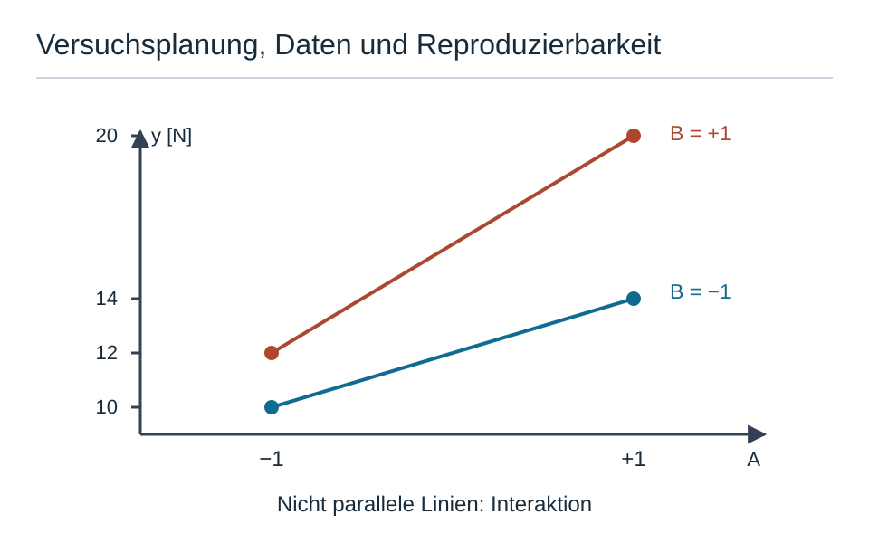

# M16-L3 – Versuchsplanung, Daten und Reproduzierbarkeit {#L3}

**Kursbereich:** M16 – Ingenieurpraxis und Forschungsprojekt

**Niveau:** Bachelor / Master

**Vorwissen:** [M16-L2 – Wirtschaftlichkeit und Projektmanagement](M16-L2.md)

**Lernziel:** Faktorielle Versuche planen, Haupteffekte und Wechselwirkung berechnen und Rohdaten sichern.

## Einstieg {#S1}

Wer immer nur einen Parameter ändert, kann übersehen, dass die Wirkung eines Parameters vom anderen abhängt.

## Grundlagen, Begriffe und Modell {#S2}

Ein vollständiger Versuchsplan mit k Faktoren auf je zwei Stufen besitzt $2^k$ Kombinationen. Faktoren werden als −1 und +1 codiert; die Antwortgröße muss mit Einheit und Messverfahren festgelegt werden. Für zwei Faktoren A und B lautet ein Modell $y=\beta_0+\beta_A x_A+\beta_B x_B+\beta_{AB}x_Ax_B$. In einem ausgeglichenen Plan ist jeder Haupteffekt die Differenz der Mittelwerte zwischen hoher und niedriger Faktorstufe; der zugehörige Koeffizient ist die Hälfte dieses Effekts. Der Interaktionseffekt entspricht der Differenz der Mittelwerte für positives und negatives Produkt $x_Ax_B$. Zufällige Versuchsreihenfolge reduziert Verwechslung mit zeitlichen Trends. Wiederholungen liefern eine Schätzung der Streuung; bei Störgrößen können Blöcke helfen. Dokumentiere Messgeräte, Kalibrierung, unveränderte Rohdaten, Auswertungscode und Versionsstand.

*Zweifaktorieller Versuchsplan mit vier Kombinationen und Interaktionsdiagramm.*

## Durchgerechnetes Beispiel {#S3}

Fiktive Antwort in N: (−,−) 10; (+,−) 14; (−,+) 12; (+,+) 20. Gesamtmittel 14 N; A-Effekt = (14+20)/2 − (10+12)/2 = 6 N; B-Effekt = 4 N; AB-Effekt = (10+20)/2 − (14+12)/2 = 2 N. β₀ = 14, β_A = 3, β_B = 2, β_AB = 1, jeweils in N.

## Selbstkontrolle {#S4}

### Aufgaben

1. Wie viele Versuche benötigt ein vollständiger Plan mit drei Faktoren und zwei Wiederholungen je Kombination?
2. Kann aus den vier unreplizierten Werten die reine Messstreuung geschätzt werden?

::: {.lc-solutions data-lc-section="S4"}
### Lösungen

1. 2³·2 = 16.
2. Nein. Das vollständige Modell hat vier Parameter für vier Werte und keine Restfreiheitsgrade.
:::

## Annahmen und Grenzen {#S5}

Keine Signifikanzbehauptung ohne geeignetes Fehlermodell und Wiederholungen. Zwei Stufen zeigen keine Krümmung.

## Zusammenfassung und Übergang {#S6}

Ein guter Versuchsplan trennt Effekte, Interaktionen und Unsicherheit und hält die Auswertung reproduzierbar.

**Weiterlesen:** [M16-L4 – Bachelorprojekt: mechanisches System](M16-L4.md)

## Quellen {#S7}

- [NIST/SEMATECH – Full factorial designs](https://www.itl.nist.gov/div898/handbook/pri/section3/pri333.htm) · 5.3.3.3: full factorial design and run count · Zuletzt abgerufen: 2026-11-25
- [NIST TN 1297 – Appendix A: Law of Propagation of Uncertainty](https://www.nist.gov/pml/nist-technical-note-1297/nist-tn-1297-appendix-law-propagation-uncertainty) · A.3: first-order Taylor approximation, sensitivities and covariance · Zuletzt abgerufen: 2026-11-25
- [MIT CEE Communication Lab – Research Paper and Presentation](https://mitcommlab.mit.edu/cee/commkit/research-paper-and-presentation/) · Methods, results, discussion and limitations · Zuletzt abgerufen: 2026-11-25

