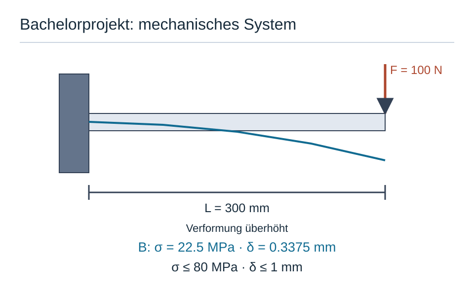

# M16-L4 – Bachelorprojekt: mechanisches System {#L4}

**Kursbereich:** M16 – Ingenieurpraxis und Forschungsprojekt

**Niveau:** Bachelor

**Vorwissen:** [M16-L3 – Versuchsplanung, Daten und Reproduzierbarkeit](M16-L3.md)

**Lernziel:** Ein mechanisches Bachelorprojekt von der Anforderung bis zum dokumentierten Konzeptnachweis bearbeiten.

## Einstieg {#S1}

Das Projekt führt Statik, Werkstoffwahl, CAD und Prüfung zusammen. Als rein rechnerisches Lernobjekt dient ein einfacher Kragträger.

## Grundlagen, Begriffe und Modell {#S2}

Auftrag: Entwickle ein Konzept für einen Lehrträger, der unter einer gedachten Endlast von 100 N bei 300 mm freier Länge höchstens 1 mm ausweicht und höchstens 80 MPa nominale Biegespannung erreicht. Vergleiche mindestens zwei rechteckige Querschnitte bei angenommenem Elastizitätsmodul E = 200 GPa. Für Breite b und Höhe h gilt $I=bh^3/12$, $\sigma=FLh/(2I)$ und $\delta=FL^3/(3EI)$. Erstelle eine Anforderungstabelle, Freikörperskizze, Variantenmatrix und parametrische Zeichnung. Prüfe beide Kriterien getrennt; begründe Materialannahme und Lastfall.

Abgabe: Rechenblatt mit Einheiten, CAD-Modell mit Maßbezügen, Vergleichstabelle, Risiko- und Annahmenliste sowie Plan für eine ungefährliche, betreute Modellprüfung. Ohne geeignete Einrichtungen bleibt die Prüfung virtuell; erfinde keine Messwerte. Bewertungsraster: Anforderungen 20 %, Modell und Rechnung 30 %, Variantenentscheidung 20 %, Nachweisplanung 20 %, Dokumentation 10 %.

*Kragträger mit Prüflast und zwei rechnerischen Akzeptanzkriterien.*

## Durchgerechnetes Beispiel {#S3}

Variante A: b = 20 mm, h = 10 mm, I ≈ 1666,67 mm⁴, σ = 90 MPa, δ = 2,7 mm: beide Kriterien verfehlt. Variante B: b = 20 mm, h = 20 mm, I ≈ 13333,33 mm⁴, σ = 22,5 MPa, δ = 0,3375 mm: rechnerisch beide erfüllt.

## Selbstkontrolle {#S4}

### Aufgaben

1. Wie ändern sich Spannung und Durchbiegung bei Verdopplung der Last?
2. Welche zusätzlichen Nachweise wären für ein reales Bauteil notwendig?

::: {.lc-solutions data-lc-section="S4"}
### Lösungen

1. Im linearen Modell verdoppeln sich beide; B hätte 45 MPa und 0,675 mm.
2. Unter anderem reale Materialdaten, Befestigungsnachweis, Lastkollektiv, Toleranzen, Versagensarten und geeignete Prüfungen.
:::

## Annahmen und Grenzen {#S5}

Ideale Einspannung, linear elastischer Balken, statische Last; keine Bauanleitung oder Freigabe tragender Bauteile.

## Zusammenfassung und Übergang {#S6}

Ein Projekt ist abgeschlossen, wenn die festgelegten Lernanforderungen nachvollziehbar bearbeitet und die Grenzen dokumentiert sind.

**Weiterlesen:** [M16-L5 – Masterprojekt: Simulation und Validierung](M16-L5.md)

## Quellen {#S7}

- [MIT OCW – D-Lab II: Design Packet](https://ocw.mit.edu/courses/ec-720j-d-lab-ii-design-spring-2010/pages/projects/intro/) · Design stages and documentation · Zuletzt abgerufen: 2026-11-25
- [OpenStax – University Physics Volume 1, 12.3 Stress, Strain, and Elastic Modulus](https://openstax.org/books/university-physics-volume-1/pages/12-3-stress-strain-and-elastic-modulus) · §12.3: stress, strain, elastic modulus · Zuletzt abgerufen: 2026-11-25
- [MIT OCW – Mechanics & Materials I: Lecture Notes](https://ocw.mit.edu/courses/2-001-mechanics-materials-i-fall-2006/pages/lecture-notes/) · Lecture index, parts 1–8; individual PDFs pending · Zuletzt abgerufen: 2026-11-25
- [NASA Systems Engineering Handbook – Product Realization](https://www.nasa.gov/reference/5-0-product-realization/) · Sections 5.3–5.4: verification and validation · Zuletzt abgerufen: 2026-11-25

