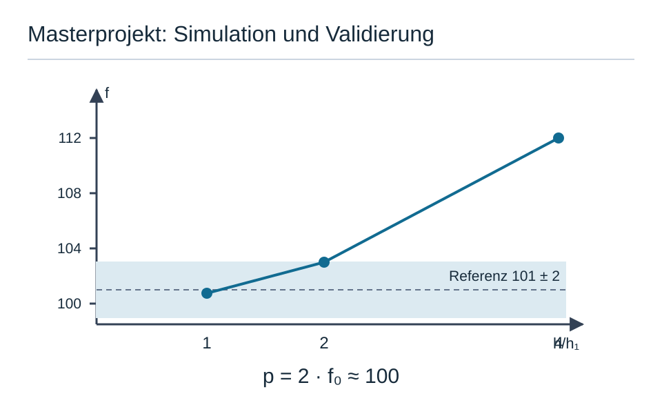

# M16-L5 – Masterprojekt: Simulation und Validierung {#L5}

**Kursbereich:** M16 – Ingenieurpraxis und Forschungsprojekt

**Niveau:** Master

**Vorwissen:** [M16-L4 – Bachelorprojekt: mechanisches System](M16-L4.md)

**Lernziel:** Ein Masterprojekt mit Verifikation, Unsicherheitsanalyse und unabhängiger Validierung planen und auswerten.

## Einstieg {#S1}

Das Projekt untersucht, ob ein numerisches Modell der Wärmeleitung für einen vorab definierten Anwendungsbereich aussagekräftig ist.

## Grundlagen, Begriffe und Modell {#S2}

Auftrag: Modellierung einer stationären eindimensionalen Wärmeleitung in einer homogenen Platte mit vorgegebenen Randtemperaturen. Verwende zunächst die analytische Lösung als Verifikationsfall und danach einen separaten, geeigneten Referenzdatensatz für eine Validierungsstudie. Bei konstantem k, ohne Quellen und mit Länge L gilt $T(x)=T_0+(T_L-T_0)x/L$ sowie $q''=-k(T_L-T_0)/L$. Prüfe Energieerhaltung, Einheiten und Implementierung. Untersuche bei einem zusätzlichen Fall mit gekrümmtem Temperaturprofil, etwa durch räumlich konstante volumetrische Wärmeerzeugung bei konstantem k und vorgegebenen Randtemperaturen, mindestens drei Gitter mit konstantem Verfeinerungsverhältnis r. Für monotone asymptotische Konvergenz mit nicht verschwindenden, bei Verfeinerung betragsmäßig abnehmenden Differenzen kann $p=\ln|(f_3-f_2)/(f_2-f_1)|/\ln r$ mit f₁ fein, f₂ mittel, f₃ grob geschätzt werden. Numerische Konvergenz allein validiert kein physikalisches Modell.

Lege vor dem Vergleich eine Zielgröße, einen zulässigen Fehler und die Unsicherheiten von Messung und Modell fest. Kalibrierungs- und Validierungsdaten müssen getrennt bleiben. Abgabe: reproduzierbares Skript, Parameterdatei, Gitterstudie, Referenzdaten mit Herkunft, Residuen, Unsicherheitsbudget und Diskussion. Bewertungsraster: Fragestellung 15 %, Verifikation 25 %, Validierung 25 %, Unsicherheit 20 %, Reproduzierbarkeit 15 %.

*Gitterkonvergenz und unabhängiger Vergleich zwischen Modell und Referenzwert.*

## Durchgerechnetes Beispiel {#S3}

Analytisch: k = 10 W/(m K), L = 0,1 m, T₀ = 350 K, T_L = 300 K; q″ = 5000 W/m², T(0,05 m) = 325 K. Separates fiktives Konvergenzbeispiel: f₃ = 112, f₂ = 103, f₁ = 100,75 (gleiche Einheit), r = 2; p = ln(9/2,25)/ln 2 = 2. Richardson-Schätzwert f₀ ≈ 100. Fiktiver unabhängiger Referenzwert 101 ± 2: Abweichung von f₀ = −1; dies allein genügt nicht für eine allgemeine Validierung.

## Selbstkontrolle {#S4}

### Aufgaben

1. Wie groß ist die analytische Wärmeflussdichte bei doppelter Plattendicke?
2. Warum ist ein zum Kalibrieren verwendeter Datensatz kein unabhängiger Validierungsdatensatz?

::: {.lc-solutions data-lc-section="S4"}
### Lösungen

1. 2500 W/m² bei unveränderten übrigen Größen.
2. Die Modellparameter wurden an diese Daten angepasst; der Vergleich kann daher die Vorhersagefähigkeit überschätzen.
:::

## Annahmen und Grenzen {#S5}

Alle Beispielwerte sind synthetisch; es wurde kein realer Versuch durchgeführt. Konvergenzformel nur im geeigneten asymptotischen Bereich anwenden.

## Zusammenfassung und Übergang {#S6}

Verifikation untersucht die Lösung des gewählten Modells, Validierung dessen Eignung für den beabsichtigten Einsatz.

**Weiterlesen:** [M16-L6 – Wissenschaftliches Schreiben und Abschlussarbeit](M16-L6.md)

## Quellen {#S7}

- [NASA Glenn / NPARC – Conducting and Reporting a CFD Analysis](https://www.grc.nasa.gov/www/wind/TFAWS2007/Conducting-Reporting.pdf) · Folien Verification Assessment, Grid Convergence Study und Order of Convergence (20–24): Verifikation, Konvergenzordnung und Richardson-Extrapolation · Zuletzt abgerufen: 2026-11-25 · Inhaltlich geprüft: 2026-11-25
- [NASA Systems Engineering Handbook – Product Realization](https://www.nasa.gov/reference/5-0-product-realization/) · Sections 5.3–5.4: verification and validation · Zuletzt abgerufen: 2026-11-25
- [NIST TN 1297 – Appendix A: Law of Propagation of Uncertainty](https://www.nist.gov/pml/nist-technical-note-1297/nist-tn-1297-appendix-law-propagation-uncertainty) · A.3: first-order Taylor approximation, sensitivities and covariance · Zuletzt abgerufen: 2026-11-25

