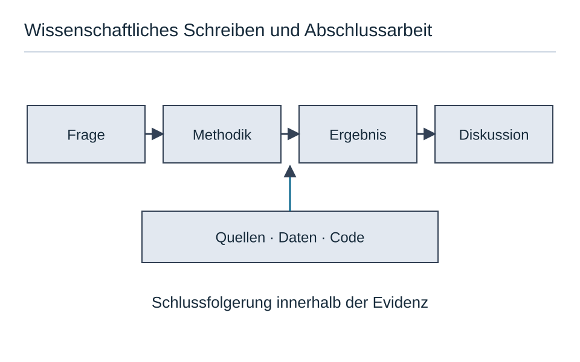

# M16-L6 – Wissenschaftliches Schreiben und Abschlussarbeit {#L6}

**Kursbereich:** M16 – Ingenieurpraxis und Forschungsprojekt

**Niveau:** Bachelor / Master

**Vorwissen:** [M16-L5 – Masterprojekt: Simulation und Validierung](M16-L5.md)

**Lernziel:** Eine wissenschaftliche Arbeit mit transparentem Erkenntnisweg, Quellen und nachvollziehbaren Grenzen strukturieren.

## Einstieg {#S1}

Eine Abschlussarbeit ist kein Tätigkeitsprotokoll, sondern ein begründeter Beitrag zu einer klaren Forschungsfrage.

## Grundlagen, Begriffe und Modell {#S2}

Formuliere eine überprüfbare Frage, grenze den Gegenstand ab und unterscheide bestehendes Wissen von eigener Leistung. Die Einleitung begründet die Frage, der Stand der Forschung ordnet die Quellen ein, die Methodik erläutert Versuchs- oder Modellwahl und Auswertung, der Ergebnisteil berichtet Befunde und die Diskussion prüft ihre Bedeutung, Unsicherheiten und alternative Erklärungen. Die Schlussfolgerung beantwortet die Frage nur innerhalb der belegten Grenzen. Zitiere tatsächlich konsultierte Quellen mit Fundstelle und trenne Paraphrasen von wörtlichen Zitaten. Kennzeichne synthetische Daten und Hilfsmittel; lege Daten, Code, Parameter und Versionsstände soweit zulässig ab.

Für einen Vergleich von Modellwert $y_m$ und Referenzwert $y_r$ kann $e=y_m-y_r$ und bei $y_r\ne0$ der relative Fehler $e/y_r$ angegeben werden. Ein einzelner Fehlerwert ohne Messunsicherheit, Versuchsbedingungen und Stichprobenumfang erlaubt keine allgemeine Aussage über Genauigkeit. Erstelle eine Nachweismatrix mit Aussage, Quelle oder Datensatz, Auswerteschritt und Grenze. Abschlussaufgabe: Verfasse einen Kurzbericht zum Bachelor- oder Masterprojekt mit Abstract, Fragestellung, Methodik, Resultaten, Diskussion, Quellen und Reproduktionsanhang.

*Nachweiskette von Forschungsfrage über Daten und Auswertung zur begrenzten Schlussfolgerung.*

## Durchgerechnetes Beispiel {#S3}

Fiktiver Prüfpunkt: Modellwert 10,2 mm, Referenz 10,0 mm; e = 0,2 mm, relativer Fehler = 2 %. Zulässige Aussage: Das Modell überschätzt diesen Referenzwert um 0,2 mm unter den angegebenen Bedingungen. Nicht belegt: Das Modell ist generell auf 2 % genau.

## Selbstkontrolle {#S4}

### Aufgaben

1. Wie groß ist der relative Fehler bei Modellwert 9,5 mm und Referenz 10 mm?
2. Wo gehören alternative Erklärungen und Modellgrenzen in die Arbeit?

::: {.lc-solutions data-lc-section="S4"}
### Lösungen

1. −5 %; das Modell unterschätzt den Referenzwert.
2. Vor allem in die Diskussion, mit den für das Verständnis erforderlichen Annahmen bereits in der Methodik.
:::

## Annahmen und Grenzen {#S5}

Keine institutionelle Prüfungsordnung oder echte Abschlussarbeit; formale Anforderungen und Regeln zur Hilfsmittelnutzung sind jeweils separat zu prüfen.

## Zusammenfassung und Übergang {#S6}

Wissenschaftliche Qualität beruht auf nachvollziehbaren Methoden, überprüfbaren Aussagen und offenen Grenzen.

Der geplante Lernweg endet hier. Wiederhole die Selbstkontrollen und dokumentiere dein Abschlussprojekt.

## Quellen {#S7}

- [MIT CEE Communication Lab – Research Paper and Presentation](https://mitcommlab.mit.edu/cee/commkit/research-paper-and-presentation/) · Methods, results, discussion and limitations · Zuletzt abgerufen: 2026-11-25
- [NIST TN 1297 – Appendix A: Law of Propagation of Uncertainty](https://www.nist.gov/pml/nist-technical-note-1297/nist-tn-1297-appendix-law-propagation-uncertainty) · A.3: first-order Taylor approximation, sensitivities and covariance · Zuletzt abgerufen: 2026-11-25
- [NASA Systems Engineering Handbook – Product Realization](https://www.nasa.gov/reference/5-0-product-realization/) · Sections 5.3–5.4: verification and validation · Zuletzt abgerufen: 2026-11-25

