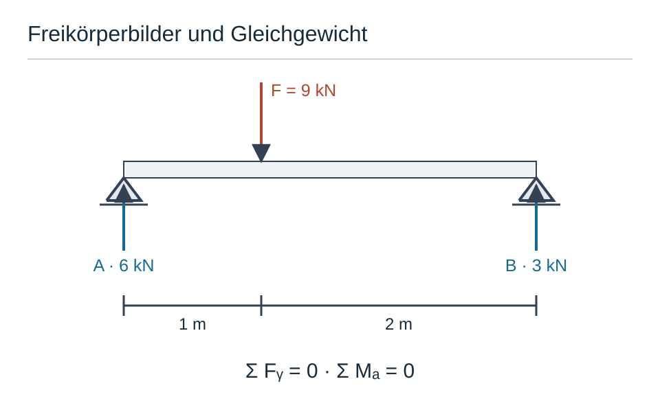

# M2-L1 – Freikörperbilder und Gleichgewicht {#L1}

**Kursbereich:** M2 – Statik und Festigkeitslehre

**Niveau:** Bachelor

**Vorwissen:** [M1-L1 – Einheiten, Skalierung und Dimensionsanalyse](M1-L1.md)

**Lernziel:** Freikörperbild zeichnen und die drei ebenen Gleichgewichtsbedingungen anwenden.

## Einstieg {#S1}

Eine Maschine steht auf einem Träger. Bevor die Festigkeit des Trägers bewertet werden kann, muss bekannt sein, welche Kräfte in die Lager eingeleitet werden.

## Grundlagen, Begriffe und Modell {#S2}

Ein Freikörperbild isoliert den betrachteten Körper gedanklich. Entfernte Verbindungen werden durch ihre Kraft- und gegebenenfalls Momentenwirkungen ersetzt. Eingeprägte Lasten, Eigengewicht und Kontaktreaktionen sind äußere Kräfte; innere Kräfte werden erst bei einem Schnitt sichtbar. Ein ebenes ideales Festlager überträgt zwei Kraftkomponenten, ein reibungsfreies Loslager eine Reaktion normal zur Auflage. Eine Einspannung kann zusätzlich ein Moment übertragen.

Für einen ruhenden starren Körper im Inertialsystem gelten in der Ebene

$$
\sum F_x=0,\quad \sum F_y=0,\quad \sum M_O=0.
$$

Der Bezugspunkt $O$ für Momente ist frei wählbar; eine geschickte Wahl durch den Angriffspunkt einer unbekannten Kraft vereinfacht die Gleichung. Positive Momente seien hier gegen den Uhrzeigersinn gerichtet. Ein zunächst negativ berechneter Reaktionswert bedeutet, dass die wahre Richtung der angenommenen Pfeilrichtung entgegengesetzt ist. Bei einem einseitigen Kontakt muss anschließend geprüft werden, ob eine solche Reaktion physikalisch möglich ist.

*Freigeschnittener Balken mit Einzellast 9 kN und vertikalen Lagerreaktionen 6 und 3 kN.*

## Durchgerechnetes Beispiel {#S3}

Ein Balken der Länge 3 m ist bei A links gelenkig und bei B rechts rollengelagert. Eine vertikale Einzellast $F=9\,\mathrm{kN}$ wirkt 1 m rechts von A; das Eigengewicht wird vernachlässigt. Es gibt keine horizontale Last, daher $A_x=0$. Moment um A:

$$
3\,\mathrm m\cdot B_y-1\,\mathrm m\cdot9\,\mathrm{kN}=0.
$$

Somit $B_y=3\,\mathrm{kN}$, aus der Vertikalbilanz $A_y=9-3=6\,\mathrm{kN}$. Kontrolle um B: $-3\cdot6+2\cdot9=0\,\mathrm{kN\,m}$. Die größere Reaktion tritt beim näheren Lager auf.

## Selbstkontrolle {#S4}

### Aufgaben

1. Verschiebe die 9-kN-Last zur Balkenmitte. Welche vertikalen Reaktionen entstehen?
2. Kann ein frei aufliegendes ideales Loslager eine Zugkraft normal zur Auflage übertragen?

::: {.lc-solutions data-lc-section="S4"}
### Lösungen

1. Je 4,5 kN wegen Symmetrie und Vertikalgleichgewicht.
2. Nein; ohne geeignete Sicherung kann der Kontakt abheben.
:::

## Annahmen und Grenzen {#S5}

Gleichgewicht ist keine Garantie für Tragfähigkeit oder Stabilität. Das Modell ignoriert Lagersteifigkeit, Reibung und Verformung. Für reale Lastfälle sind Eigengewicht, dynamische Kräfte, zulässige Kontaktbedingungen und Sicherheitsnachweise zu berücksichtigen.

## Zusammenfassung und Übergang {#S6}

Kräfte und Momente am Gesamtsystem bestimmen die Lagerreaktionen; als Nächstes werden einzelne Stäbe untersucht.

**Weiterlesen:** [M2-L2 – Lagerreaktionen und Fachwerke](M2-L2.md)

## Quellen {#S7}

- [OpenStax – University Physics Volume 1, 12.1 Conditions for Static Equilibrium](https://openstax.org/books/university-physics-volume-1/pages/12-1-conditions-for-static-equilibrium) · Kräfte- und Momentengleichgewicht, Schwerpunkt · Zuletzt abgerufen: 2026-11-25

