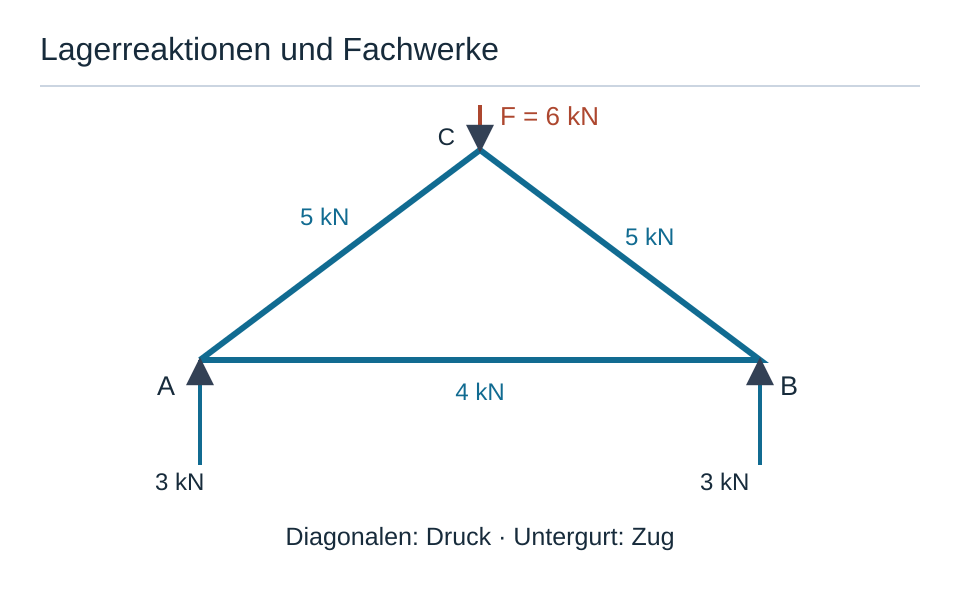

# M2-L2 – Lagerreaktionen und Fachwerke {#L2}

**Kursbereich:** M2 – Statik und Festigkeitslehre

**Niveau:** Bachelor

**Vorwissen:** [M2-L1 – Freikörperbilder und Gleichgewicht](M2-L1.md)

**Lernziel:** Knotenkräfte in einem idealen ebenen Fachwerk durch Gleichgewicht bestimmen.

## Einstieg {#S1}

Ein leichtes Maschinengestell kann als Fachwerk modelliert werden. Die Geometrie entscheidet, wie eine äußere Last auf Zug- und Druckstäbe verteilt wird.

## Grundlagen, Begriffe und Modell {#S2}

Ein ideales Fachwerk besteht aus geraden Stäben mit gelenkigen Knoten. Lasten greifen nur an Knoten an; Eigengewicht und Stabbiegung werden vernachlässigt oder gesondert abgebildet. Jeder Stab ist dann ein Zweikraftkörper: Die Endkräfte sind gleich groß, entgegengesetzt und kollinear. Zugkräfte werden positiv angesetzt, indem Kraftpfeile am freigeschnittenen Knoten vom Knoten weg weisen. Ein negatives Ergebnis bedeutet Druck.

Zuerst werden die äußeren Lagerreaktionen über das Gesamtgleichgewicht bestimmt. Anschließend kann jeder Knoten als Punkt mit $\sum F_x=\sum F_y=0$ betrachtet werden. Beginne bei einem Knoten mit höchstens zwei unabhängigen unbekannten Stabkräften. Alternativ erlaubt ein Ritterschnitt die Berechnung ausgewählter Stabkräfte mithilfe des Gleichgewichts eines abgetrennten Teils. Für ein einfaches ebenes Fachwerk ist $m+r=2j$ eine notwendige Zählbedingung statischer Bestimmtheit (Stäbe $m$, Reaktionskomponenten $r$, Knoten $j$), aber nicht hinreichend: Die Geometrie kann trotzdem instabil sein.

*Symmetrisches Dreieckfachwerk mit Druckdiagonalen, Zuguntergurt und vertikaler Spitzenlast.*

## Durchgerechnetes Beispiel {#S3}

Dreieckfachwerk mit $A=(0,0)$, $B=(8,0)$ und $C=(4,3)$ in Metern. A ist Festlager, B Loslager. Eine Last 6 kN wirkt senkrecht nach unten in C. Aus Symmetrie und Gleichgewicht folgen $A_y=B_y=3\,\mathrm{kN}$ und $A_x=0$. Die Diagonalen sind je 5 m lang, also $\sin\theta=3/5$, $\cos\theta=4/5$.

Am Knoten C sind beide Diagonalzugkräfte $N$ aus Symmetrie gleich. Angenommene Zugrichtungen zeigen nach unten zu A und B:

$$
-2N\cdot3/5-6\,\mathrm{kN}=0.
$$

Damit $N=-5\,\mathrm{kN}$, beide Diagonalen stehen unter Druck. Am Knoten A liefert horizontales Gleichgewicht $N_{AB}+(-5)\cdot4/5=0$, somit $N_{AB}=4\,\mathrm{kN}$ Zug. Vertikal gilt $3-5\cdot3/5=0$.

## Selbstkontrolle {#S4}

### Aufgaben

1. Wie verändern sich die Stabkräfte, wenn die Spitzenlast bei gleicher Geometrie verdoppelt wird?
2. Warum ist ein sehr flaches Dreieck bei gleicher Spitzenlast ungünstig?

::: {.lc-solutions data-lc-section="S4"}
### Lösungen

1. Diagonalen je 10 kN Druck, Untergurt 8 kN Zug, Lager je 6 kN.
2. Bei kleinem sin θ muss der Betrag der Diagonalkraft wachsen, damit ihre Vertikalkomponente dieselbe Last trägt.
:::

## Annahmen und Grenzen {#S5}

Knoten sind real häufig teilsteif, Kräfte können exzentrisch angreifen, und Druckstäbe können knicken. Der Fachwerkansatz ist deshalb ein Lastmodell, kein abschließender Festigkeitsnachweis.

## Zusammenfassung und Übergang {#S6}

Der Knotenschnitt liefert Normalkräfte; bei Balken mit Biegelasten werden zusätzliche innere Schnittgrößen benötigt.

**Weiterlesen:** [M2-L3 – Schnittgrößen und Querkraft](M2-L3.md)

## Quellen {#S7}

- [Engineering Statics – Method of Joints](https://engineeringstatics.org/method-of-joints.html) · Method of joints; planar truss equilibrium · Zuletzt abgerufen: 2026-11-25
- [OpenStax – University Physics Volume 1, 12.1 Conditions for Static Equilibrium](https://openstax.org/books/university-physics-volume-1/pages/12-1-conditions-for-static-equilibrium) · Kräfte- und Momentengleichgewicht, Schwerpunkt · Zuletzt abgerufen: 2026-11-25

