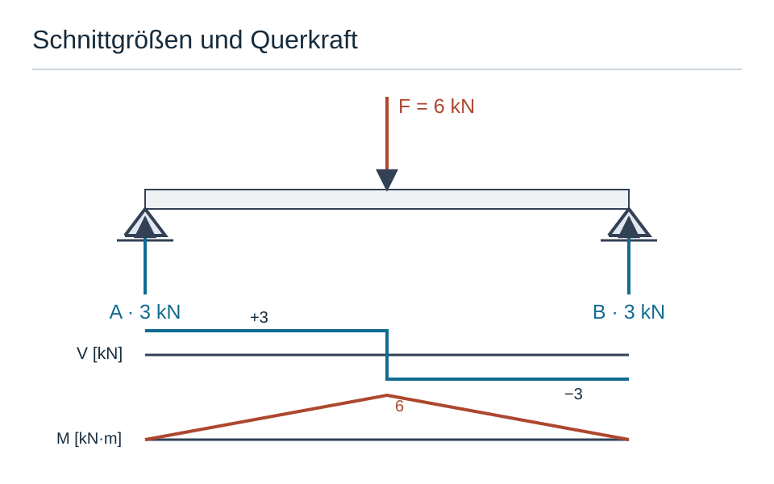

# M2-L3 – Schnittgrößen und Querkraft {#L3}

**Kursbereich:** M2 – Statik und Festigkeitslehre

**Niveau:** Bachelor

**Vorwissen:** [M2-L2 – Lagerreaktionen und Fachwerke](M2-L2.md)

**Lernziel:** Querkraft- und Momentenverläufe aus einem Schnittgleichgewicht bestimmen.

## Einstieg {#S1}

Ein Träger kann an jeder Stelle ein anderes Biegemoment besitzen. Die Suche nach der maximal beanspruchten Stelle erfordert den inneren Lastverlauf, nicht nur die Lagerreaktionen.

## Grundlagen, Begriffe und Modell {#S2}

Ein Schnitt senkrecht zur Balkenachse legt die resultierenden inneren Kräfte und Momente frei. Im ebenen Modell sind dies Normalkraft $N$, Querkraft $V$ und Biegemoment $M$. Für das linke Balkenteil sei positives $V$ an der rechten Schnittfläche nach unten gerichtet und positives $M$ gegen den Uhrzeigersinn (sagende Biegung). Eine nach unten positive Streckenlast $q(x)$ führt bei dieser Konvention in glatten Bereichen zu

$$
\frac{\mathrm dV}{\mathrm dx}=-q(x),\qquad \frac{\mathrm dM}{\mathrm dx}=V(x).
$$

Eine Einzellast erzeugt einen Sprung im Querkraftverlauf, aber ohne zusätzliches Einzelmoment bleibt der Momentenverlauf stetig. Unter gleichmäßig verteilter Last ist $V$ linear und $M$ quadratisch. Bei einer unbelasteten Teilstrecke bleibt $V$ konstant und $M$ linear. Ein lokales Momentenextremum liegt häufig bei $V=0$ oder einem Vorzeichenwechsel an einer Einzellast; Randwerte sind ebenso zu prüfen.

*Einfach gelagerter Balken mit mittiger Einzellast, stufenförmiger Querkraft und dreieckigem Momentenverlauf.*

## Durchgerechnetes Beispiel {#S3}

Ein Balken der Länge 4 m ist an beiden Enden gelenkig bzw. rollend gelagert und mittig mit 6 kN nach unten belastet. Die vertikalen Reaktionen betragen je 3 kN. Für $0<x<2\,\mathrm m$ gilt $V=3\,\mathrm{kN}$ und $M=3\,\mathrm{kN}\cdot x$. Für $2<x<4\,\mathrm m$ gilt $V=-3\,\mathrm{kN}$ und

$$
M=3\,\mathrm{kN}\cdot x-6\,\mathrm{kN}\cdot(x-2\,\mathrm m).
$$

Bei $x=2\,\mathrm m$ beträgt das maximale Moment 6 kN·m. Beide Formeln liefern dort denselben Wert. An den idealen Endlagern gilt $M=0$. Bei fehlender axialer Belastung ist $N=0$.

## Selbstkontrolle {#S4}

### Aufgaben

1. Berechne M bei x=1 m und x=3 m.
2. Wie ändert sich V an der mittigen Einzellast?

::: {.lc-solutions data-lc-section="S4"}
### Lösungen

1. Je 3 kN·m.
2. Es springt von +3 kN auf −3 kN, also um −6 kN.
:::

## Annahmen und Grenzen {#S5}

Vorzeichenkonventionen sind in der Literatur nicht einheitlich. Verwende eine Konvention durchgängig und kontrolliere Randbedingungen. Das eindimensionale Balkenmodell löst örtliche Spannungsspitzen an Lasteinleitungsstellen nicht auf.

## Zusammenfassung und Übergang {#S6}

Schnittgrößen sind Eingangsdaten für die Spannungs- und Verformungsrechnung.

**Weiterlesen:** [M2-L4 – Spannung, Dehnung und Zug](M2-L4.md)

## Quellen {#S7}

- [Engineering Statics – Shear and Bending Moment Diagrams](https://engineeringstatics.org/VM_diagrams.html) · Shear and bending moment diagrams · Zuletzt abgerufen: 2026-11-25
- [University of Prince Edward Island – Engineering Mechanics: Statics](https://pressbooks.library.upei.ca/statics/) · Contents: chapters 5–6 on trusses and internal forces; detailed chapters pending · Zuletzt abgerufen: 2026-11-25

