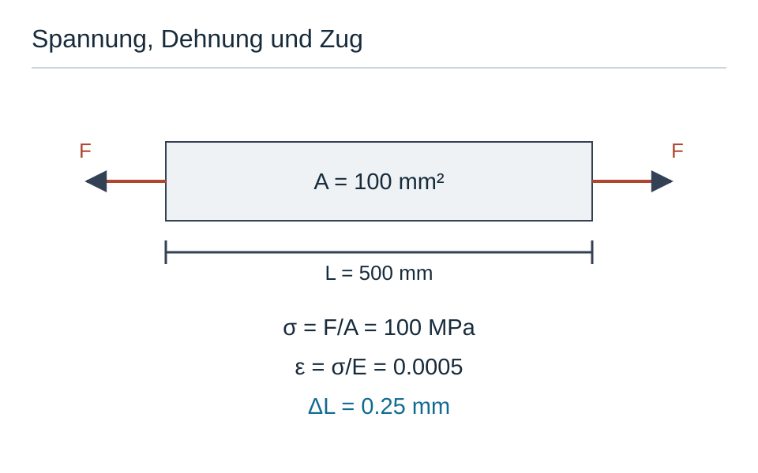

# M2-L4 – Spannung, Dehnung und Zug {#L4}

**Kursbereich:** M2 – Statik und Festigkeitslehre

**Niveau:** Bachelor

**Vorwissen:** [M2-L3 – Schnittgrößen und Querkraft](M2-L3.md)

**Lernziel:** Normale Spannung, Dehnung und elastische Längenänderung unterscheiden und berechnen.

## Einstieg {#S1}

Zwei Zugstäbe können dieselbe Kraft übertragen, aber unterschiedliche Spannungen und Verlängerungen aufweisen. Kraft allein ist kein Werkstoffkennwert.

## Grundlagen, Begriffe und Modell {#S2}

Die technische Normalspannung eines gleichmäßig axial beanspruchten Stabs ist $\sigma=N/A_0$ mit Anfangsquerschnitt $A_0$. Die technische Dehnung ist $\varepsilon=\Delta L/L_0$ mit Anfangslänge $L_0$. Zug ist positiv; Druck negativ. Im linear-elastischen Bereich bei einachsiger Beanspruchung und konstanten Bedingungen gilt das Hookesche Gesetz $\sigma=E\varepsilon$. Der Elastizitätsmodul $E$ ist eine Steifigkeitskenngröße in Pascal, keine Festigkeitsgrenze.

Durch Einsetzen folgt bei konstantem Querschnitt und Material

$$
\Delta L=\frac{NL_0}{EA_0},\qquad k=\frac{EA_0}{L_0}.
$$

Die Federsteifigkeit $k$ hängt zusätzlich zur Materialsteifigkeit von der Bauteilgeometrie ab. Bei abschnittsweise konstanten Eigenschaften und rein axialer Belastung werden die Abschnittsverlängerungen mit ihren Vorzeichen addiert. Seitliche Dehnung unter Zug wird bei isotrop linear-elastischem Material durch die Querkontraktionszahl $\nu$ beschrieben: $\varepsilon_y=-\nu\varepsilon_x$ für freie Querrichtung.

*Zugstab mit Kräften, Querschnittsfläche, Messlänge und berechneter Verlängerung.*

## Durchgerechnetes Beispiel {#S3}

Ein idealisierter Stab hat $A_0=100\,\mathrm{mm^2}$, $L_0=500\,\mathrm{mm}$ und den angenommenen Modul $E=200000\,\mathrm{N/mm^2}$. Eine Zugkraft von 10 kN erzeugt $\sigma=10000/100=100\,\mathrm{MPa}$. Die Dehnung ist $100/200000=0.0005$ bzw. 0.05 %. Die Verlängerung ergibt sich zu $0.0005\cdot500=0.25\,\mathrm{mm}$. Die Federsteifigkeit beträgt $200000\cdot100/500=40000\,\mathrm{N/mm}$. Kontrolle: $40000\cdot0.25=10000\,\mathrm N$.

## Selbstkontrolle {#S4}

### Aufgaben

1. Verdopple die Stablänge bei gleicher Kraft, Fläche und gleichem E. Was ändert sich?
2. Kann aus E allein die zulässige Zugkraft bestimmt werden?

::: {.lc-solutions data-lc-section="S4"}
### Lösungen

1. Spannung und Dehnung bleiben gleich; Verlängerung verdoppelt sich auf 0,5 mm; Steifigkeit halbiert sich.
2. Nein. Dazu werden unter anderem tatsächliche Festigkeitskennwerte, Querschnitt, Lastfall und Sicherheitskonzept benötigt.
:::

## Annahmen und Grenzen {#S5}

Das Modell setzt kleine Dehnungen und lineare Elastizität voraus. Es gilt nicht für plastische Verformung, lokale Kerbspannungen oder starke Temperaturänderungen. Der angenommene E-Wert ist keine verbindliche Werkstoffspezifikation.

## Zusammenfassung und Übergang {#S6}

Bei axialer Belastung wird Spannung über die Fläche bestimmt; Biegung erfordert zusätzlich die Verteilung der Fläche um die Neutralachse.

**Weiterlesen:** [M2-L5 – Biegung und Durchbiegung](M2-L5.md)

## Quellen {#S7}

- [OpenStax – University Physics Volume 1, 12.3 Stress, Strain, and Elastic Modulus](https://openstax.org/books/university-physics-volume-1/pages/12-3-stress-strain-and-elastic-modulus) · §12.3: stress, strain, elastic modulus · Zuletzt abgerufen: 2026-11-25
- [MIT OCW – Mechanics of Materials (Fall 1999)](https://ocw.mit.edu/courses/3-11-mechanics-of-materials-fall-1999/) · Course Description; Spannung/Dehnung, Fachwerk, Torsion, Biegung; weiterführende Einzeltexte offen · Zuletzt abgerufen: 2026-11-25

