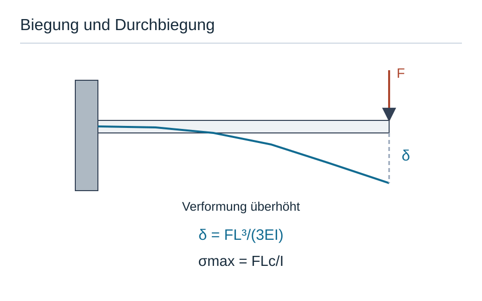

# M2-L5 – Biegung und Durchbiegung {#L5}

**Kursbereich:** M2 – Statik und Festigkeitslehre

**Niveau:** Bachelor

**Vorwissen:** [M2-L4 – Spannung, Dehnung und Zug](M2-L4.md)

**Lernziel:** Biegespannung und Durchbiegung eines schlanken linear-elastischen Balkens berechnen.

## Einstieg {#S1}

Ein auskragender Werkzeughalter kann die Belastung ohne Bruch überstehen und trotzdem zu stark nachgeben. Festigkeit und Steifigkeit müssen getrennt bewertet werden.

## Grundlagen, Begriffe und Modell {#S2}

Die Euler-Bernoulli-Balkentheorie nimmt an, dass ebene Querschnitte auch bei der Verformung eben und senkrecht zur verformten Balkenachse bleiben. Bei homogener linearer Elastizität und reinem Biegemoment verläuft die Längsdehnung linear über die Querschnittshöhe. Für einen Querschnitt mit Koordinate $y$ von der Neutralachse und Flächenträgheitsmoment $I=\int_A y^2\,\mathrm dA$ gilt bei passender Vorzeichenkonvention $\sigma_x=-My/I$. Der Betrag der maximalen Spannung ist $|M|c/I$, wobei $c$ der größte Abstand von der Neutralachse ist. Für ein Rechteck der Breite $b$ und Höhe $h$ in Biegerichtung ist $I=bh^3/12$.

Die Krümmung ist bei kleinen Neigungen proportional zu $M/(EI)$. Für einen Kragträger mit Endlast $F$ und konstantem $EI$ ergibt die Integration der Krümmung unter den Einspannbedingungen (Weg und Neigung null) die Enddurchbiegung $\delta=FL^3/(3EI)$ im Betrag. Das maximale Moment $FL$ tritt an der Einspannung auf. Die dritte Potenz der Höhe im Flächenträgheitsmoment erklärt, warum eine geänderte Querschnittsorientierung die Biegesteifigkeit stark beeinflusst.

*Einseitig eingespannter Balken mit Endlast und überhöht gezeichneter Durchbiegung.*

## Durchgerechnetes Beispiel {#S3}

Gegeben sei ein idealer Kragträger mit $L=300\,\mathrm{mm}$, $b=20\,\mathrm{mm}$, $h=40\,\mathrm{mm}$, $E=200000\,\mathrm{N/mm^2}$ und Endlast $F=200\,\mathrm N$.

- $I=20\cdot40^3/12=106666.67\,\mathrm{mm^4}$.
- $M_\mathrm{max}=200\cdot300=60000\,\mathrm{N\,mm}$.
- $|\sigma_\mathrm{max}|=60000\cdot20/106666.67=11.25\,\mathrm{MPa}$.
- $\delta=200\cdot300^3/(3\cdot200000\cdot106666.67)\approx0.084375\,\mathrm{mm}$.

Die geringe Durchbiegung gegenüber der Länge ist mit der Kleindeformationsannahme vereinbar, ersetzt aber keine Prüfung des gesamten Modells.

## Selbstkontrolle {#S4}

### Aufgaben

1. Wie ändert sich die Enddurchbiegung bei doppelter Länge und sonst gleichen Größen?
2. Was passiert mit I, wenn Breite und Höhe vertauscht werden (von 20 × 40 mm auf 40 × 20 mm)?

::: {.lc-solutions data-lc-section="S4"}
### Lösungen

1. Sie wächst um den Faktor acht. Die maximale Biegespannung verdoppelt sich.
2. Der neue Wert 40·20³/12 = 26666,67 mm⁴ ist ein Viertel des ursprünglichen Werts; die Durchbiegung vervierfacht sich.
:::

## Annahmen und Grenzen {#S5}

Kurze oder tiefe Balken können nennenswerte Schubverformung aufweisen. Reale Einspannungen sind nicht perfekt starr; Kerben, Lastkontakt und Ermüdung benötigen getrennte Modelle. Zahlenwerte sind hypothetisch. Die Detailprüfung der verlinkten Vorlesungsunterlagen ist offen.

## Zusammenfassung und Übergang {#S6}

Biegung koppelt Moment und Krümmung; Torsion koppelt Drehmoment und Verdrehung.

**Weiterlesen:** [M2-L6 – Torsion und kombinierte Beanspruchung](M2-L6.md)

## Quellen {#S7}

- [MIT OCW – Mechanics & Materials I: Lecture Notes](https://ocw.mit.edu/courses/2-001-mechanics-materials-i-fall-2006/pages/lecture-notes/) · Lecture index, parts 1–8; individual PDFs pending · Zuletzt abgerufen: 2026-11-25
- [MIT OCW – Unified Engineering: Materials and Structures: Lecture Notes](https://ocw.mit.edu/courses/16-001-unified-engineering-materials-and-structures-fall-2021/pages/lecture-notes/) · Lecture index: beam theory, torsion, buckling; individual files pending · Zuletzt abgerufen: 2026-11-25

