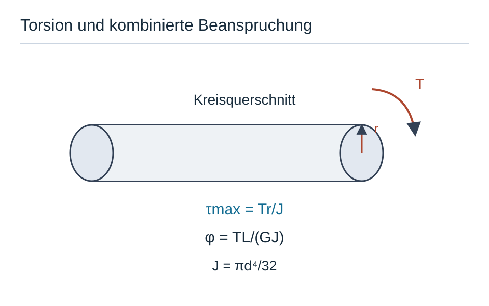

# M2-L6 – Torsion und kombinierte Beanspruchung {#L6}

**Kursbereich:** M2 – Statik und Festigkeitslehre

**Niveau:** Bachelor

**Vorwissen:** [M2-L5 – Biegung und Durchbiegung](M2-L5.md)

**Lernziel:** Schubspannung und Verdrehung einer Kreiswelle ermitteln sowie eine kombinierte Beanspruchung einordnen.

## Einstieg {#S1}

Eine Antriebswelle überträgt Drehmoment zwischen Motor und Getriebe. Neben der Torsion kann sie durch Zahnrad- und Lagerkräfte gebogen werden.

## Grundlagen, Begriffe und Modell {#S2}

Für eine gerade homogene, isotrope, linear-elastische Kreiswelle gilt unter Saint-Venant-Torsion $\gamma(r)=r\varphi/L$. Mit Schubmodul $G$ und $\tau=G\gamma$ ergibt die Momentenbilanz $T=\int_A \tau r\,\mathrm dA=G\varphi J/L$. Dabei bezeichnet $J=\int_A r^2\,\mathrm dA$ das polare Flächenträgheitsmoment. Damit

$$
\tau(r)=\frac{Tr}{J},\qquad \varphi=\frac{TL}{GJ}.
$$

Für einen Vollkreis mit Durchmesser $d$ ist $J=\pi d^4/32$, für ein kreisförmiges Rohr $J=\pi(d_o^4-d_i^4)/32$. Bei isotrop linear-elastischem Material gilt $G=E/[2(1+\nu)]$. Im allgemeinen nichtkreisförmigen Querschnitt tritt Verwölbung auf; das polare Flächenträgheitsmoment ist dann nicht ohne Weiteres die Torsionskonstante.

Für einen punktweise überlagerten Spannungszustand aus Längsnormalspannung $\sigma$ und Schubspannung $\tau$ ergibt die von-Mises-Vergleichsspannung $\sigma_v=\sqrt{\sigma^2+3\tau^2}$. Sie wird bei geeigneten duktilen, isotropen Werkstoffen als Kriterium für den Beginn plastischen Fließens genutzt, nicht als universelles Bruch- oder Ermüdungskriterium.

*Kreiswelle mit Drehmoment, Radius, maximaler Schubspannung und Verdrehwinkel.*

## Durchgerechnetes Beispiel {#S3}

Eine idealisierte Vollwelle hat $d=20\,\mathrm{mm}$, $L=250\,\mathrm{mm}$ und $G=80000\,\mathrm{N/mm^2}$. Das Drehmoment beträgt $T=50\,\mathrm{N\,m}=50000\,\mathrm{N\,mm}$. Es folgt $J=\pi\cdot20^4/32\approx15707.96\,\mathrm{mm^4}$. Die maximale Schubspannung ist $50000\cdot10/15707.96\approx31.83\,\mathrm{MPa}$. Die Verdrehung beträgt $50000\cdot250/(80000\cdot15707.96)\approx0.00995\,\mathrm{rad}$, etwa 0.570°. Falls am selben Oberflächenpunkt zusätzlich eine Längsnormalspannung von 60 MPa vorliegt, folgt $\sigma_v=\sqrt{60^2+3\cdot31.83^2}\approx81.48\,\mathrm{MPa}$. Das ist eine Vergleichsspannung, keine Freigabe des Bauteils.

## Selbstkontrolle {#S4}

### Aufgaben

1. Wie ändern sich maximale Torsionsspannung und Verdrehung bei doppeltem Durchmesser?
2. Wo ist die Schubspannung bei idealer Vollkreistorsion null?

::: {.lc-solutions data-lc-section="S4"}
### Lösungen

1. Da J mit d⁴ wächst, sinkt die Oberflächenspannung auf 1/8 und die Verdrehung auf 1/16.
2. In der Wellenachse bei r=0.
:::

## Annahmen und Grenzen {#S5}

Die Wellenrechnung setzt kleine elastische Verformung, Kreisquerschnitt und gleichmäßige Lastübertragung voraus. Absätze, Nuten, Lastwechsel, Lagerkontakt, kritische Drehzahlen und Temperatur erfordern weitere Prüfungen. Die Detailprüfung der Fachunterlagen ist offen.

## Zusammenfassung und Übergang {#S6}

Bei Druckbeanspruchung kann bereits vor Erreichen der Materialfestigkeit ein Stabilitätsversagen auftreten.

**Weiterlesen:** [M2-L7 – Stabilität und Knicken](M2-L7.md)

## Quellen {#S7}

- [MIT OCW – Mechanics & Materials I: Lecture Notes](https://ocw.mit.edu/courses/2-001-mechanics-materials-i-fall-2006/pages/lecture-notes/) · Lecture index, parts 1–8; individual PDFs pending · Zuletzt abgerufen: 2026-11-25
- [MIT OCW – Unified Engineering: Materials and Structures: Lecture Notes](https://ocw.mit.edu/courses/16-001-unified-engineering-materials-and-structures-fall-2021/pages/lecture-notes/) · Lecture index: beam theory, torsion, buckling; individual files pending · Zuletzt abgerufen: 2026-11-25
- [MIT OCW – Mechanics of Materials (Fall 1999)](https://ocw.mit.edu/courses/3-11-mechanics-of-materials-fall-1999/) · Course Description; Spannung/Dehnung, Fachwerk, Torsion, Biegung; weiterführende Einzeltexte offen · Zuletzt abgerufen: 2026-11-25

