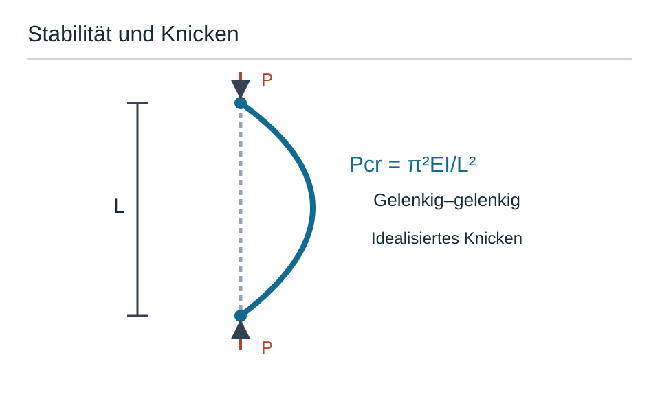

# M2-L7 – Stabilität und Knicken {#L7}

**Kursbereich:** M2 – Statik und Festigkeitslehre

**Niveau:** Bachelor

**Vorwissen:** [M2-L6 – Torsion und kombinierte Beanspruchung](M2-L6.md)

**Lernziel:** Elastische Euler-Knicklast herleiten und von einem Materialfestigkeitsversagen unterscheiden.

## Einstieg {#S1}

Ein schlanker Druckstab kann seitlich ausweichen, obwohl seine mittlere Druckspannung noch deutlich unter der Fließgrenze liegt. Das Versagen betrifft die Stabilität des Gleichgewichtszustands.

## Grundlagen, Begriffe und Modell {#S2}

Für einen ideal geraden beidseitig gelenkig gelagerten Stab unter zentrischer Druckkraft $P>0$ lautet die linearisierte Knickgleichung $EIw''+Pw=0$. Mit $w(0)=w(L)=0$ erhält man nichttriviale Lösungen $w=A\sin(n\pi x/L)$ nur für $P_n=n^2\pi^2EI/L^2$. Die kleinste Eigenlast ist für $n=1$

$$
P_\mathrm{cr}=\frac{\pi^2EI}{L^2}.
$$

Für idealisierte andere Lagerbedingungen wird $L$ durch die effektive Knicklänge $KL$ ersetzt. Der Faktor $K$ beträgt etwa 1 für gelenkig–gelenkig und 2 für ideal eingespannt–frei. Es ist um die Achse mit dem maßgebenden kleineren Flächenträgheitsmoment zu prüfen, sofern die Randbedingungen gleich sind. Mit Trägheitsradius $i=\sqrt{I/A}$ ergibt sich die Schlankheit $\lambda=KL/i$ und die ideale Knickspannung $\sigma_\mathrm{cr}=\pi^2E/\lambda^2$.

Die Eigenlast ist keine zulässige Betriebsbelastung. Bei realen Imperfektionen entsteht bereits unterhalb der idealen Eigenlast eine seitliche Auslenkung. Bei geringen Schlankheiten können plastische Effekte dominieren und das Euler-Modell verlassen werden.

*Beidseitig gelenkig gelagerter Druckstab mit idealisierter seitlicher Knickform.*

## Durchgerechnetes Beispiel {#S3}

Ein idealer Druckstab ist 1000 mm lang, beidseitig gelenkig gelagert und besitzt einen rechteckigen Querschnitt $20\times10\,\mathrm{mm}$ bei angenommenem $E=200000\,\mathrm{N/mm^2}$. Um die schwache Achse ist $I=20\cdot10^3/12=1666.67\,\mathrm{mm^4}$. Daher

$$
P_\mathrm{cr}=\pi^2\cdot200000\cdot1666.67/1000^2\approx3290\,\mathrm N.
$$

Bei $A=200\,\mathrm{mm^2}$ entspricht dies ungefähr 16.45 MPa mittlerer Druckspannung. Die Schlankheit beträgt $1000/\sqrt{1666.67/200}\approx346.4$. Die Rechnung zeigt den Einfluss der Geometrie, nicht die tatsächliche Tragfähigkeit eines Bauteils.

## Selbstkontrolle {#S4}

### Aufgaben

1. Wie verändert sich die ideale Knicklast bei halbierter Länge?
2. Wie ändert sie sich bei gleicher Länge und idealem eingespannt–freiem statt gelenkig–gelenkigem Stab?

::: {.lc-solutions data-lc-section="S4"}
### Lösungen

1. Sie vervierfacht sich, sofern die Euler-Annahmen weiter gelten.
2. Mit K=2 statt K=1 sinkt sie auf ein Viertel.
:::

## Annahmen und Grenzen {#S5}

Der Euler-Ansatz setzt einen schlanken, ideal geraden, zentrisch belasteten Stab mit linear-elastischem Material und idealisierten Lagern voraus. Imperfektionen, lokale Beulung, Restspannungen, exzentrische Last, plastisches Knicken und Sicherheitsvorschriften sind gesondert zu berücksichtigen. Die Einzelunterlagenprüfung bleibt offen.

## Zusammenfassung und Übergang {#S6}

Statische Gleichgewichts-, Festigkeits- und Stabilitätsmodelle haben unterschiedliche Aufgaben. Der nächste Themenblock behandelt Bewegung und Dynamik.

**Weiterlesen:** [M3-L1 – Bewegung und Bezugssysteme](M3-L1.md)

## Quellen {#S7}

- [MIT OCW – Unified Engineering: Materials and Structures: Lecture Notes](https://ocw.mit.edu/courses/16-001-unified-engineering-materials-and-structures-fall-2021/pages/lecture-notes/) · Lecture index: beam theory, torsion, buckling; individual files pending · Zuletzt abgerufen: 2026-11-25
- [MIT OCW – Mechanics & Materials I: Lecture Notes](https://ocw.mit.edu/courses/2-001-mechanics-materials-i-fall-2006/pages/lecture-notes/) · Lecture index, parts 1–8; individual PDFs pending · Zuletzt abgerufen: 2026-11-25

