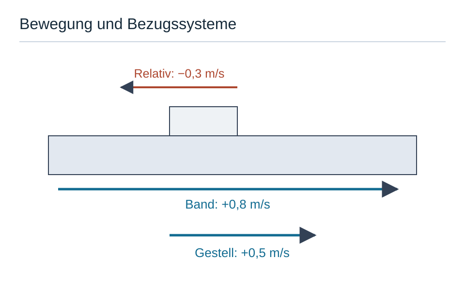

# M3-L1 – Bewegung und Bezugssysteme {#L1}

**Kursbereich:** M3 – Kinematik und Dynamik

**Niveau:** Bachelor

**Vorwissen:** [M1-L1 – Einheiten, Skalierung und Dimensionsanalyse](M1-L1.md)

**Lernziel:** Geschwindigkeit und Beschleunigung in eindeutig benannten Bezugssystemen bestimmen.

## Einstieg {#S1}

Ein Roboter greift auf einem laufenden Band nach einem Werkstück. Die Kamera am Gestell und die Kamera auf dem Band beobachten verschiedene Geschwindigkeiten. Beide Messungen können richtig sein.

## Grundlagen, Begriffe und Modell {#S2}

Die Position $\mathbf r(t)$ beschreibt einen Punkt relativ zu einem Ursprung. Geschwindigkeit und Beschleunigung sind $\mathbf v=d\mathbf r/dt$ und $\mathbf a=d\mathbf v/dt$. Bei eindimensionaler konstanter Beschleunigung gilt $x=x_0+v_0t+at^2/2$ und $v=v_0+at$. Die Weglänge ist von der vorzeichenbehafteten Ortsänderung zu unterscheiden.

Für zwei parallel ausgerichtete, rein translatorische Systeme A und B gilt $\mathbf r_{P/A}=\mathbf r_{B/A}+\mathbf r_{P/B}$; Ableiten liefert die Addition der Geschwindigkeiten. Bei konstanter Relativgeschwindigkeit stimmen die Beschleunigungen überein. Bei rotierenden Systemen treten zusätzliche Terme auf. Kreisbewegung hat selbst bei konstantem Geschwindigkeitsbetrag eine Beschleunigung zum Mittelpunkt: $a_n=v^2/r$.

*Geschwindigkeitsvektoren von Förderband und Bauteil.*

## Durchgerechnetes Beispiel {#S3}

Bandgeschwindigkeit 0,8 m/s nach rechts, Werkstückgeschwindigkeit relativ zum Band 0,3 m/s nach links. Mit rechts positiv: 0,8 − 0,3 = 0,5 m/s relativ zum Gestell. Nach 4 s beträgt die Verschiebung 2 m.

## Selbstkontrolle {#S4}

### Aufgaben

1. Ein Schlitten startet aus Ruhe mit 2 m/s². Weg nach 3 s?
2. Welche Normalbeschleunigung entsteht bei 4 m/s und 2 m Radius?

::: {.lc-solutions data-lc-section="S4"}
### Lösungen

1. 9 m.
2. 8 m/s².
:::

## Annahmen und Grenzen {#S5}

Keine relativistischen Geschwindigkeiten; die einfachen Additionsregeln gelten ohne Drehung der Achsen.

## Zusammenfassung und Übergang {#S6}

Bewegung wird zunächst geometrisch beschrieben. Kräfte bestimmen anschließend ihre Änderung.

**Weiterlesen:** [M3-L2 – Newtonsche Bewegungsgleichungen](M3-L2.md)

## Quellen {#S7}

- [OpenStax – Relative Motion in One and Two Dimensions](https://openstax.org/books/university-physics-volume-1/pages/4-5-relative-motion-in-one-and-two-dimensions) · §4.5 relative motion · Zuletzt abgerufen: 2026-11-25
- [OpenStax – Motion in Two and Three Dimensions: Key Equations](https://openstax.org/books/university-physics-volume-1/pages/4-key-equations) · Ch. 4 velocity and reference frames · Zuletzt abgerufen: 2026-11-25

