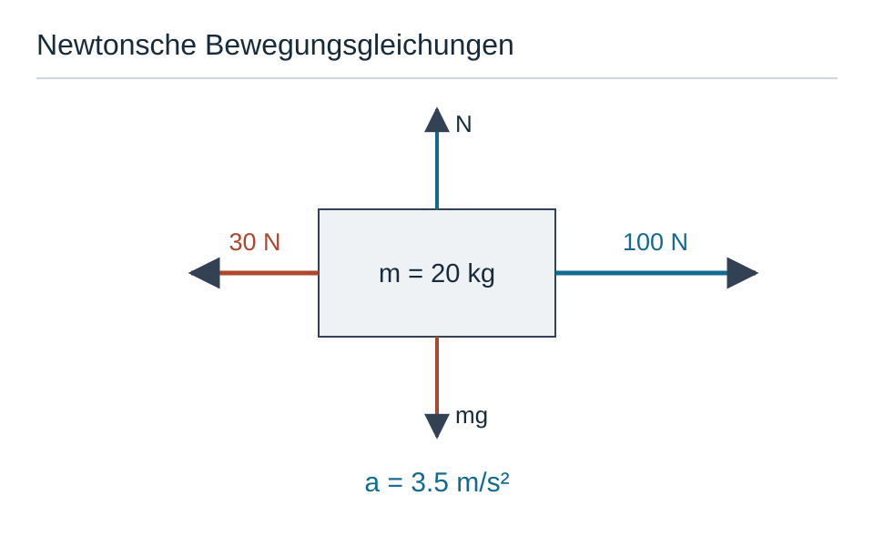

# M3-L2 – Newtonsche Bewegungsgleichungen {#L2}

**Kursbereich:** M3 – Kinematik und Dynamik

**Niveau:** Bachelor

**Vorwissen:** [M3-L1 – Bewegung und Bezugssysteme](M3-L1.md)

**Lernziel:** Aus einem Freikörperbild die Beschleunigung bestimmen.

## Einstieg {#S1}

Ein Linearantrieb muss nicht nur die Nutzlast bewegen, sondern auch Reibung und bewegte Eigenmasse überwinden.

## Grundlagen, Begriffe und Modell {#S2}

Für einen Körper konstanter Masse in einem Inertialsystem gilt $\sum\mathbf F=m\mathbf a$. Zeichne nur die auf den freigeschnittenen Körper wirkenden äußeren Kräfte ein. Gewicht und Normalkraft können sich bei horizontaler Bewegung ausgleichen, obwohl beide vorhanden sind. Ein Kräftepaar nach Newton III wirkt dagegen auf zwei verschiedene Körper und darf nicht innerhalb eines einzelnen Freikörperbildes gestrichen werden.

Beim einfachen Coulomb-Modell liegt die Haftreibung bis zur Grenze $\mu_s N$; sie passt sich der Belastung an. Bei Gleiten wirkt näherungsweise $F_R=\mu_kN$ entgegen der Relativbewegung. Die Bewegungsgleichung in x-Richtung lautet dann beispielsweise $m\ddot x=F_A-F_R$. Anfangsbedingungen sind nötig, um die Bahn zu bestimmen.

*Kräftebilanz an einem horizontalen Schlitten.*

## Durchgerechnetes Beispiel {#S3}

Ein bereits gleitender Schlitten (20 kg) wird mit 100 N horizontal angetrieben. Reibung 30 N. Resultierende 70 N; Beschleunigung 70/20 = 3,5 m/s². Die Vertikalkräfte sind im Gleichgewicht.

## Selbstkontrolle {#S4}

### Aufgaben

1. Welche Antriebskraft hält die Geschwindigkeit bei 30 N Reibung konstant?
2. Welche Beschleunigung hat die doppelte Masse bei derselben Resultierenden von 70 N?

::: {.lc-solutions data-lc-section="S4"}
### Lösungen

1. 30 N.
2. 1,75 m/s².
:::

## Annahmen und Grenzen {#S5}

Reibung ist in Wirklichkeit geschwindigkeits-, temperatur- und zustandsabhängig.

## Zusammenfassung und Übergang {#S6}

Die Kraftbilanz liefert die momentane Beschleunigung; Energie- und Impulsbilanzen erlauben alternative Lösungswege.

**Weiterlesen:** [M3-L3 – Arbeit, Energie und Impuls](M3-L3.md)

## Quellen {#S7}

- [OpenStax – Newton’s Second Law](https://openstax.org/books/university-physics-volume-1/pages/5-3-newtons-second-law) · §5.3 net force and acceleration · Zuletzt abgerufen: 2026-11-25

