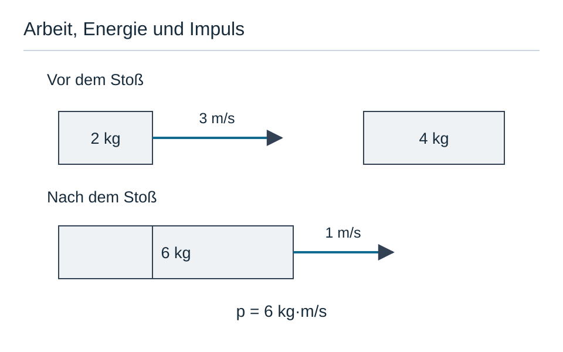

# M3-L3 – Arbeit, Energie und Impuls {#L3}

**Kursbereich:** M3 – Kinematik und Dynamik

**Niveau:** Bachelor

**Vorwissen:** [M3-L2 – Newtonsche Bewegungsgleichungen](M3-L2.md)

**Lernziel:** Energie und Impuls unterscheiden und passende Erhaltungssätze anwenden.

## Einstieg {#S1}

Beim Abbremsen einer Maschine muss ihre Bewegungsenergie abgeführt werden. Bei einem kurzen Stoß interessiert zusätzlich die Impulsübertragung.

## Grundlagen, Begriffe und Modell {#S2}

Mechanische Arbeit ist $W=\int\mathbf F\cdot d\mathbf r$, Leistung $P=\mathbf F\cdot\mathbf v$. Die Nettoarbeit am Massenpunkt entspricht $\Delta(mv^2/2)$. Bei konservativen Kräften lässt sich potenzielle Energie einführen; Reibung wandelt mechanische Energie in andere Energieformen um.

Der Impuls $\mathbf p=m\mathbf v$ ist ein Vektor. Der Kraftstoß $\int\mathbf F\,dt$ ist seine Änderung. Für ein System ohne resultierenden äußeren Kraftstoß bleibt der Gesamtimpuls erhalten. Beim vollkommen unelastischen Stoß bewegen sich die Körper nach dem Stoß gemeinsam; kinetische Energie ist dabei nicht erhalten, Gesamtenergie hingegen schon.

*Impulsbilanz zweier Wagen vor und nach einem unelastischen Stoß.*

## Durchgerechnetes Beispiel {#S3}

Ein Wagen von 2 kg fährt mit 3 m/s auf einen ruhenden Wagen von 4 kg und koppelt an. Gesamtimpuls 6 kg·m/s; gemeinsame Geschwindigkeit 6/6 = 1 m/s. Anfangsenergie 9 J, Endenergie 3 J. Die Differenz 6 J geht in Verformung, Wärme und andere innere Energieformen.

## Selbstkontrolle {#S4}

### Aufgaben

1. Wie viel Arbeit leistet eine konstante Kraft von 50 N über 2 m in Kraftrichtung?
2. Welche Leistung liefert dieselbe Kraft bei 3 m/s in Kraftrichtung?

::: {.lc-solutions data-lc-section="S4"}
### Lösungen

1. 100 J.
2. 150 W.
:::

## Annahmen und Grenzen {#S5}

Für reale Stöße sind Kontaktsteifigkeit, Impulsdauer und Geometrie gesondert zu modellieren.

## Zusammenfassung und Übergang {#S6}

Impulserhaltung und kinetische Energieerhaltung haben verschiedene Bedingungen.

**Weiterlesen:** [M3-L4 – Starrkörper und Rotation](M3-L4.md)

## Quellen {#S7}

- [OpenStax – Work-Energy Theorem](https://openstax.org/books/university-physics-volume-1/pages/7-3-work-energy-theorem) · §7.3 work and kinetic energy · Zuletzt abgerufen: 2026-11-25
- [OpenStax – Linear Momentum: Key Equations](https://openstax.org/books/university-physics-volume-1/pages/9-key-equations) · Ch. 9 momentum conservation · Zuletzt abgerufen: 2026-11-25

