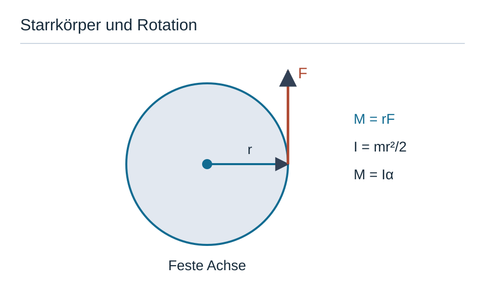

# M3-L4 – Starrkörper und Rotation {#L4}

**Kursbereich:** M3 – Kinematik und Dynamik

**Niveau:** Bachelor

**Vorwissen:** [M3-L3 – Arbeit, Energie und Impuls](M3-L3.md)

**Lernziel:** Trägheitsmoment, Winkelbeschleunigung und Rotationsenergie berechnen.

## Einstieg {#S1}

Ein Schwungrad mit außen konzentrierter Masse speichert bei gleicher Masse und Drehzahl mehr Energie als eine kompakte Nabe.

## Grundlagen, Begriffe und Modell {#S2}

Die Winkelgeschwindigkeit ist $\omega=\dot\theta$, die Winkelbeschleunigung $\alpha=\dot\omega$. Im starren Körper hängt die tangentiale Geschwindigkeit vom Abstand zur Drehachse ab: $v=\omega r$. Bei einer festen Achse ist $I=\int r^2\,dm$. Für die homogene Vollscheibe gilt $I=mr^2/2$, für einen ideal dünnen Ring $I=mr^2$. Das Trägheitsmoment bezieht sich immer auf eine benannte Achse.

Das Moment einer tangentialen Kraft beträgt $M=rF$; allgemein ist der Momentenvektor $\mathbf r\times\mathbf F$. Bei konstanter Massengeometrie und fester Achse gilt $\sum M=I\alpha$. Rotationsenergie ist $I\omega^2/2$, die Leistung um diese Achse $M\omega$.

*Drehmoment am Rand einer Scheibe mit fester Achse.*

## Durchgerechnetes Beispiel {#S3}

Vollscheibe 10 kg, Radius 0,2 m: I = 0,2 kg·m². Ein konstantes Nettomoment 4 N·m erzeugt 20 rad/s². Nach 2 s aus Ruhe: 40 rad/s und Rotationsenergie 160 J.

## Selbstkontrolle {#S4}

### Aufgaben

1. Welches Trägheitsmoment hat ein dünner Ring gleicher Masse und gleichen Radius?
2. Welcher Leistung entsprechen 4 N·m bei 40 rad/s?

::: {.lc-solutions data-lc-section="S4"}
### Lösungen

1. 0,4 kg·m².
2. 160 W.
:::

## Annahmen und Grenzen {#S5}

Die Skalargleichung gilt für eine feste Achse; allgemeine räumliche Bewegung erfordert den Trägheitstensor.

## Zusammenfassung und Übergang {#S6}

Rotationsdynamik erweitert die translatorische Bewegungsgleichung um achsbezogene Größen.

**Weiterlesen:** [M3-L5 – Schwingungen und Resonanz](M3-L5.md)

## Quellen {#S7}

- [OpenStax – Fixed-Axis Rotation: Key Equations](https://openstax.org/books/university-physics-volume-1/pages/10-key-equations) · Ch. 10 torque, inertia and kinetic energy · Zuletzt abgerufen: 2026-11-25

