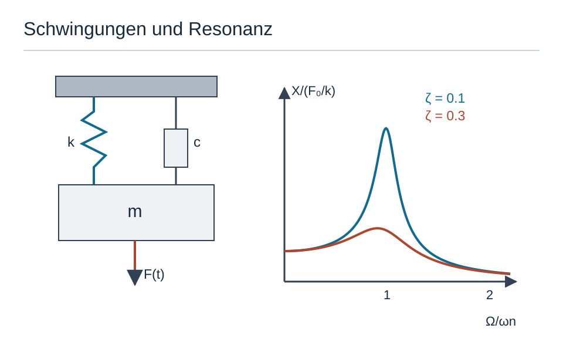

# M3-L5 – Schwingungen und Resonanz {#L5}

**Kursbereich:** M3 – Kinematik und Dynamik

**Niveau:** Bachelor

**Vorwissen:** [M3-L4 – Starrkörper und Rotation](M3-L4.md)

**Lernziel:** Eigenfrequenz und Resonanz eines linearen Einmassenschwingers einordnen.

## Einstieg {#S1}

Ein Motor kann eine Maschinenstruktur periodisch anregen. Eine geringe Erregerkraft kann in der Nähe einer Eigenfrequenz eine große Antwort erzeugen.

## Grundlagen, Begriffe und Modell {#S2}

Für die Auslenkung aus der statischen Gleichgewichtslage gilt $m\ddot x+c\dot x+kx=F_0\cos(\Omega t)$. Masse m, Dämpfung c und Federsteifigkeit k bestimmen die Dynamik. Ohne Dämpfung und Anregung ist $\omega_n=\sqrt{k/m}$, $f_n=\omega_n/(2\pi)$. Der dimensionslose Dämpfungsgrad lautet $\zeta=c/(2\sqrt{km})$.

Die stationäre Amplitude ist $X=F_0/\sqrt{(k-m\Omega^2)^2+(c\Omega)^2}$. Bei kleiner Dämpfung liegt das Maximum nahe der Eigenfrequenz; die genaue Resonanzfrequenz der Auslenkung ist bei $0<\zeta<1/\sqrt 2$ kleiner als $\omega_n$. Dämpfung begrenzt die Amplitude und verändert die Phase.

*Einmassenschwinger mit Feder und Dämpfer sowie Frequenzgang.*

## Durchgerechnetes Beispiel {#S3}

Masse 5 kg, Steifigkeit 2000 N/m, Dämpfung 20 N·s/m. Eigenkreisfrequenz 20 rad/s, Frequenz 3,18 Hz, Dämpfungsgrad 0,1. Bei Erregung mit 20 rad/s und Kraftamplitude 10 N: X = 10/(20·20) = 0,025 m.

## Selbstkontrolle {#S4}

### Aufgaben

1. Wie ändert sich die Eigenfrequenz bei vierfacher Masse?
2. Welche statische Auslenkung erzeugen 10 N bei 2000 N/m?

::: {.lc-solutions data-lc-section="S4"}
### Lösungen

1. Sie halbiert sich.
2. 5 mm.
:::

## Annahmen und Grenzen {#S5}

Lineare Feder und viskoser Dämpfer; reale Systeme können mehrere Moden und nichtlineare Kontakte besitzen.

## Zusammenfassung und Übergang {#S6}

Schwingungsanalyse verbindet Kraftbilanz, Differentialgleichung und konstruktive Vermeidung von Resonanz.

**Weiterlesen:** [M4-L1 – Kristallstruktur und Gefüge](M4-L1.md)

## Quellen {#S7}

- [OpenStax – Oscillations: Key Equations](https://openstax.org/books/university-physics-volume-1/pages/15-key-equations) · Ch. 15 harmonic and damped motion · Zuletzt abgerufen: 2026-11-25

